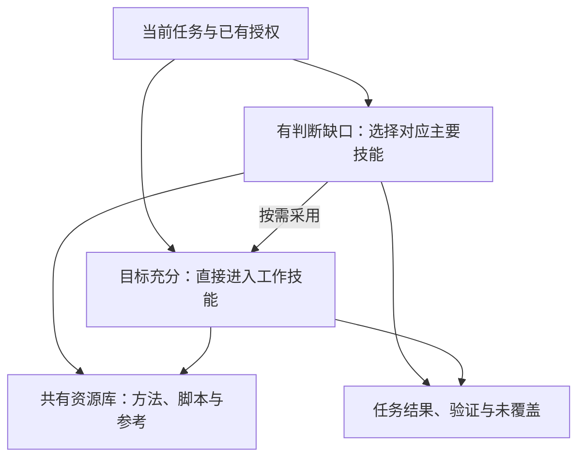

# 507-skills

507-skills 是一套可独立使用、按任务组合的智能体技能。当前实现位于 `skills/`，包含 **21 个入口：10 个主要技能、11 个次要工作能力**；共有方法、执行脚本、图解与界面组件和设计参考集中维护在 `lib/`。

最近本地定版为 **0.3.3**，见[版本记录](CHANGELOG.md#033---2026-11-03)；后续四维方法、入口主动判断、共有库发现检查及任务转换／资源定位属于[未定版增量](CHANGELOG.md#unreleased)。demo与自动检查接入已推送main；本轮行为测试判定修订只作本地提交，暂不推送。原版本标签保留本地，不创建发布页。

用户主要通过主要技能表达目标，Agent 按任务需要采用主要或次要技能。清楚任务直接采用相应能力，有实质缺口才补相应判断；不要求用户点选内部技能链。各入口的触发、权限、结果与完成条件以自己的 `SKILL.md` 为准。

## 从当前任务进入

| 需要完成什么 | 当前入口 |
| --- | --- |
| 弄清目标、边界和关键取舍 | [507-what](skills/507-what/SKILL.md) |
| 认识项目、查清现状或解释机制 | [507-why](skills/507-why/SKILL.md) |
| 构造新方案或选择已有系统的变更路径 | [507-how](skills/507-how/SKILL.md) |
| 完成工程实现、修复、局部修改或指定测试 | [507-do](skills/507-do/SKILL.md) |
| 限定模块清理代码与规则，先列清单 | [507-clean](skills/507-clean/SKILL.md) |
| 完成创作、成文或局部修改 | [507-create](skills/507-create/SKILL.md) |
| 将成熟内容适配目标受众、场景与载体 | [507-adapt](skills/507-adapt/SKILL.md) |
| 发现、整理和推进已有工作，或局部更新事项 | [507-work](skills/507-work/SKILL.md) |
| 建立项目依据、审计工作指令或维护导航 | [507-setup](skills/507-setup/SKILL.md) |
| 设计、维护技能或审计技能指令 | [skill-design](skills/skill-design/SKILL.md) |
| 实施、修复、写作、适配、审查及其他清楚工作 | [21 个入口与职责](skills/README.md) |



图解复杂状态、跨角色时序、对象关系或同条件比较时，可按需采用次要能力 [507-visualize](skills/507-visualize/SKILL.md)；简单说明直接完成。

需要产品界面展示图、功能卡片或模拟操作短动画时，可按需采用次要能力 [507-demo](skills/507-demo/SKILL.md)。通用组件、范例、播放器和检查工具只在共有库存在一份，技能直接引用；时间线、步骤、比较、版面与排队联动可直接用[共有图解组件](lib/components/visual-components.md)，真实业务与完整视频仍沿原任务交付。

## 当前文档与目录

| 需要查什么 | 唯一入口 |
| --- | --- |
| 技能身份、用途和必要资源 | [技能清单](skills/README.md) · [身份与资源声明索引](packages.json) |
| 共有方法、组件、工具说明与设计参考 | [共有资源库](lib/README.md) · [逐技能资源关系](lib/skill-resource-map.md) |
| 名称和易混词义 | [术语表](GLOSSARY.md) |
| 库级使用与交付要求 | [分层规格](spec/技能分层与共有资源.md) |
| 文档与导航的共用阅读设计 | [DESIGN](DESIGN.md) |
| 当前版本、能力范围、已知限制与待办 | [PROGRESS](PROGRESS.md) |
| 长期依据、外部来源和历史记录 | [文档导航](doc/README.md) |

`skills/` 是唯一现行技能源码，`lib/` 是共有资源维护源。`archive/legacy/common/`、`archive/legacy/code/`、`archive/legacy/write/` 保留旧版技能、来源和回退用途；旧路线、候选及各轮验证从[历史导航](doc/历史导航.md)查阅，不并入当前入口清单。

## 获取与使用

```sh
git clone https://github.com/ssdiwu/507-skills.git
```

使用时保留同一集合的 `skills/` 与 `lib/` 并列布局；技能按需选择，共有库显式提供依赖。引用定位统一按[共有资源合同](lib/README.md#定位和依赖)处理安装软链接及嵌套参考。所有视觉组件统一 React，技能不携带共有方法、执行脚本、组件或 runtime 副本。构建集合也保留这一布局。
按目标宿主的实际约定放置或注册技能目录，核对发现、调用和必要工具；本库不假定统一安装路径、递归扫描、软链接或重载方式。具体图像、Office 和音视频制作复用当前环境实际可用的工具，其能力与权限另行核实。文件存在、构建和安装不证明自然采用或业务效果。

宿主的工具与调度方式可以不同，同一技能的触发条件、修改权限、停止位置、产物与验收要求仍保持一致。项目局部约束优先于全局习惯；本库不自动覆盖个人或项目配置。

### Codex：链接完整安装集合

先用现有构建器生成版本固定的完整集合：

```sh
python3 -B scripts/package_skills.py build
```

构建回执中的目录包含并列的 `skills/`、`lib/`、`packages.json` 和 `bundle.json`。将该目录整体复制到宿主扫描范围之外的新安装版本目录，保留原层级；通用资源在每个安装集合中仅有一份。构建输出保持不可变，node_modules 和集合内的预览构建输出写入安装版本目录。需要图解、界面或离线页面导出时，先在安装版本的 `lib/components/visual-runtime/` 中执行 `npm ci --ignore-scripts`，再核对实际共有工具能运行。

安装入口 `~/.agents/skills/507-skills` 链接到准备好的完整安装版本目录。宿主看到的入口形如 `507-skills/skills/507-adapt/SKILL.md`，其 `../../lib/README.md` 可直接定位同一集合的共有资源。不要链接整个源码仓库根目录，其中含归档和历史构建；构建集合仅包含清单内的现行技能及资源。

已有安装切换前，记录原链接目标及当前安装版本。先在新目录完成文件指纹、引用和必要运行检查，再通过临时链接原子替换安装入口；目标已被其他工作改变时停止替换。实体目录、未知文件或其他技能入口不得直接覆盖。旧安装保留供恢复使用，恢复时同样核对入口当前归属。

源码保存后，需要重新构建、准备并验证新安装版本，再切换入口才能应用变化。已有会话可能仍持有旧目录信息，切换后用新会话核对发现的名称、数量、实际入口和必要资源。本库应恰好为清单中的 21 个现行技能，没有归档或同名重复；其他独立技能继续按各自身份核对。路径检查、宿主发现、自然任务和业务结果分别保留证据。

## 维护与贡献

共有源和打包检查见[技能维护说明](skills/README.md#资源维护与构建)。技能修改遵循[贡献规范](AGENTS.md)；[全局规则示例](templates/AGENTS.global.example.md)可按明确目标参考，不自动覆盖宿主配置。

远端自动检查覆盖集合、共有库与历史工具回归，包含现有UI、布局和检查器测试；具体入口见[检查配置](.github/workflows/tests.yml)。[轻量行为测试方案](doc/40-版本实施方案/2026-11-04-核心技能轻量行为测试方案.md)以完整完成任务为准，技能发现与读取只作诊断；已有首轮限定试用，仍按变化选测，不增加日常固定流程。

贡献方式见[CONTRIBUTING](CONTRIBUTING.md)，安全边界见[SECURITY](SECURITY.md)，版本变更见[CHANGELOG](CHANGELOG.md)，许可见[LICENSE](LICENSE)。提交、推送、安装和发布分别依据具体授权与实际结果。

持续工作主动维护必要本地依据并读回接续，守住只读和对外动作限制。what/why/how 是 5W2H 的独立视角，plan 是按需采用的次要能力；技能分层、会话分层和 A/B/C 验收职责分别定义，见[术语表](GLOSSARY.md#会话分层与验收职责)。当前源码更新与已发布版本、宿主安装及行为试用分别成立。
