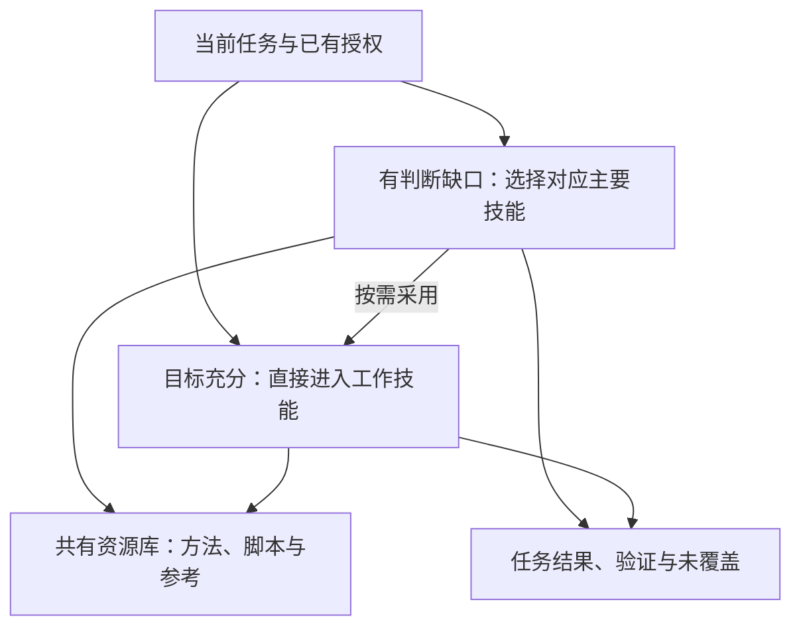

# 507-skills

507-skills 是一套可独立使用、按任务组合的智能体技能。当前实现位于 `next/skills/`，包含 **19 个入口：5 个主要技能、14 个次要工作能力**；共有方法、执行脚本和设计参考集中维护在 `lib/`。

用户主要通过主要技能表达目标，Agent 按任务需要采用主要或次要技能。清楚任务直接采用相应能力，有实质缺口才补相应判断；不要求用户点选内部技能链。各入口的触发、权限、结果与完成条件以自己的 `SKILL.md` 为准。

## 从当前任务进入

| 需要完成什么 | 当前入口 |
| --- | --- |
| 弄清目标、边界和关键取舍 | [507-what](next/skills/507-what/SKILL.md) |
| 认识项目、查清现状或解释机制 | [507-why](next/skills/507-why/SKILL.md) |
| 选择具体变更位置和推进策略 | [507-how](next/skills/507-how/SKILL.md) |
| 完成创作、成文或局部修改 | [507-create](next/skills/507-create/SKILL.md) |
| 设计或维护技能体系 | [skill-design](next/skills/skill-design/SKILL.md) |
| 实施、修复、写作、适配、审查及其他清楚工作 | [19 个入口与职责](next/README.md) |



## 当前文档与目录

| 需要查什么 | 唯一入口 |
| --- | --- |
| 技能身份、用途和必要资源 | [next/README](next/README.md) · [精确清单](next/packages.json) |
| 共有方法、执行脚本、工具说明与设计参考 | [共有资源库](lib/README.md) |
| 名称和易混词义 | [术语表](GLOSSARY.md) |
| 库级使用与交付要求 | [分层规格](spec/技能分层与共有资源.md) |
| 文档与导航的共用阅读设计 | [DESIGN](DESIGN.md) |
| 当前源码、安装及尚未验证的部分 | [PROGRESS](PROGRESS.md) |
| 长期依据、外部来源和历史记录 | [文档导航](doc/README.md) |

`next/skills/` 是当前技能源码，`lib/` 是共有资源维护源。`common/`、`code/`、`write/` 保留旧版技能、来源和回退用途；旧路线、候选及各轮验证从[历史导航](doc/历史导航.md)查阅，不并入当前入口清单。

## 获取与使用

```sh
git clone https://github.com/ssdiwu/507-skills.git
```

选择 `next/skills/` 中需要的技能目录，完整保留其 `SKILL.md`、必要参考和脚本。共有资源已按清单生成普通随包副本；单项使用不要求作者仓库或兄弟技能。

按目标宿主的实际约定放置或注册技能目录，核对发现、调用和必要工具；本库不假定统一安装路径、递归扫描、软链接或重载方式。具体图像、Office 和音视频制作复用当前环境实际可用的工具，其能力与权限另行核实。文件存在、构建和安装不证明自然采用或业务效果。

宿主的工具与调度方式可以不同，同一技能的触发条件、修改权限、停止位置、产物与验收要求仍保持一致。项目局部约束优先于全局习惯；本库不自动覆盖个人或项目配置。

## 维护与贡献

共有源和打包检查见[next 的维护说明](next/README.md#资源维护与构建)。技能修改遵循[贡献规范](AGENTS.md)；[全局规则示例](templates/AGENTS.global.example.md)可按明确目标参考，不自动覆盖宿主配置。

贡献方式见[CONTRIBUTING](CONTRIBUTING.md)，安全边界见[SECURITY](SECURITY.md)，版本变更见[CHANGELOG](CHANGELOG.md)，许可见[LICENSE](LICENSE)。提交、推送、安装和发布分别依据具体授权与实际结果。
