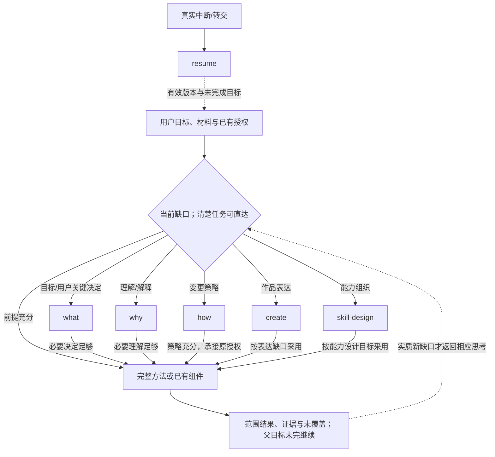
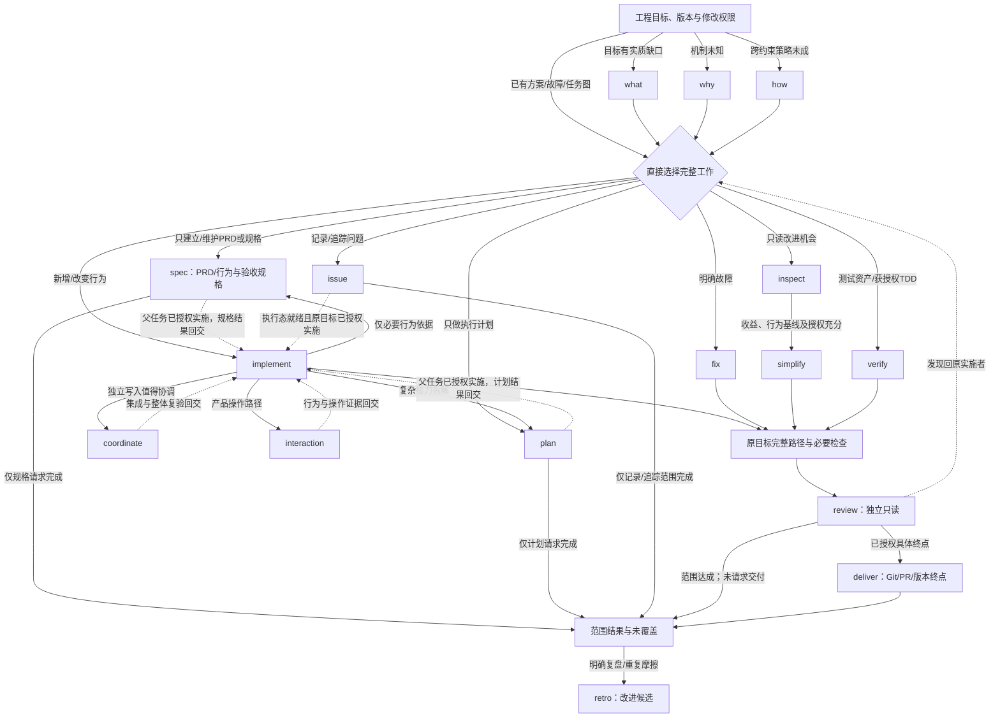
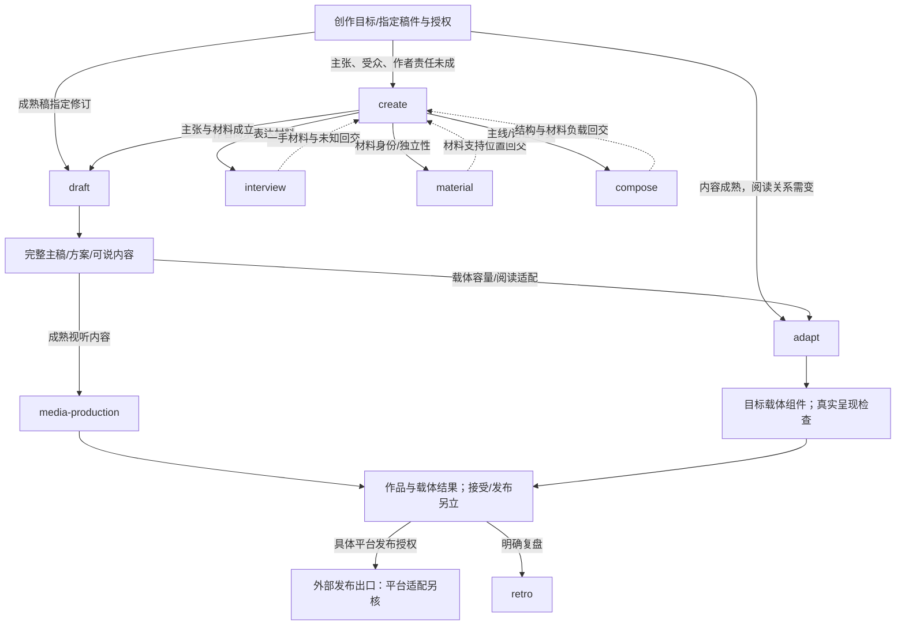
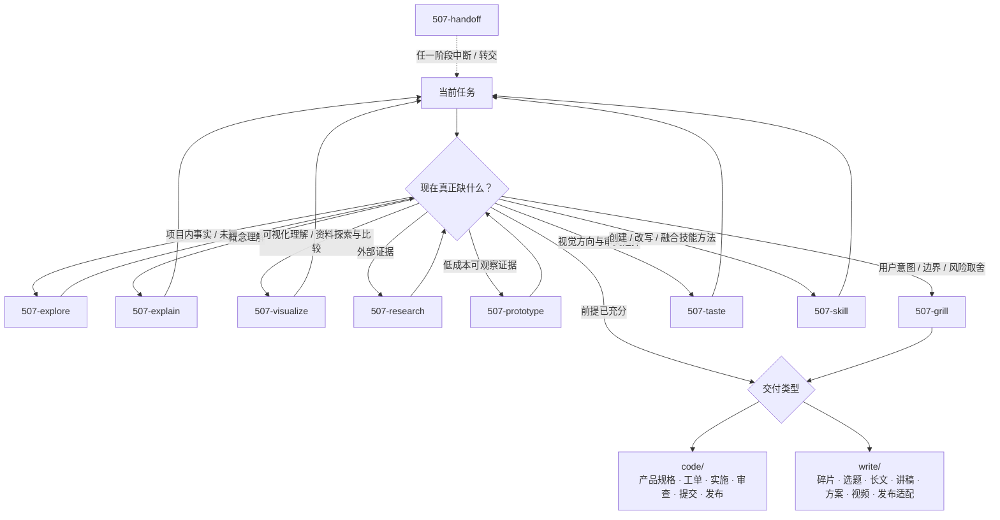
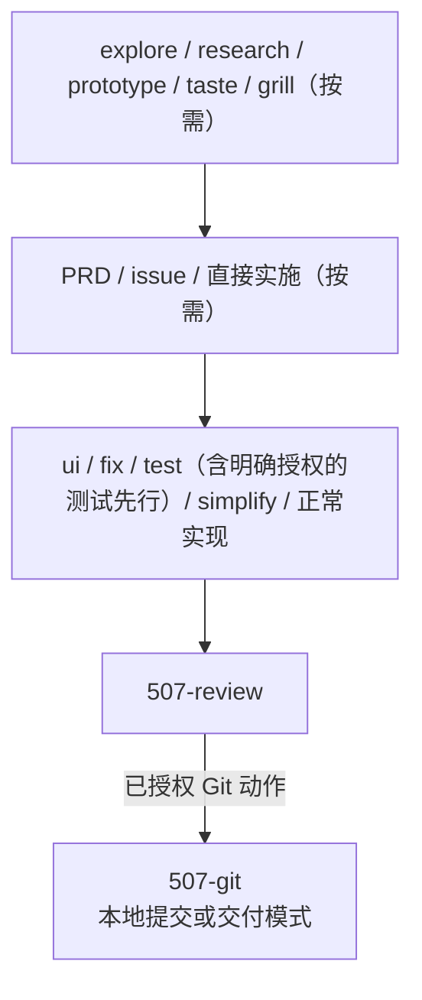
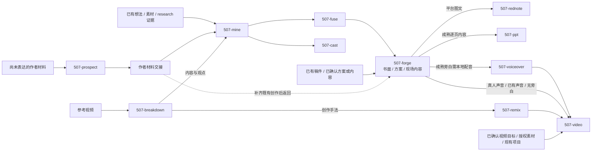

# Agent Skills

本轮新增[507-product-map](next/skills/507-product-map/SKILL.md)交互点功能梳理，源码候选现为五主要、十五次要共20入口；共有方法和地图组件已经落实。当前实际安装仍为下述c333的19入口，候选实现、材料试用与安装分别记录，见[本轮实施与试用](doc/40-版本实施方案/2026-10-14-交互点功能地图实施与试用.md)。

当前c333固定版已按用户授权接入真实用户环境，五主要、十四次要共19入口／262文件；两个工作位置重新扫描均发现19个启用入口。旧18入口固定副本保留恢复点；来源、独立读回及范围见[当前接入](doc/40-版本实施方案/2026-10-14-c333使用环境接入.md)，历史接入见[原记录](doc/10-架构与运行/新版用户环境接入.md)。安装与发现已成立，自然任务中的选择、接力和业务验收继续按实际工作观察。

此前已将三种协作尺度融入同一新版，覆盖工程、写作、研究与一般工作，见[三情境与生成任务网页](doc/10-架构与运行/三情境协调与生成任务网页.md)。已有过程记录是状态维护源，临时网页由共有组件生成和重生成；需要新表达能力时先扩组件，生成HTML不直接编辑。

工作能力扩展与现有过程记录的分工见[工作推进与接续](doc/10-架构与运行/工作推进与过程接续.md)；此前隔离候选与正式接入阶段分开；当前接入与试用见[work-update接入说明](doc/10-架构与运行/work-update接入与真实工作试用.md)。

整体分工初步确认what、why、how、create、skill-design五个主要技能，可继续增减；knowledge下沉次要方法；职责继续按“特有思考、完整方法、共有组件”讨论，见[设计候选](doc/40-版本实施方案/2026-10-11-思考方法组件分工.md)。以下说明上轮已有实现。

用户安装版为五主要、十四次要；当前源码另增交互点功能梳理，主要职责保持五个。产品组件查找与抽取职责已接入；新入口的真实产品工作仍未验证。完整入口见[新体系说明](next/README.md)。资源闭包已检查，既有六类真实来源任务/九阶段试用保留原范围与版本，结果见[实际试用](doc/10-架构与运行/创作与工程实际试用.md)。安装不把旧试用升级为新能力通过；接入、记录与恢复约定见[试用准备](doc/10-架构与运行/真实环境试用准备.md)。

**源码与业务验证分别成立**：旧30通用能力的保留、合并和机制退出已逐项落实；专项媒体工具和真实任务效果仍有边界。准确状态见[整体覆盖](doc/10-架构与运行/新体系实现覆盖.md)，首次卡点与修订由[本轮安排](doc/40-版本实施方案/2026-10-12-创作与工程路径接入.md)承接。

| 当前问题 | 阅读入口 |
| --- | --- |
| 当前新版skill怎样使用和随库交付 | [新体系说明](next/README.md) |
| 怎样规划、编写、重构技能体系 | [skill-design](next/skills/skill-design/SKILL.md) |
| 怎样明确目标和关键取舍 | [507-what](next/skills/507-what/SKILL.md) |
| 怎样发现、整理和推进现有工作 | [507-work-update](next/skills/507-work-update/SKILL.md) |
| 怎样找产品组件库、复用或抽取重复界面块 | [507-component](next/skills/507-component/SKILL.md) |
| 怎样梳理交互点、对照设计／实现／运行证据 | [507-product-map](next/skills/507-product-map/SKILL.md) |
| 共有方法、消费者与生成关系在哪里 | [共有库](lib/README.md) |
| 旧30拆成了什么，哪些本轮不进入 | [重建方案](doc/40-版本实施方案/2026-10-11-两能力重建.md) |
| 调用、独立包和恢复应达到什么要求 | [库级规格](spec/技能分层与共有资源.md) |
| 阅读设计、词义、来源与当前进度 | [DESIGN](DESIGN.md) · [GLOSSARY](GLOSSARY.md) · [来源](doc/20-能力参考/skill-library-comparison/README.md) · [PROGRESS](PROGRESS.md) |

本仓库按[Agent Skills规范](https://agentskills.io/specification)组织可独立读取的包，不以目录推断宿主发现或权限。当前清单源码已构建，安装、启用、提交和发布仍按各自实际状态判断。

## 历史设计流程导航（2026-10-11）

创作与工作处理的Luna重放、确定遗漏和应补职责见[正式会话重放评估](doc/10-架构与运行/正式会话Luna重放与能力补强.md)；[核验回执](doc/40-版本实施方案/2026-10-11-Luna创作与工作重放核验.json)区分十份输出、网站操作与尚未成立的真实平台/宿主效果。测试完成不等于候选通过或替换完成。

代码与项目里哪些职责会采用、哪些跳过，旧grill怎样回交完整方案，见[任务采用与决策接力](doc/10-架构与运行/任务采用与决策接力.md)。[情境与观察资料](doc/40-版本实施方案/2026-10-11-工程采用与决策资料.json)是网站的唯一数据维护源：7类任务/19个情境属于设计推演；3轮what属于模拟输入、显式读包的受控Agent演练。宿主自然选择与真实工程接力尚未成立。[本轮核验](doc/40-版本实施方案/2026-10-11-任务采用与决策接力核验.json)分别记录设计、网页、演练和未完成的试用门。

五个主要职责的判断轴、问题示例、方法采用/跳过和典型失败见[特有思考参考](doc/10-架构与运行/主要技能特有思考参考.md)。它是doc参考，实际技能合同与已实现范围仍以各SKILL.md和核验为准。UI／UX模式与按需提示见[共有设计资料](lib/design/README.md)。

下图保留2026-10-11的5主要/32方法/48接口设计导航，当前源码20入口／已安装19入口与方法去向见上方实现说明和旧30处置，允许直接请求方法或组件；不表示历史候选都已注册、安装或运行。完整工程、创作、视听与能力设计的条件/返回见[工作流对照](doc/10-架构与运行/工作流对照与条件接力.md)。图的唯一详细维护源在该文档；此处只提供入口概览。



<details>
<summary>查看当前工程与创作设计路线；都是按需采用</summary>

### 当前工程路线



### 当前创作路线



</details>

仅理解/调查/策略/规格/计划的请求止于对应结果；实施请求沿已有授权继续。提交、推送、合并、发布和人工接受分别成立，内容平台发布适配仍另核。下面的旧图是原发布导航，保留用于来源对照，不视为当前候选全部已迁移。

## 已发布基线与历史工作流

以下common/code/write的30项说明与流程保留已发布基线，作为方法拆解来源与回退参考。它们没有整体转入新体系，也不是本轮安装范围；本轮使用上方next入口。此前19入口／11能力的提案已被两能力重建取代，见[历史方案](doc/90-归档/方案/2026-10-11-30项技能分层方案.md)。

<details>
<summary>展开已发布基线的30项说明与流程，仅用于来源追溯</summary>

## 适合谁

- 想把“和 Agent 聊聊”变成可复用工作流的人；
- 需要区分证据、决策、规格、实施、审查和交付的人；
- 在一个或多个支持 Agent Skills、或提供兼容技能加载机制的宿主中，希望共用一套方法的人；
- 想按需采用单个 skill，而不是一次引入完整框架的人。

## 工作流定义

`common/` 是**横向层**，不是进入 `code/` 或 `write/` 前必须依次通过的阶段。项目未知、概念障碍、资料探索与比较、外部证据、用户决策和会话移交可以在任意时点出现；任务已经清楚时直接进入交付动作。

`507-prototype` 位于 `code/`，但在流程上属于**前置证据层**：只有一个具体未知能低成本观察、且学习收益高于制作与清理成本时才进入，再把 verdict（结论）送回探索、对齐、PRD、issue 或实施。



流程图是导航，不是强制仪式。一个 skill 可以有多个候选出口；Agent 根据当前目标、证据和出口合同选择下一步，并用一句话向用户解释“现在用什么、为什么”。用户只决定其真正拥有的意图与取舍，不负责记忆或选择 skill 名称。

## 两条交付线

### 代码与产品



issue 支持 `draft（对话草稿）→ investigation（调查态）→ ready（执行态）`；调查和执行默认共用同一个远程 issue，证据进评论，当前结论回写正文，标签与负责人在每个远程状态都按仓库规范核验。

具体行为改动按需通过现有入口完成影响调查、工程设计与行为验收，方法入口见 [代码工作流](code/README.md)。产品行为变化按项目规则先更新现行规格，小改无需另建完整 PRD 或工单；前提充分后直接实施。架构检查复用目标项目已有能力，并分别报告实际覆盖、新旧违规和未验证部分。

当前阶段、未完成事项、依赖与下一动作见根 [PROGRESS.md](PROGRESS.md)，历史和详细证据由 [doc](doc/README.md) 导航；README 不复制进度正文，具体工单保持自己的状态权威。

`507-setup` 采用统一的[项目启动与迁移标准](code/507-setup/references/project-standard.md)：新项目建立工作依据，已有项目在授权范围内核对有效内容并迁移。README 管定位与入口，AGENTS 管工作规则，DESIGN 管共用设计，GLOSSARY 管词义，spec 管现行功能与验收，doc 管长期依据、说明和规划；按实际用途裁剪，不创建空文件，迁移后退出旧维护路径。

### 写作与内容



`prospect` 是可跳过的入口；若它由已有创意、主稿或现场内容为了补一手材料而调用，完成后返回调用它的创作动作，不强制进入 `mine`。

`grill` 贯穿需要用户确认的中心判断、方案边界和发布承诺；`507-forge` 的方案模式只写面向人的活动、培训、合作或项目方案，具体软件产品规格归 `prd`。已有稿件仅需表达润色时可直接进入 `507-forge` 的书面模式，保留原意、事实边界与作者声音，不强制补创意卡或走素材链；成文、结构重写与平台改编继续按写作合同推进。

## 目录

| 目录 | 目的 | 主要入口 |
| --- | --- | --- |
| [`common/`](common/README.md) | 跨代码与写作的横向认知、理解工具、证据、决策和移交能力 | `507-explore`、`507-explain`、`507-visualize`、`507-research`、`507-grill`、`507-handoff`、`507-skill`、`507-taste` |
| [`code/`](code/README.md) | 前置原型证据、产品规格、工单、实现、审查、提交、发布和架构回路 | `507-prototype`、`507-prd`、`507-issue`、`507-fix`、`507-review` 等 |
| [`write/`](write/README.md) | 从作者材料、素材、观点和视频到文章、讲稿、方案、创作包、审片母版与发布适配 | `507-prospect`、`507-mine`、`507-fuse`、`507-forge`、`507-video` 等 |

领域词义见 [GLOSSARY](GLOSSARY.md)，独立软件产物的现行要求见 [spec](spec/README.md)，长期依据与历史见 [doc 导航](doc/README.md)。

## Skill 速查

### 横向层

| Skill | 动作 |
| --- | --- |
| `507-explore` | 只读探索项目未知，在会话中维护已知、未知、当前可推进边界与证据边界；路径不明时形成可验证的证据化候选 |
| `507-explain` | 把用户不理解的单个概念讲懂：定义必须可指认，引入的术语必须讲、标黑盒或删掉；解释未成立时按构造、表达、载体三层排查，示意使用表格或受支持的 Mermaid |
| `507-visualize` | 将已成立材料制作成关系探索、条件观察、方案对照或独立阅读工具；按目标选择静态图、对话内交互或网页，核对关系、来源与实际操作 |
| `507-research` | 核实外部事实与机制，产出可被下一步直接消费的证据交接 |
| `507-grill` | 先查事实，再沿依赖关系对齐只有用户能够决定的取舍；复杂时用当前渲染器支持的 Mermaid 决策控制台显示 frontier、冲突与阻塞，简单关系使用文字或表格，并把结论路由到唯一当前权威 |
| `507-handoff` | 中断、换会话或转交时输出脱敏的临时交接摘要 |
| `507-skill` | 创建、改写、审视或融合技能方法；先判断职责与信息归属，再交付经相称验证的技能合同 |
| `507-taste` | 视觉方向没有自动判据时，先取观点再铺开粗稿，靠淘汰收敛；方向定了才分层、精修与机械验收 |

### 代码与产品

| Skill | 动作 |
| --- | --- |
| `507-setup` | 按请求维护项目依据或导航；覆盖初始化、规范迁移、只读巡检及局部 README／地图维护，分别核对范围与完成证据 |
| `507-prototype` | 用成本可控的可丢弃原型获得前置证据与 verdict |
| `507-prd` | 将已确认需求整理为 spec 中的现行行为与验收基准；按授权迁移旧要求，版本交付安排由 doc 承载 |
| `507-issue` | 草拟、创建和维护调查态到执行态的 GitHub issue 生命周期；评论留历史，正文与回链维护当前真相 |
| `507-ui` | 将已确认需求与视觉方向落实为产品界面，完成范围内实现、实际渲染与操作验证 |
| `507-fix` | 建反馈环，最小修复 bug、报错、回归或冲突 |
| `507-test` | 按请求维护测试或执行明确授权的测试先行开发，生产修改范围分别核对 |
| `507-simplify` | 保持外部行为不变，简化内部模块、抽象和接缝 |
| `507-review` | 审查明确交付范围的规范、需求与质量 |
| `507-git` | 按授权完成本地提交、推送、标签或版本交付，模式前提和实际结果分别核对 |
| `507-inspect` | 只读寻找架构摩擦并输出完整证据报告 |

### 写作与内容

| Skill | 动作 |
| --- | --- |
| `507-prospect` | 通过非诱导、按材料可问边界自适应成组的创作采访，显化作者材料、说话位置与未确认缺口 |
| `507-mine` | 把想法、指定素材或 research 证据变成彼此可区分、带证据身份的可复用碎片与材料单元 |
| `507-fuse` | 比较竞争解释与材料负载，把碎片组合成带作品边界的候选 idea |
| `507-cast` | 把成熟碎片簇聚合成知识库主题页 |
| `507-forge` | 按文章、正式方案或现场内容完成成文与修订，保留各模式的素材、作者声音、责任和验收边界 |
| `507-ppt` | 以“语义组件 × 设计语言 × 视觉呈现”原型选型并制作、验证可编辑 `.pptx` 或离线单文件 HTML |
| `507-voiceover` | 用已授权的本地声音档案把成熟旁白生成并验证为带真实时长的配音包 |
| `507-breakdown` | 把一个视频编译成可核验的 `video_completed` 拉片包 |
| `507-remix` | 从完成拉片包借创作手法，重组为原创视频创作包 |
| `507-video` | 把成熟内容、创作包和授权素材制作为经当前版本审片与技术验收的本地母版；Remotion 使用 Studio，其他已有引擎使用等价预览 |
| `507-rednote` | 默认用本地动态工作台把成熟主稿编译为三轴视觉、真实 DOM 分页的 3:4 连续文章；明确要求摘要时才提炼为一页一个观点，并可生成 Live Photo 与公众号封面对 |

完整触发词、输入输出、验收与出口以各目录的 `SKILL.md` 为准。

## 获取与接入

通过 Git（版本控制）克隆仓库，或从仓库页面下载源码：

```bash
git clone https://github.com/ssdiwu/507-skills.git
```

本仓库不规定统一的安装目录、复制或链接方式、递归发现能力、重载方式和显式调用语法；这些都是宿主实现约定，不是 Agent Skills 规范的一部分。接入时请按目标宿主的当前文档，将需要使用、且直接包含 `SKILL.md` 的 skill 目录放入或注册到其技能发现范围。

本仓库按 `common/`、`code/` 与 `write/` 分层组织。不要假定宿主会递归扫描这些目录；若目标宿主只发现技能根目录的直接子目录，应分别暴露所需的 `507-*` skill 目录，而不是只注册仓库根目录。

## 使用

skill 的 `description`（描述）说明任务动作、适用条件与易混淆边界，宿主可按用户意图自动加载。例如：

- “先看看项目里现在知道什么、还缺什么” → `507-explore`
- “查清这个外部项目实际怎么做” → `507-research`
- “把这两套方法做成可点击的比较，查看条件和后续去向” → `507-visualize`
- “把这套已验证方法融入现有技能，或提炼成新技能” → `507-skill`
- “先别写，采访我，把能一起问的创作材料集中问出来” → `507-prospect`
- “把这个观点挖成碎片” → `507-mine`
- “这个假设先做个便宜原型验证” → `507-prototype`
- “把调查中的 issue 补证后转成执行工单” → `507-issue`
- “把这篇主稿做成小红书图卡” → `507-rednote`
- “用我在 Voicebox 里确认的声音生成这份旁白” → `507-voiceover`
- “把旁白、录像和截图做成可审片的视频” → `507-video`

需要显式调用某个技能时，使用目标宿主当前文档规定的语法；本仓库不把任何一种产品的命令格式当成通用入口。不同宿主可以使用不同工具和调度方式，但同一 skill 的触发条件、修改权限、停止位置、产物、验收与出口合同应保持一致；宿主缺少必要能力时，应明确报告限制。

## 配套 Agent 配置

[`templates/AGENTS.global.example.md`](templates/AGENTS.global.example.md) 提供可选的全局 Agent 行为规范示例。只有目标宿主支持 `AGENTS.md` 或等价规则文件、且使用者希望采用这套协作纪律时才需要参考；`507-setup` 只会在用户明确指定目标后使用它生成候选，不会自动覆盖现有配置。按宿主能力补充本地调度规则时，不要把个人称呼、机器路径、私有仓库或凭据同步回公开仓库。

项目局部约束始终优先于全局习惯。

## 设计原则

1. **一 skill 一项清晰职责**：同一职责中确有产物或权限差异时明确分流；相邻职责靠产物与路由接力，不用总控技能吞并。
2. **横向能力按需调用**：common 不是前置仪式；事实、理解、证据和决策在哪一层出现，就在哪里调用。
3. **出口合同显式**：每个 skill 声明完成信号、产物、候选出口与回退条件。
4. **Agent 负责路由**：用户决定真实意图与取舍，Agent 选择并解释 skill，不把框架学习成本转给用户。
5. **流程可跳过**：完整链路是地图，不是强制流水线。
6. **结果跨宿主一致**：共享技能不写特定产品的条件分支；工具过程可以不同。
7. **先证据后优化**：先定位真实问题、失败样例或验证信号，再扩大工作量。
8. **安全默认**：不提交密钥、个人/客户资料或未经授权的素材；外部密钥只通过环境变量传入。

## 依赖与边界

多数 skill 是纯 Markdown（标记语言）工作流，无额外依赖。带脚本的写作 skill 会在自身说明中列出运行时依赖和环境变量。请先阅读对应目录的 `README.md`。

本仓库不包含任何 API key（接口密钥）、账号 Cookie（会话凭据）、个人 vault（知识库）或客户材料。详见 [`SECURITY.md`](SECURITY.md)。

## 测试

公共审查方法的随包副本可单独用 `python3 scripts/sync_review_evidence.py --check` 核对；维护者改动唯一源后用 `--write` 同步。

仓库根的确定性回归入口会显式运行各目录单测、无需真实 API 的 Breakdown 脚本、当前 PPT HTML 浏览器证据、Video 条件合同、PPT manifest 与 provenance 校验：

```bash
python3 -m pip install -r requirements-test.txt
python3 scripts/test_all.py
```

默认要求 Chrome/Chromium、FFmpeg、FFprobe 和 officecli；officecli 用于 PPTX 清单读回和真实代表页生成，CI 固定为 1.0.149 并校验下载摘要。PPT 媒体检查直接验证已提交原件，生成回归验证真实 SVG/PNG 备用图和新截图，不在测试副本中修补坏样例。只有明确接受静态 HTML 检查时才使用 `--allow-missing-browser`。MiniMax 真实 adapter/E2E、Voicebox 授权生成、完整 PPTX 在目标 Office 查看器中的逐页视觉验收和 Live Photo 设备验收是独立外部门，不包含在离线绿灯中。

## 贡献与发布

- 贡献方式见 [`CONTRIBUTING.md`](CONTRIBUTING.md)。
- 安全问题见 [`SECURITY.md`](SECURITY.md)。
- 变更记录见 [`CHANGELOG.md`](CHANGELOG.md)。
- 使用条款见 [`LICENSE`](LICENSE)。

欢迎提 issue（问题单）讨论 skill 边界、可复现失败和跨宿主行为。个人偏好优先留在自己的 `AGENTS.md` 或 fork 中。

</details>

- [Luna补强复验与工程接力](doc/10-架构与运行/Luna补强复验与工程接力.md)：3共有方法实际补强，复验仍有语义问题；真实工程样本的审查/隔离修复与实际选路对照。

- [消费者对账修复与条件验证](doc/10-架构与运行/消费者对账修复与条件验证.md)：首次失败、审读后修订与构造相邻例分开；共享源和只读字段CLI实际更新。
