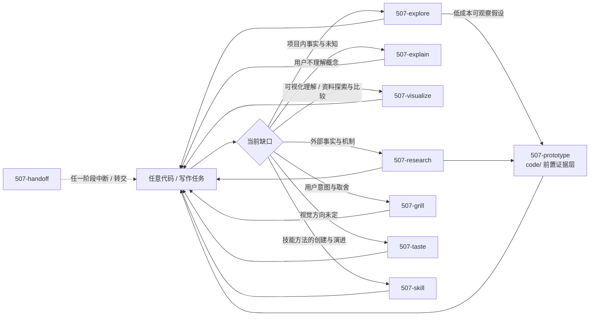

# common/ 横向认知与协作层

`common/` 放不依赖具体交付类型、可同时服务代码与写作的能力。它不是“先 common、再 code/write”的固定前置阶段，而是任意工作流在遇到项目未知、概念障碍、资料探索与比较、外部证据、用户决策、视觉方向或会话转交时调用的横向层。

任务已经清楚时可以直接进入 `code/` 或 `write/`；横向问题解决后，应返回原任务或进入边界最清楚的下一动作。

## 横向关系

## 八个动作

### `507-explore` 项目探索

从项目实际阅读入口读取本轮相关规格、设计、词义与实现，承接既有共识，区分已确认要求、当前实现和验证证据；迁移中先核对新旧权威是否已切换。在临时会话内维护目标、已知、未知、当前可推进边界与证据范围，多条路径仍无法选择时，分别说明候选的依据、适用条件和最小验证动作。具体行为影响按需使用[代码影响调查](507-explore/references/code-impact.md)；整体启动或规范迁移缺口交 setup，局部导航失真交 setup 的导航维护模式，探索自身保持只读，不建立持久地图。

### `507-explain` 概念解释

解释用户不理解的一个内部或外部概念。最短定义的名词必须指向用户能辨认的对象；用户无法想象时先给场景，再提炼定义。引入未解释术语时，必须现在解释、说明暂不展开的黑盒作用，或删掉并重写。解释未成立时按构造、表达、载体三层依次排查：先修定义落地与术语归宿，再改图设计或换真实运行证据，只有量级、连续变化或需亲手调整才有直觉的感知型障碍才在临时位置生成视觉件。示意使用表格或受支持的 Mermaid，无法渲染时退回结构化文字或表格，不生成 ASCII 图。默认不落盘，不替代项目探索和外部查证。

### `507-visualize` 可视化理解与比较

将已成立材料制作成关系探索、条件观察、方案对照或独立阅读工具。先确定用户要看明白什么，再核对对象、连接类型、方向、条件和出处；选择能完成目标的静态图表、对话内交互或网页，沿选中、继续阅读、返回和恢复验证实际结果。理解模型与载体检查分别按需读取包内参考，不规定配色、栏数、力导向图或技术框架。

普通概念讲解归 explain；产品业务界面归 ui；事实未知先取证，实际用户取舍按需对齐。图表与网页里的工作指令只是被解释对象，点选不取得业务执行权限；宿主负责实际片段、主题、工具与状态合同，安装和发布按各自授权继续。职责与验证依据见[方法沉淀记录](../doc/20-能力参考/visual-understanding/README.md)。

### `507-research` 外部调研

核实外部项目、文章、标准、竞品或时效事实；多角度问题按可独立查证的子问题展开，关键主张逐条对齐原文，取证失败时保留待核实状态。区分事实、来源观点、本项目推断与未知，默认在对话中产出可追溯的 evidence handoff（证据交接）。学习传播或增长内容时，还须交接标题点击理由、正文兑现及效果证据边界，创作与标题改编归 507-forge 的书面模式。只有结论需要长期复用时才落项目既有参考目录。

### `507-grill` 决策对齐

在提问前查清可核实事实，只询问用户拥有的产品意图、权责、体验、成本和风险取舍。复杂对齐按需显示受支持的 Mermaid 决策控制台，简单问题使用文字或表格。确认新结论前先核对与既有决定的冲突；需要保存且获授权时，更新唯一现行正文：代码项目的共用设计进入 DESIGN，词义进入 GLOSSARY，功能与验收进入 spec，依据、实现说明及交付安排进入 doc；读取时核对实际入口，旧内容按授权迁移，写作项目遵循自己的组织规则。耐久写入与远程工单仍受授权约束，不建立第二决策库。代码需求的[工程设计](507-grill/references/code-change-design.md)由 Agent 收口，明确需求可直接使用该参考；写作中缺少作者尚未表达的材料时进入 [`507-prospect`](../write/507-prospect/SKILL.md)。

### `507-taste` 视觉方向收敛

当目标是「做得对味」而不是「做得对」时使用。视觉决策没有可自动判定的成功条件，判据在用户脑子里，因此不做一步到位的生成，而是：先取只有用户才有的观点（性格、为谁、冻结哪一秒），一次铺开结构差异极大的粗稿，靠「留两个、弃一个」淘汰收敛；方向确认后才拆元素层、做组合台、跑可机械判定的检查。已有明确方向只差实现时跳过；只需回答一个具体未知用 `507-prototype`。

该方法同时服务产品、品牌与内容视觉。各媒介技能已有的原型选择与验收继续按各自合同执行；不因它移入横向层就强制多走一轮选型。

### `507-handoff` 会话移交

中断、换会话、压缩上下文或转交时，在对话中输出脱敏临时摘要。它引用正式产物，不建立第二事实源。

### `507-skill` 技能编写与演进

创建、改写、审视或融合技能方法，先判断应复用现有技能、放项目规则、按需参考还是新建入口；描述按用户动作与边界选择任务，正文保留关键合同，分支材料按条件读取。修改和外部方法融合按[演进参考](507-skill/references/evolution.md)核对来源、基线与消费者，复杂流程按[验证参考](507-skill/references/validation.md)检查选择、执行和结束行为。 本项目自有技能选定 OpenAI 目标交付时，按[界面元数据参考](507-skill/references/openai-metadata.md)提供显示名称、短介绍和起始提示，保留既有调用策略；文件、发现和实际显示分别验证。它维护技能包，不代替 research 的外部取证、grill 的用户取舍、review 的交付审查或 setup 的项目规范迁移；这些动作只在真实缺口出现时使用。

## 边界速查

| 当前真正缺什么 | 使用 | 典型返回 |
| --- | --- | --- |
| 项目里知道什么、还不知道什么、现在先查什么或验证哪个候选 | `507-explore` | 原任务、research、prototype、grill 或交付 |
| 一个概念是什么意思、怎样建立正确心智模型 | `507-explain` | 原任务 |
| 将已有资料做成可探索、可比较或可观察条件变化的理解工具 | `507-visualize` | 补证或对齐后返回、对应产品或媒介动作、原任务或直接结束 |
| 外部事实或机制能确认什么、证据在哪里 | `507-research` | explain、explore、mine、grill、规格或交付 |
| 作者如何叙述自己的亲历与判断，但尚未充分表达 | [`507-prospect`](../write/507-prospect/SKILL.md) | mine、返回调用它的创作动作或直接结束 |
| 已知前提下的用户取舍最终选什么 | `507-grill` | forge 的方案模式、prd、issue、prototype、写作或实施 |
| 图标、品牌、界面或插画方向未定，需要真实粗稿比较 | `507-taste` | 原任务、实现或对应媒介制作 |
| 把尚未沉淀的运行状态交给下一会话 | `507-handoff` | 下一会话对应动作 |
| 把稳定方法写成技能、改写现有技能或判断如何融合 | `507-skill` | 查证或对齐后返回、独立审查、原任务或直接结束 |

## 共享方法源码

`references/review-evidence.md` 是 review／inspect 的公共证据方法维护源，不是新技能入口。生成副本随两个技能分别提供，使用者无需跨包读取；维护与校验入口见[代码工作流](../code/README.md#共享审查证据方法)。

## 出口纪律

- 每个 skill 可有多个候选出口，也可直接结束或返回调用它的原工作流。技能完成后，原任务仍有已授权工作时继续承接；技能之间的边界不自动产生新的用户确认点。
- Agent 根据当前目标、证据和各 skill 的出口合同选择下一步，并简短说明理由。
- 用户只回答其真正拥有的意图与取舍，不负责记忆或选择 skill 名称。
- 长期事实仍进入项目既有术语表、决策档案、经验笔记、规格、工单或写作资产；横向层不新建总控状态库。
