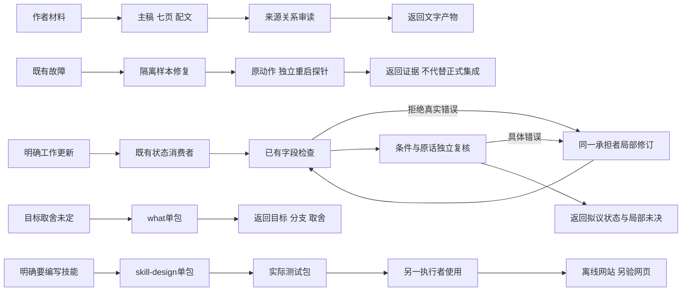

# Luna五组实际执行与消费者优化

状态：2026-10-12，本轮目的性真实会话重放与隔离执行已完成；指定工作修订经字段检查和独立语义复核通过，首次执行仍不稳定。9位执行者、3位独立审读者，运行上下文核对均为gpt-6-luna（测试模型）/medium（中等推理）。不称随机未见任务、宿主自然发现或全库替换验证。

## 本轮范围与输入

工作批量更新和后续澄清取自正式工作会话，按原消息先后分开提供；创作采用作者关于套餐前提与上下文配置的原话和冻结事实；修复采用真实项目H01故障与c8716c2旧代码的隔离副本。现有507-what负责目标与取舍，507-skill负责技能设计与编写，各以包内副本显式执行，另有明确动作／普通表格反例。私有原话、完整快照、模型日志与业务源码只保存在本地证据目录，公开文档不复制。

初始评分有两处校正，原评分文件未覆写：工作首条请求没有明确清除提醒日期的要求，不能拿后续消息否定其保留原日期；修复需求没有规定必须在首轮检测时生成冲突记录，允许满足最终目标的不同合法解法。故障输入在执行前生成，但登记中的输入指纹当时为空，不能宣称它已在初始登记中冻结。实际输入与工具回执另有指纹核对。

## 五组结果

| 目标 | 首次执行 | 实际优化与最终范围 | 尚未成立 |
| --- | --- | --- | --- |
| 既有工作更新 | 完整身份与活跃表存在；但把省略句的发送条件确定归给一个对象。独立初审漏检。 | 隔离work-update首次丢四个身份、误清日期，已有字段组件明确拒绝；接入真实检查后修订通过。后续原话明确清除提醒日期的要求后才清日期。语义反馈后保持两个条件候选；再次纠正精确引文。最终16身份／12活跃、字段检查及独立语义复核分别通过。 | 首次稳定性、条件最终归属、真实任务平台写入与回读 |
| 创作 | 主稿、七页内容与配文齐全，历史事实、不同情境模拟与作者配置分开，没有把其他来源转成本人省额度成绩。 | 文字产物在本轮来源关系范围经独立审读通过；无需因本例增加固定前链。 | 实际图卡、作者接受、当前外部销售事实与发布 |
| 隔离修复 | 实际修改H01样本源码与回归；132项自动测试、14项同步测试和构建通过。 | 独立探针覆盖第二次网络等待、同SQLite重启、后续协调、真实远端999及被替代234落盘；D02与G02相邻例通过。相同新增回归和独立重启探针在旧版均失败。 | 当前项目集成与业务接受、真实外部服务、全部UI与所有时序 |
| what本职 | 对未定范围请求给目标、边界与必要取舍，不要求固定七问或技能编写。 | 单包内引用成立；明确改400k反例直接执行，872k容量保持，没有多加确认问题。 | 宿主自然选择、自然脱离作者环境的任务执行 |
| skill-design本职 | 实际写出site-compare测试包、随包方法／骨架／元数据；普通表格反例不启动技能编写。 | 另一位Luna独立使用该测试包与公开资料，生成十二议题离线网站；网页验证另记。 | 正式入库、安装、全局共有组件复用收益与宿主自然选择 |

修复的132项是执行者完整自动测试回执；独立审查只重跑与风险相称的探针和相邻回归，不把作者自测计为独立全量业务接受。原项目已经由其维护会话继续推进，本会话不占用该工作树。

## 具体改变落在哪里

1. **共有方法暂不合入新段落。** 一轮隔离补充试验提前读取了后续原话，不能用于因果比较；仅提供首条输入的另一执行者仍擅自清日期、保留业务背景为活跃事项并产生多余未决。更多规则没有证据显示净收益，保留试验原文与失败。正式7份共有源及两包14份副本未改。
2. **次要work-update值得继续验证。** 它承担既有工作事实、字段、身份、状态、活跃视图与未决的一致更新，区别于整理知识或新建问题单。本轮只在隔离目录形成实验包，不加入正式包清单。首次失败与反馈后的成功分开，不据成功回写首次成绩。
3. **复用现有字段组件，先不新造组件。** 实验包消费已有state_diff，实现身份与字段检查及结果返回。组件能拒绝身份删除及本轮未允许变更，也接受后续明确指令；不检查自然语言归属或授权真实性。调用方提供的政策在本轮保持指纹不变，但没有技术强制的可信授权通道；不能称“自放行已堵住”。
4. **技能编写产物确有下游消费者。** site-compare承接来源、比较口径和读者任务；普通页面呈现在随包方法／骨架。第二执行者实际形成网站，比“只写了一个SKILL”增加可用证据；还不足以新增第六个主要入口或全局渲染组件。
5. **输入、评分和展示问题留在实验／阅读工具。** 后续消息先后隔离、原话准确性、实际工具读取与输出字段显示由该消费者负责，不扩成每个技能的必填审查表。参考站修正中文／英文字段兼容，原输出保持不变。

## 实际路径与返回

上述节点描述本次承接动作。方法参考不等于已经注册的技能调用；不存在固定what→why→how前链。明确动作可以直接执行；歧义仅阻塞依赖它的动作。

## 证据与停止位置

首次冻结输出、初审、评分更正、失效试验、隔离包首次失败、字段反馈修订、真实后续输入及精确引文复核各有独立身份。字段PASS与语义接受分开；独立审读者出现过漏检和分歧，校准例通过不代表后续判断可靠，回原证据裁决。

网站保留15个视图及全部既有来源／原子／旧新图／UI资料。本轮区显示17阶段，可展开每轮输入、原产物、工具读取证据、卡点及返回；审计区是接收时的历史快照。site-compare生成的网站使用同一历史快照，其中“后续尚未执行”不能当作本轮状态。模型执行、网页QA、正式包闭包及项目集成分别记录于[核验回执](../40-版本实施方案/2026-10-12-Luna五组执行与优化核验.json)。

本轮停止于指定切片达标与边界可追溯。先不新增how／why／create或fix／review正式包，不替换现用库；work-update保留为下一次真实平台／自然任务试用的次要候选。现场自然发现、授权真实性通道、同条件可靠性／成本改善、真实平台写入及完整媒体产物仍未验证。没有提交、推送、安装或发布。
