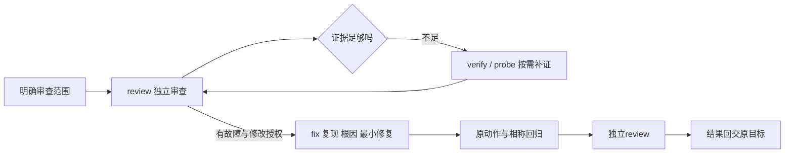

# Luna补强复验与工程接力

本轮在上一轮正式会话重放发现的基础上，补了三份实际共有方法并用Luna重新执行；另从一个正式项目的当前候选取隔离样本，完成独立审查、局部修复及独立复验。技能主合同和入口未改，七份共有源/十四副本/两包范围不变，其他五主要、三十二完整方法与四十八组件接口仍为设计。本轮不能据此接受全局替换或完整项目。

## 本轮实际改变

| 位置 | 防止的误判 | 真实消费者与范围 |
| --- | --- | --- |
| [权威与返回](../../lib/methods/authority-and-return.md) | 一项变更抹掉未撤销条件/理由；口语默默替换精确旧值；重建摘要冒充原版 | 两实际包按缺口读取；平台与稿件仍负责对象、写回和操作权限 |
| [事实与证据](../../lib/methods/evidence.md) | 两材料主题相似便视为同一实验/身份；执行者口述充当实际读取 | 两实际包；创作材料、审查和验证候选按需借用，未因此成为新包 |
| [可观察验收](../../lib/methods/validation.md) | JSON/表格完整便视为含义正确；注释称第二等待而动作在第一等待；API通过替代界面 | 两实际包；测试/审查的独立观察与确定性检查分别成立 |

随包副本由现有生成工具同步，并保留上一不可变快照。没有新增总控、强制七问、平台调度器或通用状态机；没有安装、启用或替换宿主。主合同未改不等于方法行为没变，因此本轮仍做独立审读与执行复验。

## 复验与工程样本

四个执行者同用gpt-6-luna、medium，共五份模型输出；另一个独立审读者也用Luna。执行者得到任务、候选目录和最小材料，自主选择参考；检查者的判断和期望不预先提供。源目录成熟度、宿主已发现技能与显式测试输入分别说明。运行上下文从日志核对，不只采信执行者自称；工具调用及原始结果保留，未消费完整正文的部分不推定。

| 情境 | 实际行为 | 当前结论 |
| --- | --- | --- |
| 已有作者主线的创作 | 直接用创作/成文/结构/载体内容参考，交完整主稿、七页文字与配文 | 未重新采访；未出图、发表或接受。跨来源归属仍按实际文句核对 |
| 批量工作更新与身份澄清 | 直接用共同宿主平台方法和共有判断，保留十六个替身身份 | 等待缘由补回；发送条件被写到后续对象但归属仍需保留未决；既有精确截止被覆盖，仍需纠正，结构通过不算语义通过 |
| 明确项目审查 | 只读冻结当前未提交实现，运行同步套件及精确门控探针 | 十二项同步检查通过，但第二个等待的新编辑没推到远端，后续仍停在差异状态 |
| 独立隔离修复 | 另一执行者只改样本同步基线，并保留原动作与回归 | 本地新值保留，下一次同步可推送，再下一次一致；首轮两端并未一致，正式项目未集成 |

冻结范围不以HEAD代替未提交实现：逐文件指纹与复制稳定性记录，业务库/运行凭据不复制；探针只用虚构数据、临时SQLite和本机模拟接口。网络调用限本机，真实外部服务、公司制度及设备接受未覆盖。原项目由原会话维护，不发送消息或改变原业务资料。

已有测试的“第二次等待”注释与实际动作不同：独立探针等到同一轮第二个PATCH真正挂起后才让另一账户保存，再观察平台值、远端值和后轮推进。隔离修补保留晚到修改的旧平台基线，使后轮仍能识别未同步字段，避免将它误记作已同步。独立审读者在自己的复制目录重跑十二项同步检查和探针通过；原项目若采用，需在当前基线集成后复验，不能直接把样本改动当正式完成。首轮反馈是否明确显示仍需同步，仍是产品整合检查项。

页面另补了实际消费者检查：冻结真实同步组件，仅为夹具增加导出，给无fields的采纳解析；浏览器完成渲染、比较计划和采纳动作三项检查。数据与API是虚构夹具，不是完整登录/权限/导航路径或真实服务验收。

## 期望分工与实际选择

这是设计职责路径，不是宿主固定调用顺序。只要求审查止于发现；没有修改授权不进入fix。普通内部理解、读代码和写代码不单独建立why/implement目标；现有证据充分时无需探针。

实际审查者选择了why、review、research、verify、probe；修复者选择了why、implement、verify、probe，却未采用fix。源码结果能成立，但目录选择仍有错配，不能称已减少路由。已把why的独立解释目标与review/fix内部机制理解分开，并收窄implement到普通新增行为实施；这是候选描述修正，尚未重新做自然选择试验。

## 证据和剩余工作

本地参考站把上一轮十份原始产物、本轮五份产物、期望与实际路径、具体问题、模型与工具审计并列。点击职责只查看设计合同，返回保留任务、轮次和阅读位置；不会执行原平台操作。

审查不因一份“通过”报告停止：当报告与原话、对象或字段冲突时，保留初审并拿具体证据复核。工作条件和精确截止的两个问题仍需对当前消费者纠正，不用继续堆同义规则或宣布全库通过。跨来源身份以每项原始主张为准；不能将同主题邻接表述当连接证据。

后续优先验证最少必要的资料选择、同一对象/字段的可观察对账与平台实际读回；完整工程方法包、正式共有CLI与自然宿主发现分别需要真实消费者和验收。局部样本通过不证明全库效果、统计改善、成本下降、自动安装或正式项目交付。[本轮核验](../40-版本实施方案/2026-10-11-Luna补强与工程接力核验.json)维护检查范围；[上一轮记录](正式会话Luna重放与能力补强.md)保留原始失败与实验限制。
