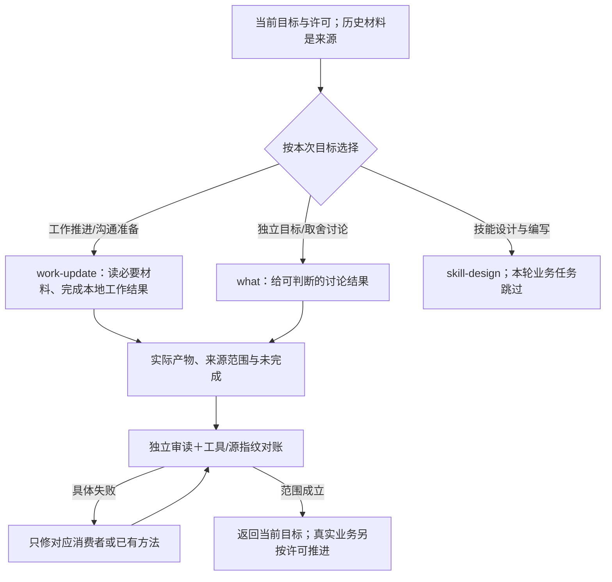

# work-update接入与真实工作试用

work-update已接入新体系，当前在仓库实现三个独立包：507-skill、507-what、507-work-update。接入是源码、资源清单、随包副本与独立构建成立；宿主安装、自然发现和业务执行分别核验，本轮没有替换全局技能库。

## 包、方法与组件

| 内容 | 唯一维护位置 | 本轮消费者与交付 |
| --- | --- | --- |
| 工作目标、输入、许可、结果和返回 | next/skills/507-work-update/SKILL.md | 可直接请求的工作能力；局部更新与完整推进按目标裁剪 |
| 事实与来源、权威与返回、验收 | lib/methods中的三份已有方法 | work-update携带普通生成副本，主合同按条件引用 |
| 工作记录与接续的专用组合 | work-update/references/process.md | 当前只有工作能力消费，不为共有库外观另建第八方法 |
| 字段对账和单状态派生视图 | lib/components/state_diff.py、work_view.py | 清单生成包内scripts副本；只读输入或写指定输出，不扩大业务权限 |

共有方法仍七源，方法副本17份，组件副本2份；三包共31构建文件。Markdown使用生成注释，Python保留解释器首行、使用合法Python注释记录源与SHA-256；不手改副本。打包器保持精确身份、声明文件、路径/软链接、引用闭包、代码语法和漂移检查，失败恢复，既有不可变两包快照保留。

## 本轮新6-luna如何进入

三个执行者拿到已构建普通包、实际历史请求及必要项目文档副本，在提示菜单里判断选择；这不是宿主自然发现。每个runtime仅写自己的outputs，没有原业务项目、真实渠道或平台写入权限。完整历史和未来回合没有自动追加到输入。

| 任务来源 | 实际选择 | 首次与修订 |
| --- | --- | --- |
| 标注团队开工与训练衔接 | work-update；跳过what和skill职责 | 交付可用开工准备，但把助理转述写得像直接查过原消息；来源表达修订通过 |
| 表单审核平台沟通准备 | work-update；跳过what和skill职责 | 漏读已提供TXT会议稿，遗漏其中关键数据处理边界；读回原稿后修订通过 |
| 独立汇报压缩讨论 | what；跳过work-update和skill职责 | 交付讨论方案，没有创建工作台账或修改作品；页数与结构仍为建议 |

采用和读取不是同一个指标：标注准备执行者实际读了三包主文，读后跳过两个相邻职责。本例不存在强制转交，但存在额外阅读；不能用其自报读取清单隐藏这一事实，也不声称成本已改善。

普通文本准备不需要整表状态生成，这两条工作任务没有强制调用视图组件；单包脚本运行由独立构建与临时目录检查另证，不捏造成模型自发执行。

## 卡点及放置判断

1. **已给资料被误当缺失。** 真实调用只按md/json筛选，未见TXT稿。原位校准已有evidence方法，说明未读、部分格式检索、未提供和无法核验的区别；同步三个实际消费者，不新增索引技能、总控或日志系统。修订还区分原会议稿8项与历史报告提到的另一12项清单。
2. **转述被写成直接来源。** 当前消费者修订引用身份，承认本轮没有重读原消息；业务准备内容保留。现有来源方法已能承接，不追加另一套台账。
3. **额外读包。** 保留为选择/读取成本观察，当前样本不足以决定增加路由器或硬性禁读。
4. **审读范围被扩大。** 审读者曾把两个更新runtime误写成三个更新且哈希相同。实测是两份更新、一份首轮冻结；原报告和校正版分开，既有确定性指纹检查承接，不把独立审读本身当不可质疑的闸门。

## 验证与未覆盖

21项打包检查通过，包含普通单包运行、Python副本漂移/语法、未知身份/目录、越界/软链接、声明完整性和失败恢复；原10项字段组件检查通过。独立包/代码审查与试跑产物审读分开，首次、反馈修订与校正报告分别保留。

旧两包的主文和专用内容保持；因本轮evidence校准，各一份方法副本按维护源同步。初次三包快照与修订后三包快照均不可变，试跑PPT的首轮输入和包不随两个工作反馈修订升级。

本地网站保留15视图、多来源原子、旧8/新5图、前轮五组17阶段和工作候选两目标三阶段；当前新增三任务五阶段与当前三包入口，历史两包构建明确保留为历史。核验、源/产物指纹及独立结论见[接入核验](../40-版本实施方案/2026-10-12-work-update接入核验.json)。

本轮没有真实平台读写、发消息、团队分派、训练、作品改稿或业务接受；没有宿主自然发现、硬环境隔离或成本改善证据。两个旧主要包对新evidence副本完成闭包与同步检查，本轮未再做完整行为回放；此前本职证据保留其版本。政策与字段PASS不具备授权真实性验证。未提交、推送、安装或发布。

网页完成34项实际检查，包括当前三包、三任务五阶段、实际产物、地址恢复、键盘、已有实现/分工的当前与历史边界、15视图和1413/768/390宽度。原来源/原子计数及历史输出身份检查通过。
