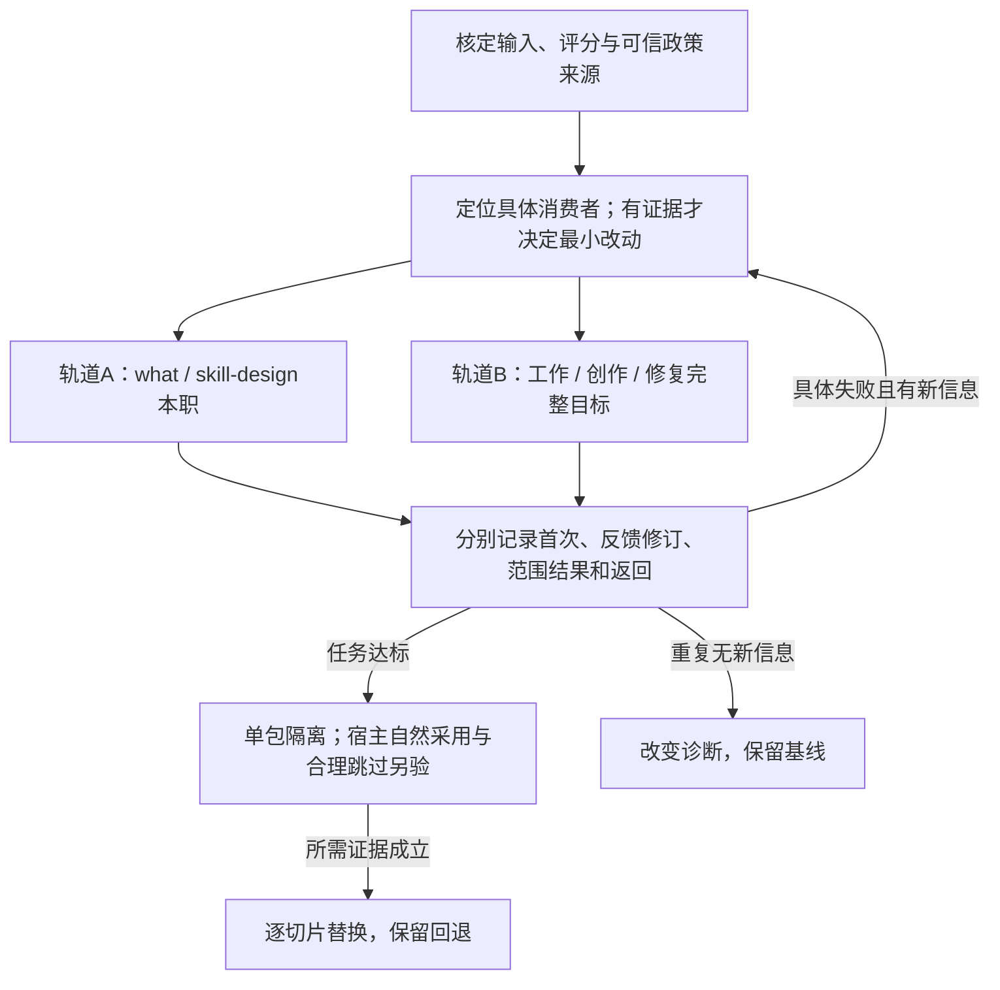

# 三份审计共识与验证分工

状态：2026-10-12，507认可三份审计的综合理解；本次回写文档与本地参考站。审计事实与分歧已核对，后续消费者修改、校准评测、未见任务与宿主试用未执行。技能合同、组件实现、包数量和安装状态未改变。

保留三层，把验证单位从候选目录转为能完成任务的真实消费者。

具体议题和网站使用同一份[审计对照资料](../40-版本实施方案/2026-10-12-审计共识与验证资料.json)。该资料维护报告归属、事实修正、处置建议与下一轮安排；本页说明判断依据和验证分工。外部报告是待核证据，其建议不自动成为项目规范或实施授权。

## 三份来源与分歧

| 来源 | 提供版本与核心提案 | 身份边界 |
| --- | --- | --- |
| D：[项目内报告](../30-独立审计/2026-10-12-三层架构与运行可靠性独立审计.md) | 三层架构与运行可靠性独立审计；保留三层，建议先建 fix/review/work-update，再收缩方法和组件。 | 正文称不同模型体系；具体模型未核实 |
| K：mirasim报告（507提供的交付文本） | 重构与运行可靠性 · 独立审计报告；两包宿主验证与校准优先；建议下沉 why、暂停组件包化。 | 任务元数据核实 kimi-k3 / max |
| P：粘贴报告（507提供的交付文本） | 507-skills 重构审计报告（2026-10-12，只读）；先核消费契约；保留工作名，按实际路径决定包化。 | 正文未标模型，身份未核实 |

三份均带历史上下文，不能称盲审，也不是同条件三模型成绩。原报告按提供版本保留；本次更正不覆写作者原文。本地参考站提供三份原件与对应指纹，公开文档不包含私有会话、原始业务记录或本机绝对路径。

## 可承接的共识与逐项更正

### 三层与85候选

**本次归类：可承接共识。** 保留特有思考／完整方法／共有组件方向。85是能力候选地图，不是85个包或实施队列；三层按缺口采用。

报告提案：D：保留三层；认为85划分不可执行，建议收缩。；K：认可职责分层；建议暂缓方法/组件包化。；P：保留分层与候选，按真实消费路径实现。。

- 分层规格：三层不是固定串行步骤；允许直接入口。
- 当前资料实际为5主要／32方法／48接口；实现仍2包、7源／14副本和1独立只读适配。

下一步：每个实现决定回到任务、输入输出、权限、完成与返回。

### 读到、用到、完成分别成立

**本次归类：可承接共识。** 需要实际工具读取证据，同时检查规则是否落到产物。字段填齐、读取清单、PASS标签均不能单独证明用户目标完成。

报告提案：D：强调引用级到动作级／拒绝级的差距。；K：强调规则被读却未进入实际正文。；P：要求追到字段、句子和消费者结果。。

- 工作日期／状态错改与创作来源桥接均曾在读过资源后出现。
- 初稿失败、反馈修订、构造相邻例的结果必须分栏。

下一步：用任务完成与具体错误是否被拒绝评估；不以调用率奖励过度路由。

### 独立审读也会漏检

**本次归类：可承接共识。** 初审漏检有证据。校准可作为限定任务的检查实验；一次校准全对或一位审读者通过均不证明未见任务可靠。作者自设百分比／次数未成为验收标准。

报告提案：D：要求先校准，并建议已知错误召回100%。；K：建议C-01/C-03/C-06校准及固定重复数。；P：强调校准与原话保真。。

- review.json漏检截止取代和接受状态丢失；corrected-review.json补出两条实质发现。

下一步：检查正反例、输入保真和首次判定；保留初判、挑战及更正。

### 两包并非从未读取／前向执行

**本次归类：事实修正。** 纠正“0／从未”。最新work a1实际工具回执包含两包正文；早期有4个what和1个skill-rebuild受控前向任务。已有证据保留，独立隔离执行和宿主自然发现仍未因此成立。

报告提案：D：称最新12输出两包读取0，且从未验证执行效果。；K：建议两包真实宿主与隔离运行。；P：区分候选重放与正式包执行。。

- 两能力重建核验.json：forwardExecution。
- repair-data work/a1与runtime-audit对应工具输入哈希1192649615875367055620f7e6801e4e2081769b2390a8c10901302ecffe5ebd。

下一步：正式包验证只验其本职；整体任务验证另列，不强迫两包拥有工作更新、创作或修复全部职责。

### 根资源读取与单包闭包

**本次归类：事实修正。** 实际自述为8/12输出含根方法源：6绝对、2相对。它是设计资料重放，证明本轮未验单包闭包；不能据此判实际包隐式依赖根。续办r2没有新增读取，不等于同一执行者r1读过的正文消失。

报告提案：D：称7份绝对根读取违反包独立；r2根本没读权威方法。；K：建议无作者仓库的隔离任务。；P：强调读取与隐式依赖需要区分。。

- 两包主文使用包内references/shared。
- 工具回执与readFiles自述有出入；需交叉核对。

下一步：单包隔离单独跑；读取审计记录上下文继承与实际正文暴露范围。

### 快照复现与公开覆盖

**本次归类：事实修正。** 私有三组重放／相邻构造对账可复跑并匹配原结果；公开十项测试未包含这三组。第三组是构造明确修订，不是实际业务写入。公开复现缺口成立。

报告提案：D：公开lib没有快照，称结构对账不可复现。；K：关注构造／反馈修订的证据边界。；P：要求固定正反例与完整记录。。

- 既有component-checks三结果重跑：REJECT／PASS／PASS及输入与脚本哈希全部匹配。
- 公开组件tests为10个合成单测。

下一步：选择脱敏等价夹具或明确私有复现入口；保留历史，避免公开原始私密记录。

### setup、organize与计数

**本次归类：事实修正。** 当前32方法包含organize。method-maintain与显示名setup是同一对象；method-spec引用它。organize confirmed只确认次要位置，工作名和具体组合仍为候选。

报告提案：D：要求统一setup与method-maintain，称setup无消费者。；K：误数31方法／organize不在32名单。；P：要求澄清ID、工作名与状态。。

- build_planning显式收窄原maintain并改name=setup；稳定ID保留。
- planning-data的organize层级、layerDecision、migrationApplied=false和interfacesAreProposals=true。

下一步：阅读处解释身份，不因ID与工作名不同自动改标识。

### 组件粒度与消费者

**本次归类：事实修正。** capability.inspect有audio.generate组件消费者；image.transform和deck.render在当前实体图无入边，但有旧素材／载体引用。judgments是40／8两组通用执行句；独立用途还取决于输入输出、边界、检查与消费者。均不足以直接删项或判48个作用域为零。

报告提案：D：建议删image.transform／deck.render／capability.inspect，称任何层零消费者。；K：称48项judgments完全一致，因此独立依据为0。；P：按真实消费者逐项判断。。

- 当前实体audio.generate.componentIds含capability.inspect。
- 组件按既定职责执行具体动作；例如source.read与page.paginate检查不同。

下一步：普通载体做法继续在共有库；按实际任务缺口实现，候选组件不自动成为SKILL包。

### why／how与主要职责

**本次归类：待验证建议。** 保留五个初步主要职责及what／why／how／create／skill-design工作名。why已约定接近理解与解释；内部fix/review的机制理解不另起目标。独立how的价值尚待验，“第3个”不是现行门槛。

报告提案：D：why保留；how建议内部化并等第3个消费者。；K：why建议下沉／改为understand，how保留候选。；P：保留五个工作名，暂缓独立包化。。

- main-understand工作名why：解释本身是交付目标才独立采用。
- how初步主要身份已确认，六个样本不证明选择频率／效果。

下一步：用独立解释、跨约束策略与直接修复任务核职责，不靠5W2H对称或数量裁决。

### 政策来源与自放行

**本次归类：待验证建议。** basis=x确实PASS；state_diff仅核给定政策，不能核真实许可。独立语义审读已发生，但可信来源／批准范围尚未绑定到生产者不能改写的边界。增加自报字段、引文或哈希不能单独堵住自放行。

报告提案：D：建议authority必填、basis长度和对象标识。；K：建议policyAuthor与同作者warning。；P：建议原话引文与输入哈希等来源记录。。

- state_diff解析只要求basis非空并匹配旧新值；README把意图和政策语义另列。
- 最终独立审读记录已核原条件／截止／消费者，故“完全没有第二来源”过强。

下一步：先明确消费者怎样采用宿主已认证指令、已有授权委托或受控回执；复用既有授权，不引入重复确认门。

### scope与infoLedger

**本次归类：待验证建议。** 异构记录范围限制成立，但现有16记录快照都有deadline，不受该反例影响。scope／账本可在真实需求下试验；普通修改不普遍增加必填表，已有trace／changes／unresolved可先复用。

报告提案：D：建议scopeIds与infoLedger必填。；K：建议来源／作者字段和校准资料。；P：强调原话和消费者对账。。

- 当前scope未知键exit2；全局保护字段在异构记录上会报protected_field_missing。
- authority-and-return明确普通修改不要求额外表格。

下一步：若需要范围政策，先定范围外变化、未知ID、删除、保护与允许变化的一致语义。

### 新包、合并与运行总控

**本次归类：待验证建议。** 各位作者的包数、合并和删项建议不直接实施。入口责任、独立委托、权限、产物和停止位置充分时才决定包化；保持任务自主直达，不加通用总控。

报告提案：D：先三包／八方法，建议若干合并与退出。；K：两包／校准优先，部分合并与下沉建议。；P：契约优先，create为后续候选。。

- project规范：不能以重复次数、实现数、代码行数代替真实边界。
- issue、PRD、并行、PR交付和retro能力仍需要明确承接。

下一步：缺口定位到某段消费者后，才选改共享资源、专用方法或独立包。

## 两条验证轨道

| 轨道 | 工作对象 | 完成依据 | 不能推成 |
| --- | --- | --- | --- |
| 轨道A：现有两包的本职验证 | what明确必要目标与用户取舍；skill-design规划、编写与演进技能。 | 清楚任务能合理跳过；必要工作完成并返回原目标；单包资料闭包和缺依赖处理。 | 整体创作／工作更新／修复完成不能自动归为这两包的成绩。 |
| 轨道B：用户任务的完整路径 | 工作状态更新、材料创作、明确故障修复／独立审查。 | 字段／来源／原动作正确，产物完整，未决只阻断依赖动作；审查后仍回原目标。 | 使用设计候选或共有资料的结果不能称正式新包已调用；平台／媒介／接受另验。 |

两条轨道分别登记版本、输入、工具、授权、实际读取和返回。既有受控执行是已有证据；隔离包执行、宿主自然采用与整体任务完成需要各自的证据。明确的工作、创作或修复任务可以直达完整工作，不因当前只有what与skill-design而强制绕行两包。

## 下一轮验证顺序（安排，未执行）

1. **核定输入、评分与政策来源**：保留首次错误和合法正例，核原话及评分；为使用字段对账的消费者明确可信依据与适用范围。 完成依据：错误被指出、合法变化不被误拦，授权依据不由候选自填创造。

2. **定位并只修具体消费者**：逐字段或句子找到失效点；有证据才决定共享规则、专用方法、脚本或独立包。 完成依据：改动降低实际误判或手工协调；不增加全任务问卷与固定路由。

3. **分轨运行正反例与未见任务**：执行前登记版本、输入、权限及检查；执行者不拿答案。轨道A和B分别记录首次、反馈修订和返回。 完成依据：约定完整产物和关键条件成立；初审／修订结果分开，不把校准等同可靠性。

4. **单包隔离与宿主自然采用**：单包离开作者仓库执行本职；宿主自然选择与合理跳过另测，显式调用仅作受控证据。 完成依据：读取／调用／返回和缺依赖处理可查；不以固定调用率诱导过度路由。

5. **达标后逐切片替换**：选已完成完整路径且有回退点的切片；正式平台、媒介和项目集成按实际风险复验。 完成依据：达标即止；连续两次无新信息或未缩小范围时换诊断；未验切片保留基线。

这是库的开发与验证安排，不是用户任务必须经过的工作流。原用户权限沿用；审读者不能新增授权，自报字段与哈希不能替代可信来源。

## 证据范围与待验证项

- 三份是带历史背景的独立审计材料，具体模型仅K有本次核实；不称盲审或同条件模型对照。
- 本轮综合核对与网站验证不是新的Luna任务成绩；后续消费者修改、评分校准、未见任务与宿主试用尚未执行。
- 成本收益、自然发现、真实平台写入、实际媒体及当前ERP接受仍未成立；85候选未迁移。
- 外部原报告按提供版本保留，事实更正记录在本次对照，不改作者原文。

已公开的定位：[两能力受控前向执行](../40-版本实施方案/2026-10-11-两能力重建核验.json)、[任务采用与决策演练](../40-版本实施方案/2026-10-11-任务采用与决策接力核验.json)、[消费者修复及初审更正](消费者对账修复与条件验证.md)、[组件语义边界](../../lib/components/README.md)、[分层规格](../../spec/技能分层与共有资源.md)。实际读取日志和三组历史对账保留私有证据；公开复现需使用脱敏等价样本。
