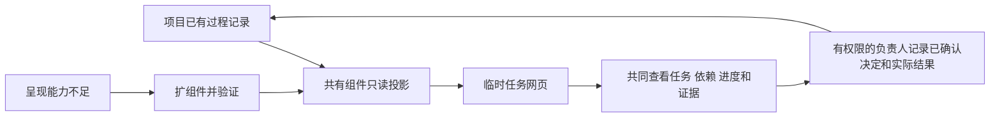

# 三情境协调与生成任务网页

2026-10-12，507确认把普通任务按需协作、任务图推进、长期目标持续协调融入同一新版，并将拆解与协调扩到写作等工作。技能身份仍为五主要/十二次要；新增一份共有协调方法和一个可运行任务网页组件，当前12方法/7脚本源、162技能文件/110共有副本。

## 职责与采用

| 情境 | 何时成立 | 如何推进 | 如何结束 |
| --- | --- | --- | --- |
| 局部协作 | 少量工作有独立结果，当前回合可完成 | 真正阻塞前提先处理，独立工作按收益安排；单人更合适可直接做 | 消费交回结果，核完整用户结果 |
| 任务图推进 | 多项独立工作和真实依赖已经成立 | 输入、权限和所有权成立后继续或委托；交回核证据并刷新受影响关系 | 整体目标与组合验证，不止于子任务完成 |
| 持续协调 | 跨回合、多日或多工作线需要可靠接续 | 复用已有过程记录保存有效版本、关键结果、剩余与下一责任人 | 当前范围结果与可接续依据，不承诺后台运行 |

三种情境可切换，不是必经三个阶段；小任务可以只有一个节点。coordinate持有协作与组合结果，create持有作者主线与作品责任，work-update持有原事项及本次工作目标；issue继续承接软件正式工单，不将写作都变成票或PR。

## 记录与网页的更新合同

该图是资料更新关系，不是技能强制调用顺序。网页是生成产物，绝不直接手改HTML更新状态、布局或功能；记录变化重跑组件，表达不足修组件再生成。沿已有过程文档维护一份当前状态，不新增必须维护的工作日志或数据库。

任务网页组件支持明确JSON任务数组路径与Markdown选定标题/表头；不猜散文、复杂表或未知平台格式。报告状态、验收记录与派生依赖提示分开，页面ready不能变成权限或派工。历史网页/投影/回执保留，错误输入与手改产物拒绝，失败保全当前可用入口；进程强杀/断电事务未验证。

## 本轮验证范围

22打包检查与43组件检查通过，含新增16项任务网页字段、来源、版本更新、错误依赖、代码围栏、文本注入、手改拒绝和运行失败恢复检查。独立审读按冻结201份源码复跑必要检查，并核Luna写作受控例：第一次按原过程记录生成，第二次只更新报告状态与说明再生成；未把报告完成变作者接受或验收。单句润色直接成文，不建任务图/网页。

另从本项目现有PROGRESS实际任务表首次生成、阶段更新并在收口后重生成网页；只更新源记录与重跑同一组件，旧版指纹保留。桌面/390px、搜索及状态/负责人筛选、前置/后续点击、来源与验收分列均已实际核对，网页内容宽度373px。参考站增加生成指纹核对、完整候选检查及进程内切换失败恢复，6项临时目录检查与独审通过；网页操作与静态检查分开。受控例基于真实需求，不是原话重放，尚未开始宿主自然发现或正式业务环境试用。

本轮准确状态见[PROGRESS](../../PROGRESS.md)，合同见[coordinate](../../next/skills/507-coordinate/SKILL.md)，共用方法见[task-coordination](../../lib/methods/task-coordination.md)，脚本与格式见[task-view](../../lib/components/task-view.md)。本轮[核验回执](../40-版本实施方案/2026-10-12-三情境协调与任务网页核验.json)保存范围和构建身份。私有模型/网页证据保存在本地参考站，不进入公开仓库。
