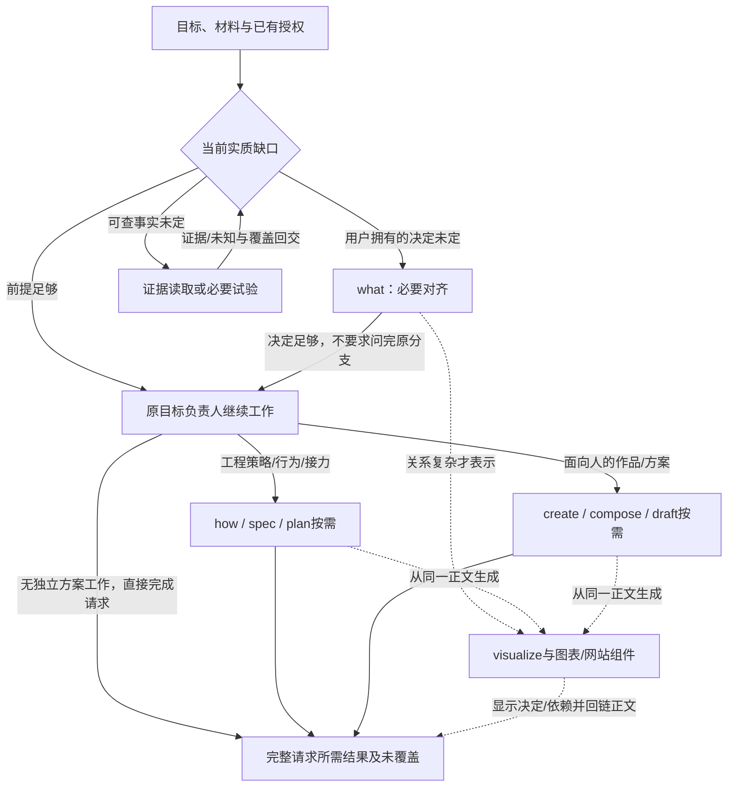

# 任务采用与决策接力

五个主要职责不是五个连续阶段。主要职责保留特有思考；完整方法对独立结果负责；组件执行已成立的动作。任务清楚时，Agent可以直接实施或采用完整方法。Agent负责整个请求，不能因一个内部方法完成而提前结束。

本轮讨论与演练依据见[工程采用与决策资料](../40-版本实施方案/2026-10-11-工程采用与决策资料.json)。其中任务情境为设计推演，三轮what记录是模拟输入、显式读取现有包的Agent演练；不是新宿主自动选择或真实项目改造。当前实际包仍为507-what、507-skill，其他五主要/32方法中的职责未整体实现。

## “激活”发生了什么

Codex先发现技能名称、描述和路径；Agent匹配当前目标或接到显式指定后读取SKILL.md，参考与脚本按需读取。隐式调用可以由技能配置限制，目录名“主要/次要”不会自动变成宿主隐藏策略。同名技能也不会按名字自动融合。[官方技能文档](https://learn.chatgpt.com/docs/build-skills)

需要分别取证：宿主发现、Agent选择、读取正文、采用参考、实际执行工具、委派及消费子结果。图中节点被选中、方法出现在lib、代码文件已经存在，不能证明这些状态已发生。普通工具调用也不都需要先建立一个Skill。

次要表示任务中的角色。用户可以用自然语言直接要求修复、写PRD或审查，无需记方法名；Agent仍须知道入口、采用条件与读取位置。少量有独立交付的完整方法可有真实可发现入口；微方法和确定性做法按消费者链接读取。不能把32个名字全注册或全藏进lib，就认为接力已经接通。包装选择应由真实试用证明。

## 代码与项目怎样采用

- 明确局部故障：fix持有修复目标，按必要证据采用research/probe/verify，原动作回归与相关检查不能省；行为改动按项目规则review。已有充分行为依据时不再问what，不新建整套PRD或工单。
- 已有项目新增：产品取舍未定才what，机制解释确有独立目标才why，跨约束策略未成才how。spec维护当前行为与验收，implement兑现真实消费者；复杂拆解才plan，独立工作值得协调才coordinate。
- 从想法到Demo：先定演示承诺与必要范围；客观未知低成本可证伪才probe。可运行Demo与一次取证原型是不同结果，网页载体不会自动把产品实现路由到create。
- 只写PRD或方案：spec、how、plan按所需结果直达，子结果回当前方案所有者；没有实施授权就止于文档结果，不进入代码、部署或PR。
- 已有任务图并行开工：coordinate负责就绪前沿、分工、结果整合和整体复验。子代理的“完成”不是集成完成；PR、CI、合并及发布也不是一个状态。
- 只读审查直接review，主动改进机会调查用inspect。setup维护项目依据和导航，不包办框架升级、服务安装或数据迁移；升级的真实变更由how/implement等承接。

“没读verify方法”不能免除验证；“没读spec方法”不能免除现行行为依据。已有充分材料可以直接消费，独立方法只在它确有判断或工作结果时采用。

## grill由谁接替

旧[507-grill](../../common/507-grill/SKILL.md)负责目标/边界/用户取舍对齐，原合同明确不负责完整方案起草。它的出口本来就包括PRD、面向人的方案、issue、取证或直接实施。

当前[507-what](../../next/skills/507-what/SKILL.md)承接必要澄清、事实与决定归属、问题依赖、真实候选、冲突、唯一权威及返回。旧grill要求顶层分支走完后收束，并在每完成一个顶层分支时重写累积共识。新what以行动所需信息足够为停止条件，在复杂、跨分支或移交时整理完整结论，并取消固定“共同理解确认”。必要分支与可视化仍保留。

用户要求完整方案时，what的结果还要被消费。工程方案由how形成策略，按目标采用model/spec/plan等；面向人的活动、合作或表达方案由create及compose/draft等承接。已授权实施的请求则继续到原目标验收，不能止于对齐或方案。

## 复杂对齐连续性：建议补入实际消费者

只在复杂、跨分支或将移交时维护：当前范围、已确认、当前可问、被事实或回答阻塞、已排除或被取代、下一行动、当前正文归宿。稳定标识用于必要依赖与追溯，不要求每题编号。

回答和证据到来后重新计算问题必要性。新回答让开放范围、交接期限或写权限不再相关时撤下；明确修订只替换受影响决定，仍有效的内容不重问。将问题消除与事实验证通过分开：业务决定足够，不代表未知接口已经安全。

图表或网站读取当前正文/有版本的观察材料，标明决定、待验证事实、阻塞与取代；必要历史回链到issue评论、Git记录或符合准入条件的ADR。网站不是第二份可独立修改的现行决定台账。无耐久消费者时共识留在会话，需要持续约束且获授权时回最近的spec、DESIGN、GLOSSARY或方案正文。

区分三个结束信号：下一步已可推进、此次对齐已完成、原请求已完成。what处理前两者；原目标负责人继续核对第三者。这里是补强设计，尚未增加运行总控、决策状态机或新的decision/grill技能。

## 次要方法是否满足

当前32个方法的结果合同基本覆盖本轮代码/项目情境，未发现据此必须增加第33个方法的证据。但职责覆盖、包闭包、宿主发现、运行接力和最终效果分别成立。可发现入口与读取闭包尚需实际消费者实现和试用。

已有合同需要补清三处：coordinate的就绪/回交/集成证据绑定精确版本；deliver区分约定head的CI、评论反馈、修复回交和授权交付终点；verify按实际风险核对驱动、目标实例、就绪、执行身份、副作用和清理。它们已有[来源评估](../40-版本实施方案/2026-10-11-五主要与次要能力评估.md)支持，不是三个新技能。

## 替换前怎样真用

先以显式读取已实现包检验多轮澄清和返回；再在单个试用消费者核验真实发现与自然选择。明确正例、同词负例、只读范围、已充分任务、事实阻塞、用户修订和父目标续办；旧/新对照固定原请求、材料、工程基线、模型和授权，不提前把正确路线教给执行者。[官方技能评估建议](https://developers.openai.com/blog/eval-skills)

工程纵向试用应先做够一个真实改动所需的闭包，验证“从请求到完整交付”，并加只写PRD、明确修复、已有任务图等短路径。无需等32个全实现，也不能只凭what/skill-design两包通过就宣布旧30可全面替换。当前未安装、替换用户全局技能、运行真实项目、提交或发布；实际消费者试用的范围和失败恢复另行明确。
