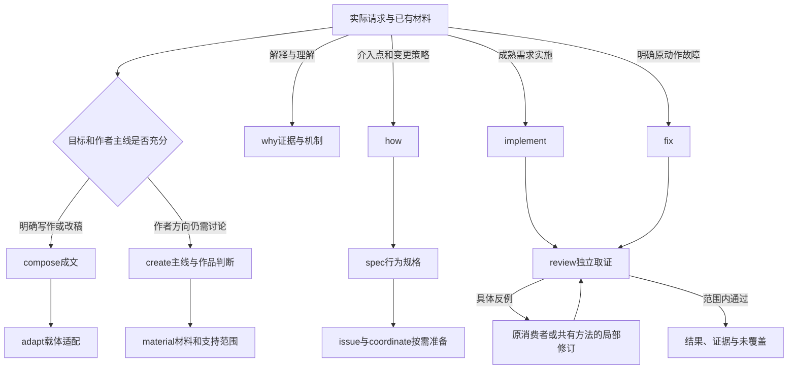

# 创作与工程实际试用

2026-10-12，本轮在同一个507-skills新版实现五主要、十二次要、十一共有方法与六脚本源。四名执行者与一名独立审读者实际均为gpt-6-luna/medium（模型/思考强度），使用生成后的技能普通副本。六类真实会话来源任务共九执行阶段，首次失败与修订均保全；没有把设计候选当作执行过的技能。

## 实际采用与跳过

| 真实来源任务 | 实际采用 | 结果与边界 |
| --- | --- | --- |
| 上下文与压缩阈值的理解 | why | 交付解释及来源/时间边界；没有把理解问题变成修改配置授权，历史套餐前提不写成当前核实价格 |
| 作者已纠正主线的小红书图文 | compose → adapt | 目标充分，跳过create/what；完整正文、七页图文HTML与来源映射，桌面/390px、正文、导航、来源锚点通过；未生成PNG或发布 |
| ERP介入策略与首个可执行工作项 | how → spec → issue/coordinate | 行为规格、本地工单、依赖与协作安排；没有直接改正式项目、创建远端工单或启动并行工程 |
| 复赛叙事与顺序讨论 | create → material | 按讨论请求分析作者主线、评分权重和未知材料；没有修改PPT，也没有把后续定稿偷渡为输入 |
| 原子比较Demo | implement | 十五原子/四来源、筛选与明细可用；首轮窄屏溢出，R2仅修布局后桌面/390px通过；数据与完整指纹保留 |
| 历史ERP同步故障 | fix → review | 首轮局部通过但范围不足，R2独立拒绝，R3完成范围内独立红绿；正式ERP仍由原项目维护者持有 |

审读者另以review、deliver、retro交付独立报告、本地PR草稿和复盘；这些产物不等于实际PR、提交或发布。what、skill-design和work-update的本职沿用前轮证据，本轮只核资源闭包。

图表示本轮实际进入方式及条件，未要求先调用五主要入口。what仍处理目标与关键取舍；how处理介入策略，不接管fix完整修复职责。材料充分的直接实施、写作及明确故障均可跳过主要技能。

## 卡点与改动归属

| 卡点 | 归属与实际修改 | 为什么没有新增技能 |
| --- | --- | --- |
| 首轮用反向去补丁重建红灯源码，且只测局部模块 | engineering-evidence补保全实际原版、同一最终回归及必要消费者；试跑补直接历史源码和HTTP/SQLite调用方 | 是四个工程消费者共有的证据判断，不是新职责 |
| 另一等待顺序丢冲突历史；未知创建并发及第六页稳定ID恢复缺口 | 当前同步/create消费者、共享记录查找原位返修，保留旧失败 | 是工程产物的具体逻辑错误，不以路由或新包遮盖 |
| Demo长指纹使390px溢出 | 当前Demo CSS换行与布局；来源与指纹不删 | 当前输出局部缺陷，尚无证据扩成共有渲染规则 |
| 审读冻结副本缺已声明项目依赖 | 显式只读依赖链接、重跑收集；首次环境失败保留 | 属于试跑环境，不能算业务红灯或技能资源暗依赖 |
| 构建发布时并发空目录可能被替换 | 构建工具改独占目录发布，新增必要并发拒绝回归 | 包维护实现错误，不增加用户技能 |

## 最终范围证据

打包/恢复/并发拒绝22项、组件行为27项通过；17入口资源闭包/漂移检查通过。构建身份为`a4ab2beb06b1b71044e95bd7e692e84dcd53f37482a7afbfa5b4ebc80580aa48`，含155文件（88方法副本、11脚本副本、4其他参考，另有52技能自有文件）。

修复最终17项回归原封不动跑在保全R2源码：14通过/3失败；相同测试跑在R3：17通过/0失败。独立审读者分别重跑，两份受审源码在运行前后保持指纹一致。通过范围是本地HTTP模拟服务、SQLite服务/存储关闭重开、二账号读回、跨等待时序、并发恢复与完整分页；不是操作系统进程重启、真实Airtable、同步UI、全ERP或正式项目验收。

Demo真实浏览器首轮390px下内容宽491px，R2为373px；桌面1413px下内容宽1396px，筛选/明细/完整来源指纹保留。图文七页HTML核对逐页正文、导航与来源锚点，桌面和390px呈现通过。当前参考站的窄屏长标识换行也已修订，历史图、原子和对照来源保留。

私有原话、执行日志、冻结源码与独立回执放在本地参考站证据区，不进入公共仓库。公共摘要见[核验资料](../40-版本实施方案/2026-10-12-创作与工程试用核验.json)，当前职责见[覆盖说明](新体系实现覆盖.md)。

## 仍需验证的能力

既有196原子的新版静态映射已完成；原子穷尽、其余候选方法、PNG/可编辑PPTX/音视频、完整产品UI、宿主自然发现、远端工单与实际多Agent工程集成、正式平台写回、稳定性与作者接受仍未成立。未采用的外部机制不自动成为必补要求。本轮通过不构成整库替换结论；旧30保留来源与回退。共有库已有16设计模式与原5提示资料，不能写成完整设计引擎。
