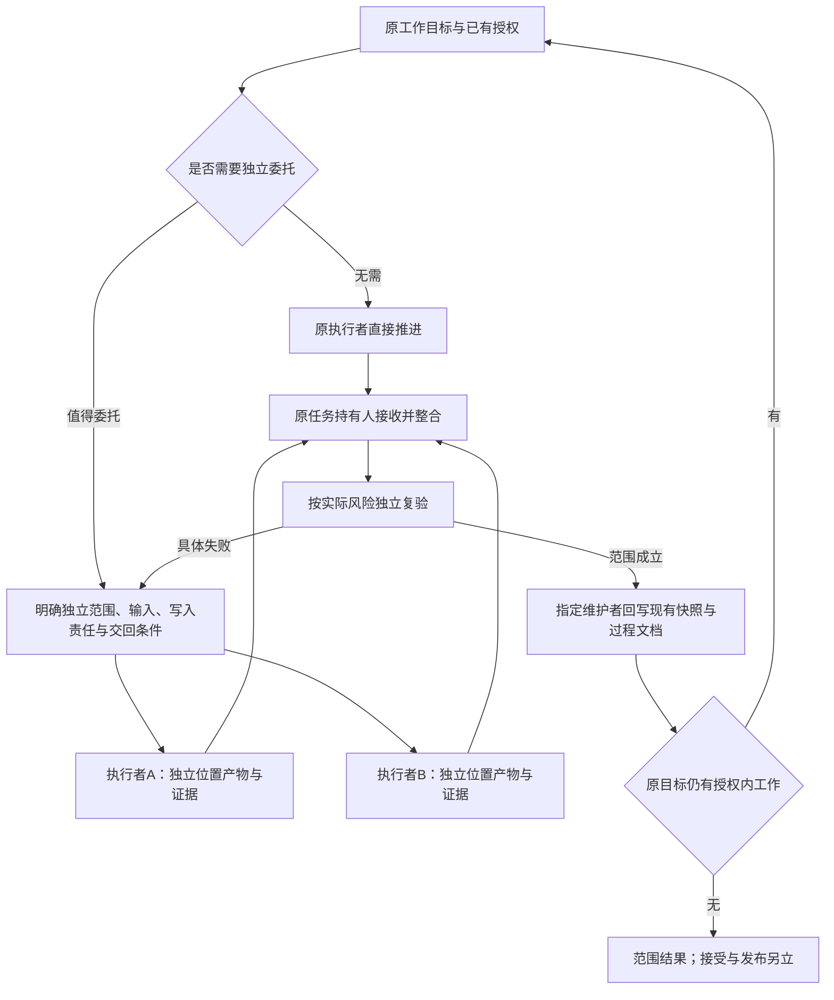

# 工作推进与过程接续

工作能力同时承担发现事项、整理顺序和推进授权内工作；局部字段更新只是其中一种模式。工作过程复用现有事项权威、当前快照和阶段文档，不增加独立日志技能或另一份任务总表。此分工已经507认可；实现仍是隔离候选，正式包与现用宿主没有替换。

[方案资料](../40-版本实施方案/2026-10-12-工作推进与记录方案.json)维护职责、归宿和边界；本地参考站从它与私有执行证据生成对照。[本轮核验](../40-版本实施方案/2026-10-12-工作推进与接续核验.json)绑定产物与检查，原始私有会话不进入公开仓库。

## 完整职责与三种进入方式

| 请求 | 此能力完成什么 | 何时结束或继续 |
| --- | --- | --- |
| 已明确某事项怎样更新 | 对账原对象、有效条件和授权字段，完成范围内更新 | 局部更新完成即可返回；不追加全局分析 |
| 整理工作并继续推进 | 从材料发现事项、核对责任、与现有权威归并、提出顺序，完成不受阻的获授权动作 | 准备结果回到原目标；一处依赖只阻塞相关动作 |
| 新读者接续已有工作 | 从当前快照和关键过程确认有效版本、已成立与剩余项、写入责任和下一动作 | 原任务允许且资源充分便继续；缺源码或渠道时交付可用准备并说明依赖 |

`work-update`暂用原实验名，显示职责已经扩展。它是可直接请求的次要能力候选，不要求用户先调用what、why、how。新产品取舍、独立创作表达或单一故障修复仍按自己的目标进入；在工作推进内部用到这些动作，不自动建立新的主要目标。

## 记录放回原来的归宿

| 归宿 | 保存什么 | 维护责任 |
| --- | --- | --- |
| 现有事项权威 | 当前事项与字段，例如任务平台或项目工单 | 有该对象写入授权者；写入、读回及业务完成各自成立 |
| PROGRESS.md | 当下目标、已成立、未完成、依赖与下一动作 | 当前工作树指定整合者；换阶段先把历史放入doc |
| 既有过程文档 | 关键决定、失败带来的新信息、交回版本和验收证据 | 指定维护者；并行执行者在隔离位置提交证据 |

只在关键变化或接续需要时记录，保留事项/范围、执行者与写入责任、时间与版本、动作/实际结果、证据/覆盖、未完成/下一责任人。已有记录足够时直接复用，不复制完整聊天、工具流水或再造日志文件。外部任务权威不是被PROGRESS替代；阶段证据也不取代当前状态。

## 多Agent（多智能体）协作

这是职责条件图，不是每项工作必经步骤。本轮实际发生两个执行者和一位独立审读者，由本会话整合隔离结果；没有实现新调度器或coordinate包，也没有联系原项目实施者。

## 本轮可复验观察

工作组使用真实历史会话摘录和16项局部替身，完成候选状态、建议顺序和派生视图。首次被独立审读拒绝：以10月12日为基准，仍把10月11日提醒当作排序依据，未说明日期已过。提醒和正式截止是不同字段，保留原值还不足以证明顺序正确。

据此在隔离候选中校准排序依据，并给具体视图组件增加可选参考日：支持的纯日期显示已过/当日/以后，未支持的时刻保留原文。修订增加下一执行者可用的PPT核对清单和ERP状态核查项，提醒日期不移动。首次、反馈、修订和复核分别保留，修订成功不能写成首次稳定或因果收益。

接续组是没有原对话的新读者，只获得包内普通文件与当前ERP两份文档副本。它准确区分134项自动测试、36组主路径通过与四项P2未通过，形成局部返修工作单；没有把旧同步修复重新当作本轮目标，也没有因历史额度恢复时间而假设原实施者当前可用。材料只在复制时核对文档指纹，不是原项目源码冻结或实际修复。

执行委托中曾把首次审读报告写成错误相对路径；工作执行者如实报告未读到文件，依据委托消息转述的完整反馈修正。这是本轮委托路径失误，不能把它的报告读取记为成功。

## 放在哪一层

| 内容 | 本轮去向 | 原因与下一门槛 |
| --- | --- | --- |
| 工作发现、归并、排序与推进 | 扩展work-update隔离包 | 有完整请求、独立结果与两种执行模式；还需自然任务及平台写回验证 |
| 工作记录与接续的归宿 | 普通共有方法候选 | 执行者和新读者采用同一原则；先验证消费者，不直接增加正式共有源 |
| 单状态生成多视图、日期提示、指纹 | 具体组件候选 | 本轮执行者实际运行，机械结果仍需语义核对；不增加业务权限 |
| 委托、单一写入、交回与整合 | 沿用coordinate设计及项目约定 | 本轮不创建新框架或日志技能 |

正式仍为两包、七份共有方法源、十四份副本及二十二文件快照。五主要/32方法/48接口是原设计地图；工作候选在本轮单列，不悄悄改旧地图或宣称已注册。上一轮创作、修复、两包本职以及五组17阶段证据继续保留。

## 当前验证结果与停止位置

工作R2经同一独立审读者增量复核为PASS_WITH_LIMITS，接续首次同为PASS_WITH_LIMITS；这些是范围结论，不是总体可靠性证明。两执行者及审读者实际上下文均为gpt-6-luna/medium；七项视图组件与三项日期检查通过。输入匹配执行前登记，首次产物无漂移，正式134份源文件未改；正式打包检查仍为2包/22文件/14副本通过。

参考站保留15视图和上一轮五组17阶段，本轮单列两目标/三阶段。真实浏览器检查了新角色、阶段/任务切换、日期原值、来源冲突、冻结数据、文件入口、地址恢复、键盘操作、15视图以及1413/768/390宽度。检查工具发生选择器歧义、错误导航属性断言和一次脚本参数笔误；原记录保留并按实际界面合同纠正，没有修改产品来迎合断言。

此轮止于隔离候选、接续准备和文档/参考站同步。下一门槛是自然真实任务能否选择、读取并继续，以及具体平台获授权写回/读回；仍不替换现用库。
