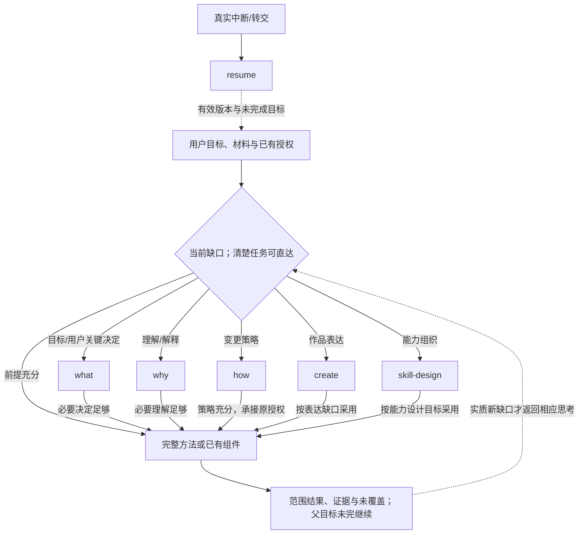
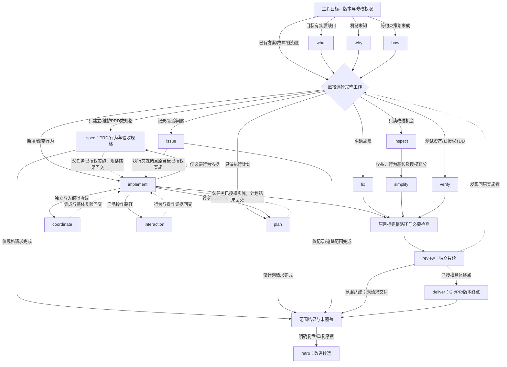
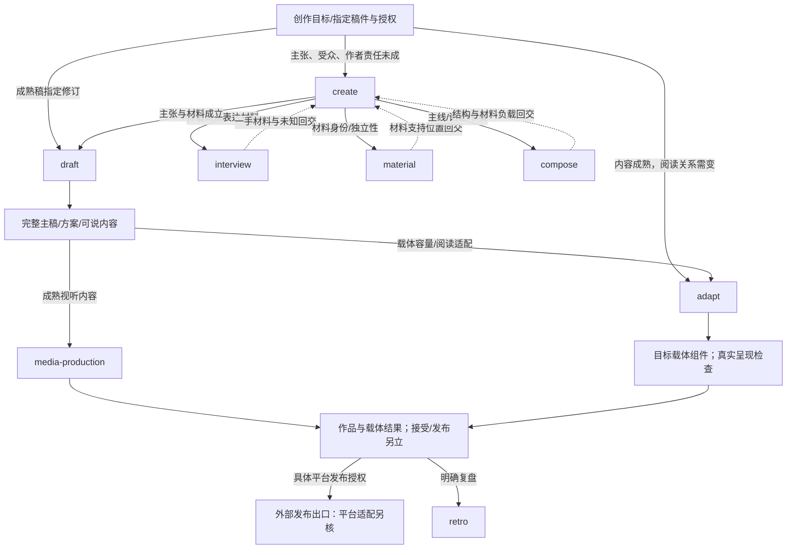
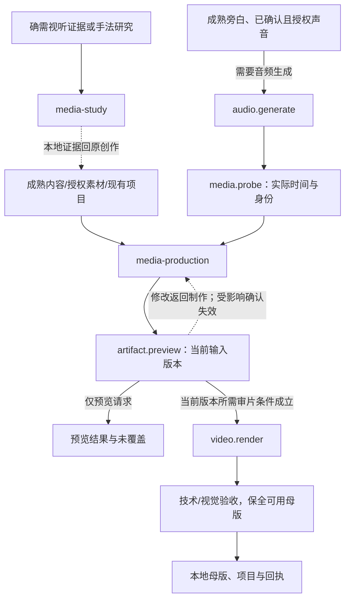
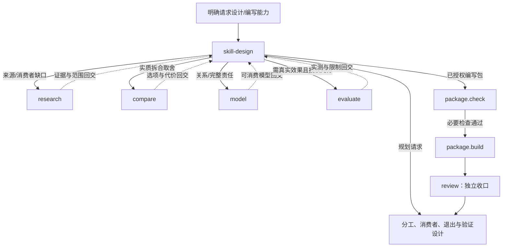

# 旧工作流与当前设计的条件接力

旧侧绑定已推送5f3b0f8的README原图；当前侧为5主要/32方法/48组件设计导航，不是技能迁移或运行证据。图只说明条件和返回，用户不必按what→why→how或三级顺序触发。规划请求止于规划，实施沿既有授权继续，子结果不结束未完成父目标。

旧README八图保留原文及固定行号；原边空条件不解除相邻正文的权限、基线或退出约束。当前内容平台发布仅为外部出口，不能冒充48接口内已实现发布能力。

## 当前任务入口

## 当前工程路线

`spec` 承接旧 `507-prd` 的完整需求规格职责，在界面中显示为“spec · PRD／行为与验收规格”。只写PRD、只做执行计划或只记录问题都可直接进入对应方法，并止于该范围结果；只有父任务已经授权实施，规格或计划的结果才回到实施。这里保留的是完整方法身份，模板与机械写入可交共有组件；未新增已实现技能包。

## 当前创作路线

## 当前视听制作

## 当前能力设计

## 直达与结束

明确故障直达fix，已有方案直达implement，现成任务图直达coordinate；成熟稿修订直达draft，清楚资料整理直达organize。只有当前缺口才采用主要思考或配套方法。

独立review的范围、提交/推送/合并/发布的授权与回执分别成立。模型、任务图、demo、网页点选、源代码存在不证明正式运行。真实中断采用resume；retro只在明确复盘或有重复摩擦时给改进候选，不自动改规则、工具或技能。
