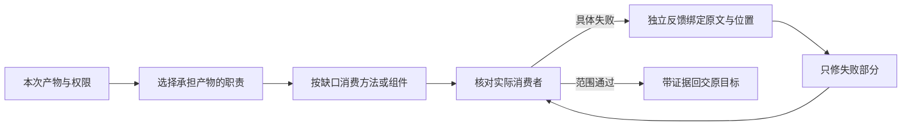

# 消费者对账修复与条件验证

本轮落实前阶段尚未完成的字段/条件/来源修复，以及主要与完整方法的选择边界。三份共有源和skill-design专用设计参考实际修改，两个包资源同步；新增一个标准库只读状态字段对账CLI。最终指定产物经独立反馈修订后通过，相邻构造例通过；首次执行仍不可靠，不能据此接受全局替换或声称宿主自然发现。

## 修复落点

| 缺口 | 实际改变 | 可观察信号 |
| --- | --- | --- |
| why过早选中、故障进入implement | 入口目录以独立产物定义条件，采用与跳过同层展示；37入口/完整方法和48组件分开按需读取 | 审查直接review、故障直接fix；内部理解不另立主要目标 |
| 输入信息漏掉、更新对象/字段不清 | [权威与返回](../../lib/methods/authority-and-return.md)先逐项信息有去向，再核对依据/对象/含义/字段 | 条件与原因保存；身份更改不暗改截止，未撤销状态保留，冲突可见 |
| 多来源被写成同一实验 | [事实与证据](../../lib/methods/evidence.md)逐主张绑定来源，连接证据不足则正文与未决同时分开 | 主稿、卡片、配文一致；有明确连接证据时允许合并 |
| 审查猜测放行 | [可观察验收](../../lib/methods/validation.md)检查实际字段/句子/未决并拒绝代表性错误 | 指出具体原句到输出位置的关系，初审漏检保留并纠正 |
| 已选政策的精确字段变化靠记忆核对 | [状态字段对账组件](../../lib/components/README.md)报告身份/字段变化，拒绝不符合政策的候选 | 错误候选拒绝，保留旧值与明确允许的替换通过，三输入指纹可复验 |

目录的分开读取是显式试验输入的修复，不是新增运行总控；85个候选和原多来源资料没有删减。只缩短首次可读索引，不从字节数推论成本或效果。整个请求的责任仍由当前消费者持有，方法片段借用不自动建立独立技能调用。

## 执行与审读

六个执行者同gpt-6-luna/medium，三个情境共十二份模型输出，另有一位独立语义审读者；包含首轮长目录、短索引、反馈修订和构造相邻请求。运行上下文/工具回执按范围核对，不检查隐藏推理，也不从引用名字推断完整理解。长目录发生读取截断；关键共有正文也有完整读取后仍失败的例子，不能把失败都归因于截断。

首轮工作更新遗漏条件和等待缘由，短索引下逐项信息对账改善，但身份澄清仍被推算成截止替换，并丢失未撤销的接受状态。独立初审同样漏检，按实际原值、输入作用和共有合同挑战后撤回。执行者只修失败字段、当前正文和未决，保留原版与其他对象；修订后独立核对通过。

创作初稿在未决中承认来源关系未知，但实际主稿、页内容与配文仍桥接身份。具体反馈后分别修三处消费者、保留其他内容，独立核对通过。构造相邻素材含明确复现关系，允许连接已证关系、保持另一来源独立；避免把修复变成一律不允许融合。

构造工作新修订明确要求取代旧精确字段时，输出才改变字段并移除已解决冲突；未涉及状态及其他对象保持。构造例不是用户新的真实业务指令或事实，不能据此写平台。

这是本次有失败的条件路径；不要求所有任务走多阶段，不前置固定what/why/how。当前通过依赖独立审读与反馈修订，不能写成首次执行已可靠或一种方法独立带来因果收益。

## 工程及组件边界

冻结工程样本的实现者直接fix，复现原动作后作同轮有界协调并保留新编辑；十三项回归及独立补证通过。第三协调等待出现更新时，后轮仍可推进；随后将该相邻时序保留为独立测试，最终十四项和原探针通过，源码与前十三断言保持。真实项目另有在途修改，样本只保持其冻结身份，不评价当前源树、自动集成或正式接受。

只读对账CLI实际集成到lib/components，十项CLI测试与三组重放／相邻构造快照的结构对账完成：拒绝无允许依据的截止变化、通过修订后保留旧值、通过与明确替换政策精确对应的新值。工具不理解原话、不验证备注或来源，不判断政策权威，不授予业务权限；政策意义仍由原指令和语义审读核定。两技能包没有隐式依赖该工具，独立使用的条件和错误从组件说明进入。

## 当前结果与未覆盖

网站保留前两阶段十五份输出，并新增本轮十二份；可以逐任务切换首次失败、反馈修订、相邻正例与直接选路，查看完整正文、表格、未决、原始JSON和只读组件说明。原输出、初审与校正版分别保留。工作表的备注按同一身份读取该轮完整快照，并明示来源；短表本身没有备注，不猜写或改写原JSON。横向结果表可键盘聚焦并提供可访问区域名称。页面、语义产物、隔离代码及宿主发现的证据各自成立，[本轮核验](../40-版本实施方案/2026-10-12-消费者修复核验.json)记录范围。

本轮未安装、替换、commit、push、发消息或发布；未真实写业务、验收图卡、完整工程界面/服务或用户接受。主要与完整方法的全部包化、自然发现和平台真实回读仍待后续任务验证。首次输出和独立初审的稳定性仍是开放问题，不以本轮修订通过隐去；本轮具体失败产物已修复并验证，至此结束该切片，不为假想未来增加总控和规则。

本轮三组字段对账保留私有可复跑输入和结果；公开十项单测尚未收录这些重放夹具。其中明确修改的第三组为构造输入，不是真实业务授权或平台写入。后续审计事实更正见[三份审计共识](三份审计共识与验证分工.md)。
