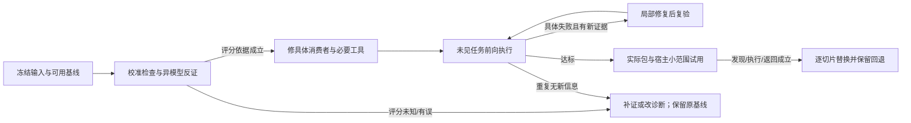

# 运行优化与异模型审计方案

状态：2026-10-12，三份审计已核对；最新[五组实际执行](Luna五组实际执行与消费者优化.md)完成消费者试验及指定切片修订，正式两包及共有实现未改。下面保留审计接收时的优化安排；随机未见任务、宿主自然采用和替换仍未验证。首次执行与独立初审仍有错误。

下一目标：让任务承担者按缺口消费方法与工具，在未见任务中完成产物并返回原目标；按已验证切片逐个替换。此文是待验证的方案，不能作为新增运行总控或固定前链。

## 优化顺序与失败出口

### 1. 冻结输入，先校准评分

把首次结果、审查结果和反馈修订结果分开。评分检查原话所约束的字段、句子与完成状态；先用已知错误和成立正例校准审读者。

进入下一步的依据：原错误能被指出且成立正例不会被一律拒绝；歧义保留为未决，不用审读者猜测填答案。

失败出口：审读者漏检或误拦时先修评分依据和材料范围，暂不据其评分改技能。

### 2. 异模型整体审计，找反例

推荐一个不同模型体系一次获得完整背景、现行合同、候选、历史失败与修订证据及文件绝对路径，独立核对依据并提出反例；用户不再分次提供材料。

进入下一步的依据：每项发现有原文依据、候选位置、影响和最小复现；分歧回证据裁决。

失败出口：完整背景包含历史结论，因此不称盲审。未知可返回UNKNOWN；多数票或置信度不构成正确证明。单文件上下文已交付，三份外部报告按来源分别核对；其中部分计数和归因已更正。

### 3. 只修真实消费者附近

优先工作字段/条件/接受状态与创作主稿/卡片/配文两个漏检路径。复用当前共有规则，用一个失败例和一个允许替换或融合的相邻正例检查；同义提示不反复增加。

进入下一步的依据：首次新执行能处理旧失败模式；明确新指令仍能生效；共有内容确被消费到具体产物。

失败出口：若两次同类尝试没有新信息，改查输入、资源读取、输出结构或评分，不继续堆规则。

### 4. 精确约束交给已有组件

用state_diff比较身份、保护字段与已核定的允许变化；结构、闭包和一致性用可复验检查。语义含义、许可与来源连接仍由任务承担者判断。

进入下一步的依据：组件能拒绝真实错误，也接受与原指令对应的合法变化；原始输入与政策版本可查。

目标与失败出口：消费者不得将自填basis或组件PASS当成授权。当前组件没有真实性鉴别机制，已有独立语义审读仍不能自动绑定可信政策来源；需先验证来源与采用边界。没有语义依据时保留旧值/未决，并继续不受影响的工作。

### 5. 未见任务前向执行与有限修复

同任务/环境比较可用旧基线与候选；执行者只拿任务、资料、工具和授权，不拿答案或既有错误反馈。记录首次结果及用户介入，再单列审查后的局部修订。

进入下一步的依据：两条高风险路径的新输入及合法正例完成、直接消费者一致、原目标返回成立，未解决实质发现为零。

失败出口：关键值误改、条件丢失、未知关系写成确定或假称完成，阻止该切片接受。重复修复未缩小失败范围时暂停并换诊断。

### 6. 真实包与宿主小范围试用

先验证实际两包：单包离开作者仓库仍可用，指定宿主自然选择/读取/返回及缺依赖处理成立。其它候选只有对应真实路径仍有缺口才包化；平台写入/回读、图卡呈现和正式工程集成另验。

进入下一步的依据：已实现切片在新会话完整完成并保留回退点；之后逐个替换可用基线，不一次替换整个库。

失败出口：显式给目录、参考页选择通过或一次修订通过均不代替宿主发现；未实现方法不冒充已注册技能。

这六步是开发和验收的安排，普通用户任务按当前缺口直达。what/why/how/create/skill-design不成为固定串行前置；已有明确故障内部理解机制仍属fix，成熟稿修改可以直接draft。

## 优先完整路径

| 路径 | 条件采用与完成 | 仍未验证 |
| --- | --- | --- |
| 工作整理与既有状态更新 | 请求明确 → 直接整理/更新 → 方法对账 + 必要字段组件 → 返回原目标；身份、提醒、截止、状态、条件与缘由；完整快照/变化/表格/未决一致。明确取代时允许修改，不明时只停受影响动作。 | 候选资料消费者已重放；真实平台写入/回读未验证 |
| 已确认材料的创作 | 作者材料 → 必要成稿/改编 → 主稿、页内容、配文 → 实际来源关系审读 → 返回作品；未知关系在三处实际正文保持未知；明确复现证据允许结合。实际图卡与发布需要单独完成。 | 文字修订通过；完整新创作包和实际图卡呈现未验证 |
| 明确故障的修复与审查 | 已知故障 → fix → 原动作/必要回归 → 独立review → 回交；恢复已知正确行为；内部理解不另立why目标。先复用冻结样本原动作与14项，源码变化再匹配新基线。 | 历史冻结样本通过；当前ERP和完整新fix/review包未验 |

先处理工作更新和创作来源两条已有漏检路径；工程冻结样本提供第三条接力对照。其它候选只有路径缺口证据充分才实现，不能为填齐目录提前包化。

## 怎样衡量与停止

- 首次结果：关键字段/状态/条件是否正确，实际产物是否完成；与反馈后的结果分栏。
- 自主性：无必要问题、额外独立委托、全库读取、用户返工次数；方法片段借用不算独立委托。
- 接受与恢复：实质错误是否被检查拦下、合法变更是否误拦、失败是否只阻塞依赖动作、修订是否回原目标。
- 运行证据：技能版本、实际读取/调用、工具输入输出、返回与平台回读；描述/图不能代替。
- 成本/时延只记录实际运行数据，同输入/环境/预算再比较，不从索引字数或检查次数推算。
- 建议工程门槛：先覆盖每条高风险路径的关键反例与合法正例，再用未见过的输入做前向执行；任务与重复次数在执行前登记。
- 达标：约定任务产物完成、关键字段/条件/来源无实质错误、必要检查通过、独立审读无未解决实质发现，返回和回退成立。
- 有限修复：当前原目标仍由同一承担者持有；失败反馈指向具体位置，只修受影响部分。两次没有新信息或范围收缩时停止重复、改变诊断。
- 达标即止该切片；小样本零错误只支持进入下一阶段，不证明总体统计可靠性或成本下降。

执行前登记同条件输入、实际版本、工具/权限及必要正反例；执行者不拿答案或已知反馈。未见案例与重复次数是工程验证预算，在执行前定下，不从有限成功推出总体可靠性。评分允许不同合法解法，不强迫固定工具顺序；假称完成和违反关键条件仍阻止接受。

## 第三方模型的审计范围

507于2026-10-12明确纠正为一次性完整上下文，文件需要时直接在prompt写绝对路径。现行交付是一份含背景、已确认决定、实际与候选边界、85候选功能字段、旧30定位、失败/修订摘要、核心源码和构造案例的完整单文件；本地模型按路径读取，网页模型一次上传该文件。旧两阶段交付退出当前要求，历史准备证据仍保留。

审计者一次核对分工、消费者、评分与未验证项，并给出定位、反例、最小改动和验证顺序。上下文有历史先验，不宣称盲审或匿名效果评测。模型共识与历史PASS不作为接受依据；确定性约束由可复验检查支持，涉及意图和来源的分歧回原证据裁决。

完整文件内嵌核心原文、32完整方法及48接口功能字段和6构造校准例；旧30全部主文、全库上游原件、原私有会话、真实ERP树未内嵌，分别给必要定位与未验证范围，不能声称整库源码逐行审计。三份审计已由507提供；具体身份、可承接结论与事实更正见[共识记录](三份审计共识与验证分工.md)，不把作者提案自动当实施决定。

方案依据包含当前项目的[修复事实](消费者对账修复与条件验证.md)与[技能验证约定](../../next/skills/skill-design/references/replay.md)。外部方法参考：[Anthropic的Agent评测说明](https://www.anthropic.com/engineering/demystifying-evals-for-ai-agents)区分代码、模型及人工判断、建议模型评分校准并验证实际结果；[LLM-as-a-judge研究](https://arxiv.org/abs/2306.05685)报告位置、篇幅、自我偏好等偏差。本次完整背景审计是带历史先验的反证参考，尚无同条件因果或可靠性验证。

历史材料准备及当时未执行状态见[准备核验](../40-版本实施方案/2026-10-12-完整审计上下文准备核验.json)；当前三份审计理解与后续安排见[共识记录](三份审计共识与验证分工.md)。
