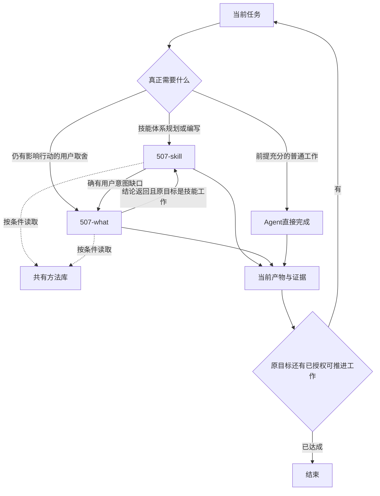

# 两能力与共有方法重建

2026-10-11，507明确将本轮收敛为两项能力：规划/编写/演进技能体系，以及明确目标与关键取舍；后者已定名507-what。该方向取代上一轮“保留30身份、默认19入口/11能力”的方案。旧技能成为可拆解素材，名称和原目录不再决定新结构。

## 本轮已经构建的对象

| 对象 | 实际职责 | 结束位置 |
| --- | --- | --- |
| [507-skill](../../next/skills/skill-design/SKILL.md) | 从任务、动作、条件与消费者规划技能、专用方法、共有方法和确定性工具；完成已授权的文件与验证 | 约定规划或技能包可交付；内部步骤结束后继续原目标 |
| [507-what](../../next/skills/507-what/SKILL.md) | 承接已有信息，澄清仍会改变行动的意图和用户取舍 | 下一动作所需信息已经足够；只需澄清时结束，已有实施授权时返回并继续 |
| [共有方法库](../../lib/README.md) | 7份按条件采用的方法，服务两个实际消费者 | 提供依据后返回当前任务，不自行路由 |
| [打包检查工具](../../next/scripts/package_skills.py) | 生成14份随包副本，核对两包闭包，构建22文件的不可变快照 | 当前选定包检查通过或明确失败；不执行、安装或发布业务 |

这些是新体系首批实际文件，使用入口见[next说明](../../next/README.md)。旧common/code/write保留已发布来源与回退材料，不是新体系的另外28个内部技能；本轮没有在宿主中混装或替换同名版本。

## 与上一轮的实质差异

- 以当前任务和方法组合形成能力，撤销“每个旧技能都要保留身份”的前提。
- skill自身增加能力规划、方法归属、组合、拆合和退出判断；what重建为行动所需的信息澄清，去掉固定问完分支、共同理解再确认和工程设计收口门。
- 意图尚未成形时先中性显化；已有真实取舍才给候选与推荐。why和5W2H按缺口使用，不形成强制七步。
- 共有源真实落在lib，两个包带生成的完整普通文件副本；主合同保留权限、完成和返回，方法细节可只改维护源再生成。
- 普通明确任务可以由Agent直接完成，两技能均不调用。规划或澄清中的简单方法也可直接读取，无需先启动另一技能。

返回原目标不是重启整套导航；承接已成立决定、授权与有效证据，只处理剩余工作。图表示条件关系，不是每次执行全部分支。

## 旧30的逐项素材去向

共有方法是片段采用，专用方法留在skill或what中；未来任务族不生成SKILL文件。当前身份重建2项、共有片段14项、专用片段1项、仅未来素材5项、本轮不进入8项。下表是本轮取舍，不承诺最终体系只需两个能力。

| 旧素材 | 本轮去向 | 采用方法 | 本轮边界 |
| --- | --- | --- | --- |
| 507-explain | 仅取共有方法片段 | clear-expression | 概念解释的诊断、术语债务和逐级升级不进入两包；只有当前澄清所需的最小解释方法进入共有层。 |
| 507-explore | 仅取共有方法片段 | evidence、question-frontier | 完整项目机制与代码影响调查延后；两包仅做目标所需的有界只读取证。 |
| 507-grill | 重建为本轮能力 → 507-what | evidence、decision-ownership、question-frontier、alternatives、authority-and-return、clear-expression | 重建为意图、问题与取舍澄清；移除固定追问仪式、代码项目目录规定、兄弟技能安装依赖和宿主图形硬编码。 |
| 507-handoff | 未来任务族素材 | 无 | 完整中断/跨会话交接暂不迁入，也不作为两能力每次的默认收尾；不自动抓取聊天或发送摘要。 |
| 507-research | 仅取共有方法片段 | evidence | 只迁来源身份、一手依据与证据缺口；完整外部比较报告和调研过程不进入两包。 |
| 507-skill | 重建为本轮能力 → 507-skill | evidence、decision-ownership、question-frontier、alternatives、validation、authority-and-return、clear-expression | 由任务/原子/消费者重新设计包，而非旧名称优先；专项主合同、host metadata与实际行为回放归本包。 |
| 507-taste | 未来任务族素材 | 无 | 真实视觉粗稿、正负反馈、资产组合等方法未来再按消费者设计；本轮不借名称将完整审美流程藏入共有层。 |
| 507-visualize | 仅取共有方法片段 | clear-expression | 只迁关系语义与最小表达；独立交互工具、网页、交互QA与发布不进入两包。 |
| 507-fix | 仅取共有方法片段 | validation | 只迁失败增量信息、复现/目标路径的验证纪律；故障修复、冲突处理、插桩不进入。 |
| 507-git | 本轮不进入 | 无 | 提交、推送、标签、版本和渠道发布与本轮两项交付无直接消费者；不迁脚本、不新建Git能力。 |
| 507-inspect | 仅取技能设计专用片段 | 包内专用方法 | 仅将职责、接缝和真实消费者证据用于技能结构设计；代码架构体检与独立报告不进入。 |
| 507-issue | 仅取共有方法片段 | authority-and-return | 只迁当前结论/取代历史的区别；远程工单、元数据及提交回读不进入。 |
| 507-prd | 仅取共有方法片段 | validation、authority-and-return | 只迁可观察行为验收和唯一现行权威；完整PRD模板、spec迁移不进入。 |
| 507-prototype | 仅取共有方法片段 | validation | 只取可证伪问题与证据/未知边界；两包可要求或使用最小证据，但不因此具备通用原型制作合同。 |
| 507-review | 仅取共有方法片段 | evidence | 迁证据分层用于本轮独立检查；独立审查仍须独立执行者，不能由共有方法假冒第三个正式能力。 |
| 507-setup | 仅取共有方法片段 | authority-and-return | 迁唯一权威、源到目标、消费者切换与退出方法；项目初始化、全目录迁移与个人规则修改不进入。 |
| 507-simplify | 仅取共有方法片段 | alternatives | 以消费者需知细节、重复规则和协调成本判断抽象；不迁行为不变代码简化执行合同。 |
| 507-test | 仅取共有方法片段 | validation | 迁公开行为、独立预期和反例用于技能回放；不迁TDD及生产代码测试维护。 |
| 507-ui | 本轮不进入 | 无 | 产品界面设计、状态反馈、平台交互和渲染验证本轮没有正式消费者，不迁到共有层。 |
| 507-breakdown | 本轮不进入 | 无 | 视频拉片、时间窗取证、可写VideoManifest和M3字段与本轮无关，现有脚本仅保留原件。 |
| 507-cast | 未来任务族素材 | 无 | 主题知识页聚合、知识库去重与图谱维护是未来任务族素材，本轮不注册或复制。 |
| 507-forge | 未来任务族素材 | 无 | 文章/方案/讲稿创作、作者声音与载体审计整体延后；不因都会写文本就并入skill包。 |
| 507-fuse | 仅取共有方法片段 | alternatives | 只迁竞争解释与反证方法；选题生成、作品边界、候选入库和图谱不进入。 |
| 507-mine | 未来任务族素材 | 无 | 已有材料到知识碎片的提取、去重互链与入库不进入；原子梳理不等于自动采用其知识库工作流。 |
| 507-ppt | 本轮不进入 | 无 | PPTX/HTML制作、布局工具与母版验证不服务本轮两能力，不抽取媒体库。 |
| 507-prospect | 仅取共有方法片段 | question-frontier | 只迁未表达动机的中性显化与问题依赖；作者亲历采访、引语归属和完整材料交付暂不进入。 |
| 507-rednote | 本轮不进入 | 无 | 图文分页、Live Photo、公众号封面与字体运行时本轮不迁。 |
| 507-remix | 本轮不进入 | 无 | 拉片包reader、borrow-map与原创视频创作包不服务本轮两能力，不抽成通用编排器。 |
| 507-video | 本轮不进入 | 无 | 视频制作、音频时间线、授权素材适配和版本化母版验收本轮不迁。 |
| 507-voiceover | 本轮不进入 | 无 | 声音档案、SSE、节奏处理、真实媒体时长与配音包均不服务本轮；不因含hash/json工具而泛化。 |

## 共有维护与独立使用

维护源和随包副本分开：源登记消费者和采用条件，副本由确定性工具生成并带源指纹。两包各自能在没有根lib和兄弟包的目录读取；相对引用越界、软链接、未登记文件、身份错误或副本漂移会报错。

不可变构建以包内实际字节确定身份。源或方法变化形成新快照，旧快照保留；已有目录内容被修改时工具拒绝覆盖。该机制解决重复复制和交付核对，不负责判断技能是否有用或自动评价Agent。

本轮的根库已经有真实消费者，因此可以验证具体共享关系。其他工具与媒体方法未迁入，后续应从实际任务需要重新组合。

## 验证与后续边界

本轮验证包括结构/引用/漂移、隔离包与负例、独立执行者的请求回放、文档及网站审读。完整结果见[核验记录](2026-10-11-两能力重建核验.json)。宿主发现、真实生产任务接受、跨模型和成本收益仍需实际证据；不以文件更少或入口数改变宣称改进效果。

后续能力不沿旧身份自动恢复。出现真实任务后，由skill判断需要哪种组合；共有方法没有独立工作时不升级成新的次要技能。

来源与过程：[已取代的上一轮方案](../90-归档/方案/2026-10-11-30项技能分层方案.md)、[30项原文审读核验](2026-10-11-30项技能审读核验.json)、[匿名会话摩擦](../10-架构与运行/会话衔接摩擦参考.md)。
