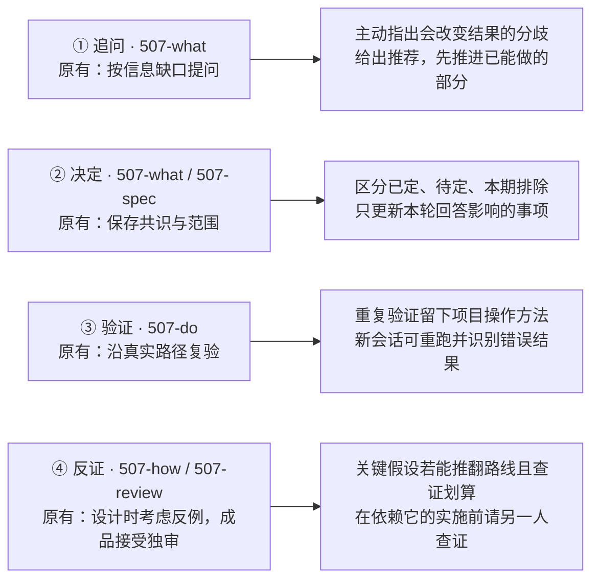

# 四项技能行为改造

每行从左向右读。四行分别对应可独立观察的行为。对照基线为 `0cef016`。

## 用同一个设置页任务读图

用户要求设置在重开后保留，本期排除云同步。

| 位置 | 期望动作 | 能识别的错误 |
| --- | --- | --- |
| ① 追问 | 多人共用设备时，解释设备共享与账号隔离的体验差异，给出推荐，同时查现有存储。规格已明确归属时直接实施。 | 默选设置归属，或把可先做的调查一并搁置。 |
| ② 决定 | 已定“重开保留”，待定“账号隔离”，本期排除“云同步”。新会话收到“按账号”后只更新归属及其依赖。 | 把按账号保存当成恢复云同步的授权。 |
| ③ 验证 | 新执行者改值、保存、关闭、重开并读回实际值。单次改色只需查看实际界面。 | 成功提示出现，但重开后值丢失仍被判为通过。 |
| ④ 反证 | 方案若依赖未经核实的“存储已隔离账号”，由独立执行者用两个账号查证并返回结果。 | 将设计者的推测当作独立验证，带着它进入依赖该假设的实施。 |
