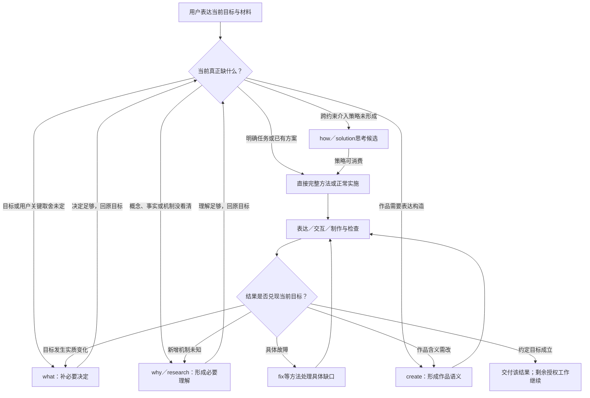

# how边界与真实任务路径推演

状态：设计研究。what、why、create、skill-design的既有命名决定保持；how的主要身份继续未定。只更新设计与本地参考网站，未改技能包、共有方法源或宿主。

## 本轮判断

how值得保留的思考是解法构造／变更策略：目标已成立、现状机制有足够理解，但跨约束的介入点、不变量、耦合、试验、迁移与退出尚未形成。它不通过“能串联方法、对整体负责、验证并返回”取得独有性，这些是各入口都要保留的通用合同。

先按策略缺口采用这项思考，主要how、下沉solution方法或留在消费者内部三种结构继续比较。本轮没有新增solution实体，也未移除主要候选。

## 相邻思考边界

| 思考 | 核心问题 | 独立结果 | 边界 |
| --- | --- | --- | --- |
| what | 要达到什么，什么算成功，哪些实质取舍属于用户？ | 足以推进的目标与关键决定 | 目标未定先澄清；已成立目标不重复询问。 |
| why | 现状/概念怎样成立，哪种解释可信，证据支持到哪里？ | 有依据的理解与解释 | 解释现状；how候选构造改变现状的介入策略。 |
| how | 怎样改变关键环节，在耦合约束下使目标成立？ | 有依据的变更策略：介入点、不变量、耦合、试验、迁移和目标验收 | 仅在策略未形成且无专用所有者时采用；不是所有行动入口。 |
| create | 如何形成符合作者、受众与事实责任的作品？ | 主张、结构、声音、论据与可用作品 | 表达策略留create；制作PPT/网站不自动进入how。 |
| skill-design | 怎样组织能力、方法和组件，降低使用与维护负担？ | 能力分工或获授权技能交付 | 技能体系已有专用思考所有者，不再套how。 |

“源码怎么运行”可以是why的机制理解，“作品怎样讲顺”属于create的表达构造；不能因为问题中含“如何”便调用how。技能体系的方案由skill-design持有，也不需再套通用how。

## 用户从目标到结果

使用者表达目标、材料、已有决定与限制。Agent先核对当前任务缺什么，可查事实自行取证，只把实质用户决定交回。用户不需要记住技能名，更不用依次触发what、why、how。

图中的连接是条件关系，不是运行时总路由。明确故障直达fix；已有任务图直达coordinate；成熟稿直接create局部修订；明确资料整理直达organize。只规划时止于规划，要求实施时在原授权内继续。正式提交、部署、发布和人工接受分别成立。

## 六个真实片段的匿名回看

范围：本地六个目的性样本，包括学习工具、交互demo、完整项目、两类创作及资料收录。只核对指定相连消息与命名材料，没有把全体会话统计成习惯或发生率。私有原会话定位、摘录与来源快照保留本地；公开文档只放匿名摘要。

实际顺序与事后建议分开。历史测试、构建、交付、取证及回执只按所取记录解释，本轮没有重跑这些项目；新角色映射不证明当时调用新分层。

| 片段 | 实际动作顺序（摘要） | how判断（设计推断） | 记录终点的边界 |
| --- | --- | --- | --- |
| 本地中文学习工具 | 提出交付范围问题 → 按第一版假设继续研究与制作 → 收到用户选择后收口 → 新增动态图与具体反馈 → 按需建立工程依据 | 初版未显示必须独立how；若新增关系图有难以确定的状态/交互策略，可局部采用策略思考。 | 记录报告本地第一版与多轮修订；后续仍有反馈，历史检查未在本轮复跑。 |
| 已有决定的交互demo | 承接既有决定 → 隔离原型实现 → 检查发现问题后返回修复 → 交付试用路径 → 用户认可并交正式实施 | 本例直接整合已有决定，how可跳过。只有介入方案或演示策略尚未形成时才采用。 | 用户明确认可演示；原型与材料身份核对。没有证明正式客户端或每项用户实测完成。 |
| 完整项目的实施与验收回返 | 从已有实现走完整路径 → 发现问题，最小修复并复验 → 整理剩余范围与接手依据 → 工程报告完成后独立验收 → 回交原执行者，返修后再验 | 项目可能需要how的跨约束变更策略，但本段主要证明完整实施/独立验收及回返；不能据此认定主要how已获实测验证。 | 所取两轮首版验收都未通过，末态为继续返修；这不是之后版本的永久状态。 |
| 路演作品：主线重组与载体反馈 | 核对成品与排除范围 → 诊断讲述问题并提主线 → 用户明确授权重组 → 生成新成品，保留播放边界 → 新反馈回载体问题 | 没有独立how的必要；“怎样讲顺”属于create的表达策略。 | 代理报告新版成品；实际播放与最新样式/声音修正仍未在所取记录中完成。 |
| 源码教材：准确性与作者修订 | 读指定稿，区分内容存在与准确 → 结构建议遭作者纠正 → 授权重写并交主稿与阅读版 → 载体反馈一度改变教学主次 → 回到作品语义，再完善图示 | 机制理解与教学组织均有专用所有者，未显示需要单独how控制。 | 记录有主稿、阅读版和多轮修訂报告；本轮未复跑其源码实验、设备或阅读体验。 |
| 组件资料的研究与收录 | 核对原库与查重 → 看内容与技术边界 → 写入与回链 → 读回报告范围 | 明确资料收录可跳过how和其他主要入口。 | 代理报告完成收录与读回，并明确没有安装/运行示例；本轮未重新访问原节点。 |

学习工具的可见消息顺序是先提范围问题、代理按第一版假设继续研究制作、用户答复后再收口；阶段并非严格串行，不能把后到确认写成开工前确认。所取消息也不独立证明所有工具执行先后。what并非每次任务的固定前置阶段。demo承接已确认决定，终点是观察、认可和正式实施依据；它也可有实现与独立检查，但不证明真实后端。完整项目则持续对整体范围和实际路径负责，独立验收失败回原实施者，自动全绿或单片通过都不结束整个目标。

创作持续保有作者主线、声音、材料与事实责任。why可补技术理解，what处理实质作者取舍，但“如何讲顺”属于create；教学顺序与正文显隐改变含义时返回作品语义，字体、已成立图示或媒介故障可局部修正。资料收录已有明确目标，研究和组织即可，不把组件示例存在误写成开发新网站。

另有一个原会话续办反例：一片通过后协调者结束，用户指出整体尚未完成后恢复。它支持通用父目标继续合同，不能作为how必须独占协调的证据。

## 三种结构仍未定案

| 结构 | 成立条件 | 得到什么 | 代价或退出条件 |
| --- | --- | --- | --- |
| 保留主要how | 变更策略本身是稳定主要任务，跨约束、消费者与迁移的策略没有其他专用所有者。 | 以工程/系统解法构造为主要职责，按目标继续获授权实施。 | 若任何行动都被接管，便形成宽泛总控。 |
| 下沉solution方法 | 当前目标已有所有者，只需要可委托的介入或实施策略。 | 交付策略后返回当前目标；本轮未新增该方法实体。 | 不能复制create和skill-design已拥有的专用方案思考。 |
| 不设独立how身份 | 请求多数可由明确方法、已有方案或普通Agent直接完成。 | 策略思考保留在实际消费者内部，必要计划照常形成。 | 若独立策略任务确实频繁，需重新评估封装收益。 |

## 来源与验证边界

样本用于反驳固定what→why→how链并观察策略缺口；尚不足以证明主要how的稳定任务频率、选择可靠性、成本、跨模型或生产收益。网站是阅读与结构比较工具，点选不发消息、不执行项目、工单、入库或发布。

现有实现仍由[两能力重建](2026-10-11-两能力重建.md)及其核验定位；本轮总体分工见[思考、方法、组件](2026-10-11-思考方法组件分工.md)。本轮[数据、独立审读与浏览器增量核验](2026-10-11-how真实路径核验.json)已在各自范围通过。两项取证P2已修正；初版25项操作与最终6项顺序/宽度检查分别绑定各自HTML，旧QA只证明其绑定版本。
