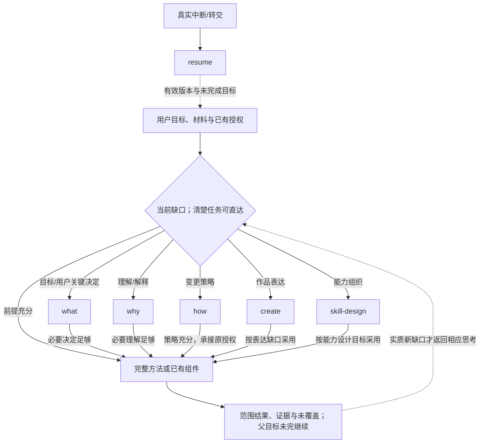
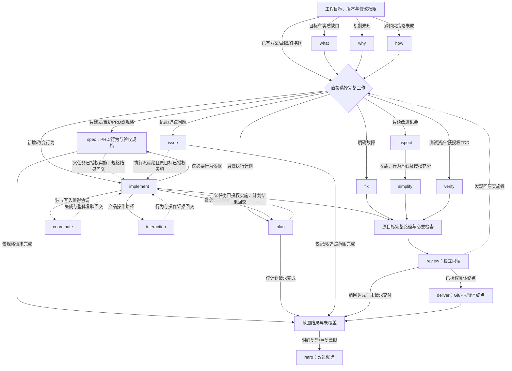
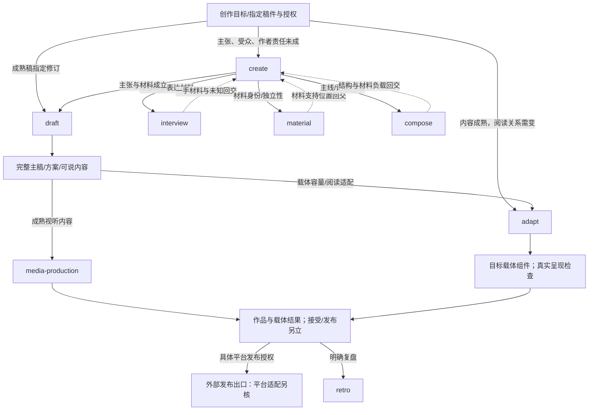
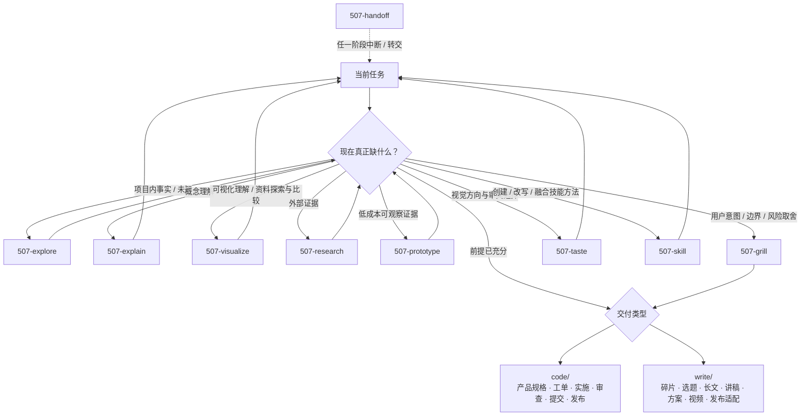
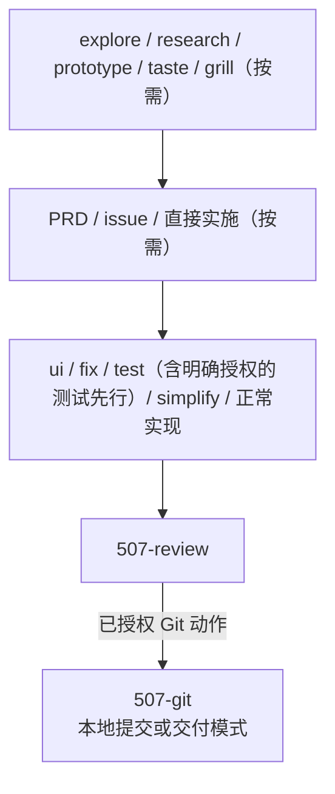
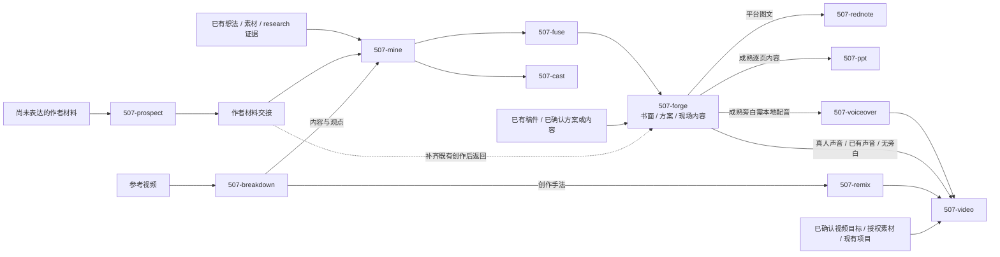

# 2026-10-18 导航整理前快照

本页保留整理前十份说明的全文、旧计划和验证入口。文中的“当前”、数量、下一步、命令及权限均限原文所在阶段，不作为当前任务或安装指令。原技能、方案、验证回执和首次失败文件保留原位。这里只重定位相对链接，原文内容不改写。

现行入口见[根说明](../../../README.md)、[技能清单](../../../next/README.md)、[当前进度](../../../PROGRESS.md)和[历史导航](../../历史导航.md)。

<a id="source-1"></a>

## 整理前文件：README.md

# Agent Skills

当前主线为 **0.3.0**：新版入口在 [next/skills](../../../next/README.md)，共有维护源在 [lib](../../../lib/README.md)。PR #1 已将截至 f8ec9f7 的分层实现纳入 main；本地主目录承接该基线，未接收的其它实验仍在独立 worktree 保留。本轮按明确授权将已审读取完整性修复与讲稿目标句组合接入未提交main及实际安装，当前650fd009、20入口／273文件，保留前批三条规则；当前状态见[本轮记录](../../40-版本实施方案/2026-10-18-读取完整性与讲稿目标句接入.md)。原027b、a299、87ea与c333回退保留；2026-10-15的issue接入见[历史记录](../../40-版本实施方案/2026-10-15-issue主线接收与安装.md)，文件安装与实际采用分别核验。版本内容、首次失败与反馈修订边界见 [CHANGELOG](../../../CHANGELOG.md#030---2026-10-15) 和 [主线归位记录](../../40-版本实施方案/2026-10-15-v0.3.0主线归位.md)。


2026-10-14阶段在[507-why](../../../next/skills/507-why/SKILL.md)落实陌生项目初识，主要职责与入口数保持不变；该阶段源码固定候选20入口／274文件，当时用户安装为19入口c333版；这是历史试用身份。一句请求的6-luna试用、具体卡点及独立判定见[本轮记录](../../40-版本实施方案/2026-10-14-why新项目初识实施与试用.md)。

2026-10-14阶段新增[507-product-map](../../../next/skills/507-product-map/SKILL.md)交互点功能梳理，源码候选现为五主要、十五次要共20入口；共有方法和地图组件已经落实。当时安装仍为下述c333的19入口，候选实现、材料试用与安装分别记录，见[本轮实施与试用](../../40-版本实施方案/2026-10-14-交互点功能地图实施与试用.md)。

此前c333固定版曾按用户授权接入真实用户环境，五主要、十四次要共19入口／262文件；两个工作位置重新扫描均发现19个启用入口。旧18入口固定副本保留恢复点；来源、独立读回及范围见[该阶段接入](../../40-版本实施方案/2026-10-14-c333使用环境接入.md)，历史接入见[原记录](../../10-架构与运行/新版用户环境接入.md)。安装与发现已成立，自然任务中的选择、接力和业务验收继续按实际工作观察。

此前已将三种协作尺度融入同一新版，覆盖工程、写作、研究与一般工作，见[三情境与生成任务网页](../../10-架构与运行/三情境协调与生成任务网页.md)。已有过程记录是状态维护源，临时网页由共有组件生成和重生成；需要新表达能力时先扩组件，生成HTML不直接编辑。

工作能力扩展与现有过程记录的分工见[工作推进与接续](../../10-架构与运行/工作推进与过程接续.md)；此前隔离候选与正式接入阶段分开；当前接入与试用见[work-update接入说明](../../10-架构与运行/work-update接入与真实工作试用.md)。

整体分工初步确认what、why、how、create、skill-design五个主要技能，可继续增减；knowledge下沉次要方法；职责继续按“特有思考、完整方法、共有组件”讨论，见[设计候选](../../40-版本实施方案/2026-10-11-思考方法组件分工.md)。以下说明上轮已有实现。

地图实施时，用户安装版为五主要、十四次要；该阶段源码另增交互点功能梳理，主要职责保持五个。产品组件查找与抽取职责已接入；新入口的真实产品工作仍未验证。完整入口见[新体系说明](../../../next/README.md)。资源闭包已检查，既有六类真实来源任务/九阶段试用保留原范围与版本，结果见[实际试用](../../10-架构与运行/创作与工程实际试用.md)。安装不把旧试用升级为新能力通过；接入、记录与恢复约定见[试用准备](../../10-架构与运行/真实环境试用准备.md)。

**源码与业务验证分别成立**：旧30通用能力的保留、合并和机制退出已逐项落实；专项媒体工具和真实任务效果仍有边界。准确状态见[整体覆盖](../../10-架构与运行/新体系实现覆盖.md)，首次卡点与修订由[本轮安排](../../40-版本实施方案/2026-10-12-创作与工程路径接入.md)承接。

| 当前问题 | 阅读入口 |
| --- | --- |
| 当前新版skill怎样使用和随库交付 | [新体系说明](../../../next/README.md) |
| 怎样规划、编写、重构技能体系 | [skill-design](../../../next/skills/skill-design/SKILL.md) |
| 怎样明确目标和关键取舍 | [507-what](../../../next/skills/507-what/SKILL.md) |
| 怎样发现、整理和推进现有工作 | [507-work-update](../../../next/skills/507-work-update/SKILL.md) |
| 怎样找产品组件库、复用或抽取重复界面块 | [507-component](../../../next/skills/507-component/SKILL.md) |
| 怎样梳理交互点、对照设计／实现／运行证据 | [507-product-map](../../../next/skills/507-product-map/SKILL.md) |
| 共有方法、消费者与生成关系在哪里 | [共有库](../../../lib/README.md) |
| 旧30拆成了什么，哪些本轮不进入 | [重建方案](../../40-版本实施方案/2026-10-11-两能力重建.md) |
| 调用、独立包和恢复应达到什么要求 | [库级规格](../../../spec/技能分层与共有资源.md) |
| 阅读设计、词义、来源与当前进度 | [DESIGN](../../../DESIGN.md) · [GLOSSARY](../../../GLOSSARY.md) · [来源](../../20-能力参考/skill-library-comparison/README.md) · [PROGRESS](../../../PROGRESS.md) |

本仓库按[Agent Skills规范](https://agentskills.io/specification)组织可独立读取的包，不以目录推断宿主发现或权限。当前清单源码已构建，安装、启用、提交和发布仍按各自实际状态判断。

## 历史设计流程导航（2026-10-11）

创作与工作处理的Luna重放、确定遗漏和应补职责见[正式会话重放评估](../../10-架构与运行/正式会话Luna重放与能力补强.md)；[核验回执](../../40-版本实施方案/2026-10-11-Luna创作与工作重放核验.json)区分十份输出、网站操作与尚未成立的真实平台/宿主效果。测试完成不等于候选通过或替换完成。

代码与项目里哪些职责会采用、哪些跳过，旧grill怎样回交完整方案，见[任务采用与决策接力](../../10-架构与运行/任务采用与决策接力.md)。[情境与观察资料](../../40-版本实施方案/2026-10-11-工程采用与决策资料.json)是网站的唯一数据维护源：7类任务/19个情境属于设计推演；3轮what属于模拟输入、显式读包的受控Agent演练。宿主自然选择与真实工程接力尚未成立。[本轮核验](../../40-版本实施方案/2026-10-11-任务采用与决策接力核验.json)分别记录设计、网页、演练和未完成的试用门。

五个主要职责的判断轴、问题示例、方法采用/跳过和典型失败见[特有思考参考](../../10-架构与运行/主要技能特有思考参考.md)。它是doc参考，实际技能合同与已实现范围仍以各SKILL.md和核验为准。UI／UX模式与按需提示见[共有设计资料](../../../lib/design/README.md)。

下图保留2026-10-11的5主要/32方法/48接口设计导航，该旧图不作为当前源码或安装清单，历史阶段清单与方法去向见相应记录和旧30处置，允许直接请求方法或组件；不表示历史候选都已注册、安装或运行。完整工程、创作、视听与能力设计的条件/返回见[工作流对照](../../10-架构与运行/工作流对照与条件接力.md)。图的唯一详细维护源在该文档；此处只提供入口概览。



<details>
<summary>查看当前工程与创作设计路线；都是按需采用</summary>

### 当前工程路线



### 当前创作路线



</details>

仅理解/调查/策略/规格/计划的请求止于对应结果；实施请求沿已有授权继续。提交、推送、合并、发布和人工接受分别成立，内容平台发布适配仍另核。下面的旧图是原发布导航，保留用于来源对照，不视为当前候选全部已迁移。

## 已发布基线与历史工作流

以下common/code/write的30项说明与流程保留已发布基线，作为方法拆解来源与回退参考。它们没有整体转入新体系，也不是本轮安装范围；本轮使用上方next入口。此前19入口／11能力的提案已被两能力重建取代，见[历史方案](../方案/2026-10-11-30项技能分层方案.md)。

<details>
<summary>展开已发布基线的30项说明与流程，仅用于来源追溯</summary>

## 适合谁

- 想把“和 Agent 聊聊”变成可复用工作流的人；
- 需要区分证据、决策、规格、实施、审查和交付的人；
- 在一个或多个支持 Agent Skills、或提供兼容技能加载机制的宿主中，希望共用一套方法的人；
- 想按需采用单个 skill，而不是一次引入完整框架的人。

## 工作流定义

`common/` 是**横向层**，不是进入 `code/` 或 `write/` 前必须依次通过的阶段。项目未知、概念障碍、资料探索与比较、外部证据、用户决策和会话移交可以在任意时点出现；任务已经清楚时直接进入交付动作。

`507-prototype` 位于 `code/`，但在流程上属于**前置证据层**：只有一个具体未知能低成本观察、且学习收益高于制作与清理成本时才进入，再把 verdict（结论）送回探索、对齐、PRD、issue 或实施。



流程图是导航，不是强制仪式。一个 skill 可以有多个候选出口；Agent 根据当前目标、证据和出口合同选择下一步，并用一句话向用户解释“现在用什么、为什么”。用户只决定其真正拥有的意图与取舍，不负责记忆或选择 skill 名称。

## 两条交付线

### 代码与产品



issue 支持 `draft（对话草稿）→ investigation（调查态）→ ready（执行态）`；调查和执行默认共用同一个远程 issue，证据进评论，当前结论回写正文，标签与负责人在每个远程状态都按仓库规范核验。

具体行为改动按需通过现有入口完成影响调查、工程设计与行为验收，方法入口见 [代码工作流](../../../code/README.md)。产品行为变化按项目规则先更新现行规格，小改无需另建完整 PRD 或工单；前提充分后直接实施。架构检查复用目标项目已有能力，并分别报告实际覆盖、新旧违规和未验证部分。

当前阶段、未完成事项、依赖与下一动作见根 [PROGRESS.md](../../../PROGRESS.md)，历史和详细证据由 [doc](../../README.md) 导航；README 不复制进度正文，具体工单保持自己的状态权威。

`507-setup` 采用统一的[项目启动与迁移标准](../../../code/507-setup/references/project-standard.md)：新项目建立工作依据，已有项目在授权范围内核对有效内容并迁移。README 管定位与入口，AGENTS 管工作规则，DESIGN 管共用设计，GLOSSARY 管词义，spec 管现行功能与验收，doc 管长期依据、说明和规划；按实际用途裁剪，不创建空文件，迁移后退出旧维护路径。

### 写作与内容



`prospect` 是可跳过的入口；若它由已有创意、主稿或现场内容为了补一手材料而调用，完成后返回调用它的创作动作，不强制进入 `mine`。

`grill` 贯穿需要用户确认的中心判断、方案边界和发布承诺；`507-forge` 的方案模式只写面向人的活动、培训、合作或项目方案，具体软件产品规格归 `prd`。已有稿件仅需表达润色时可直接进入 `507-forge` 的书面模式，保留原意、事实边界与作者声音，不强制补创意卡或走素材链；成文、结构重写与平台改编继续按写作合同推进。

## 目录

| 目录 | 目的 | 主要入口 |
| --- | --- | --- |
| [`common/`](../../../common/README.md) | 跨代码与写作的横向认知、理解工具、证据、决策和移交能力 | `507-explore`、`507-explain`、`507-visualize`、`507-research`、`507-grill`、`507-handoff`、`507-skill`、`507-taste` |
| [`code/`](../../../code/README.md) | 前置原型证据、产品规格、工单、实现、审查、提交、发布和架构回路 | `507-prototype`、`507-prd`、`507-issue`、`507-fix`、`507-review` 等 |
| [`write/`](../../../write/README.md) | 从作者材料、素材、观点和视频到文章、讲稿、方案、创作包、审片母版与发布适配 | `507-prospect`、`507-mine`、`507-fuse`、`507-forge`、`507-video` 等 |

领域词义见 [GLOSSARY](../../../GLOSSARY.md)，独立软件产物的现行要求见 [spec](../../../spec/README.md)，长期依据与历史见 [doc 导航](../../README.md)。

## Skill 速查

### 横向层

| Skill | 动作 |
| --- | --- |
| `507-explore` | 只读探索项目未知，在会话中维护已知、未知、当前可推进边界与证据边界；路径不明时形成可验证的证据化候选 |
| `507-explain` | 把用户不理解的单个概念讲懂：定义必须可指认，引入的术语必须讲、标黑盒或删掉；解释未成立时按构造、表达、载体三层排查，示意使用表格或受支持的 Mermaid |
| `507-visualize` | 将已成立材料制作成关系探索、条件观察、方案对照或独立阅读工具；按目标选择静态图、对话内交互或网页，核对关系、来源与实际操作 |
| `507-research` | 核实外部事实与机制，产出可被下一步直接消费的证据交接 |
| `507-grill` | 先查事实，再沿依赖关系对齐只有用户能够决定的取舍；复杂时用当前渲染器支持的 Mermaid 决策控制台显示 frontier、冲突与阻塞，简单关系使用文字或表格，并把结论路由到唯一当前权威 |
| `507-handoff` | 中断、换会话或转交时输出脱敏的临时交接摘要 |
| `507-skill` | 创建、改写、审视或融合技能方法；先判断职责与信息归属，再交付经相称验证的技能合同 |
| `507-taste` | 视觉方向没有自动判据时，先取观点再铺开粗稿，靠淘汰收敛；方向定了才分层、精修与机械验收 |

### 代码与产品

| Skill | 动作 |
| --- | --- |
| `507-setup` | 按请求维护项目依据或导航；覆盖初始化、规范迁移、只读巡检及局部 README／地图维护，分别核对范围与完成证据 |
| `507-prototype` | 用成本可控的可丢弃原型获得前置证据与 verdict |
| `507-prd` | 将已确认需求整理为 spec 中的现行行为与验收基准；按授权迁移旧要求，版本交付安排由 doc 承载 |
| `507-issue` | 草拟、创建和维护调查态到执行态的 GitHub issue 生命周期；评论留历史，正文与回链维护当前真相 |
| `507-ui` | 将已确认需求与视觉方向落实为产品界面，完成范围内实现、实际渲染与操作验证 |
| `507-fix` | 建反馈环，最小修复 bug、报错、回归或冲突 |
| `507-test` | 按请求维护测试或执行明确授权的测试先行开发，生产修改范围分别核对 |
| `507-simplify` | 保持外部行为不变，简化内部模块、抽象和接缝 |
| `507-review` | 审查明确交付范围的规范、需求与质量 |
| `507-git` | 按授权完成本地提交、推送、标签或版本交付，模式前提和实际结果分别核对 |
| `507-inspect` | 只读寻找架构摩擦并输出完整证据报告 |

### 写作与内容

| Skill | 动作 |
| --- | --- |
| `507-prospect` | 通过非诱导、按材料可问边界自适应成组的创作采访，显化作者材料、说话位置与未确认缺口 |
| `507-mine` | 把想法、指定素材或 research 证据变成彼此可区分、带证据身份的可复用碎片与材料单元 |
| `507-fuse` | 比较竞争解释与材料负载，把碎片组合成带作品边界的候选 idea |
| `507-cast` | 把成熟碎片簇聚合成知识库主题页 |
| `507-forge` | 按文章、正式方案或现场内容完成成文与修订，保留各模式的素材、作者声音、责任和验收边界 |
| `507-ppt` | 以“语义组件 × 设计语言 × 视觉呈现”原型选型并制作、验证可编辑 `.pptx` 或离线单文件 HTML |
| `507-voiceover` | 用已授权的本地声音档案把成熟旁白生成并验证为带真实时长的配音包 |
| `507-breakdown` | 把一个视频编译成可核验的 `video_completed` 拉片包 |
| `507-remix` | 从完成拉片包借创作手法，重组为原创视频创作包 |
| `507-video` | 把成熟内容、创作包和授权素材制作为经当前版本审片与技术验收的本地母版；Remotion 使用 Studio，其他已有引擎使用等价预览 |
| `507-rednote` | 默认用本地动态工作台把成熟主稿编译为三轴视觉、真实 DOM 分页的 3:4 连续文章；明确要求摘要时才提炼为一页一个观点，并可生成 Live Photo 与公众号封面对 |

完整触发词、输入输出、验收与出口以各目录的 `SKILL.md` 为准。

## 获取与接入

通过 Git（版本控制）克隆仓库，或从仓库页面下载源码：

```bash
git clone https://github.com/ssdiwu/507-skills.git
```

本仓库不规定统一的安装目录、复制或链接方式、递归发现能力、重载方式和显式调用语法；这些都是宿主实现约定，不是 Agent Skills 规范的一部分。接入时请按目标宿主的当前文档，将需要使用、且直接包含 `SKILL.md` 的 skill 目录放入或注册到其技能发现范围。

本仓库按 `common/`、`code/` 与 `write/` 分层组织。不要假定宿主会递归扫描这些目录；若目标宿主只发现技能根目录的直接子目录，应分别暴露所需的 `507-*` skill 目录，而不是只注册仓库根目录。

## 使用

skill 的 `description`（描述）说明任务动作、适用条件与易混淆边界，宿主可按用户意图自动加载。例如：

- “先看看项目里现在知道什么、还缺什么” → `507-explore`
- “查清这个外部项目实际怎么做” → `507-research`
- “把这两套方法做成可点击的比较，查看条件和后续去向” → `507-visualize`
- “把这套已验证方法融入现有技能，或提炼成新技能” → `507-skill`
- “先别写，采访我，把能一起问的创作材料集中问出来” → `507-prospect`
- “把这个观点挖成碎片” → `507-mine`
- “这个假设先做个便宜原型验证” → `507-prototype`
- “把调查中的 issue 补证后转成执行工单” → `507-issue`
- “把这篇主稿做成小红书图卡” → `507-rednote`
- “用我在 Voicebox 里确认的声音生成这份旁白” → `507-voiceover`
- “把旁白、录像和截图做成可审片的视频” → `507-video`

需要显式调用某个技能时，使用目标宿主当前文档规定的语法；本仓库不把任何一种产品的命令格式当成通用入口。不同宿主可以使用不同工具和调度方式，但同一 skill 的触发条件、修改权限、停止位置、产物、验收与出口合同应保持一致；宿主缺少必要能力时，应明确报告限制。

## 配套 Agent 配置

[`templates/AGENTS.global.example.md`](../../../templates/AGENTS.global.example.md) 提供可选的全局 Agent 行为规范示例。只有目标宿主支持 `AGENTS.md` 或等价规则文件、且使用者希望采用这套协作纪律时才需要参考；`507-setup` 只会在用户明确指定目标后使用它生成候选，不会自动覆盖现有配置。按宿主能力补充本地调度规则时，不要把个人称呼、机器路径、私有仓库或凭据同步回公开仓库。

项目局部约束始终优先于全局习惯。

## 设计原则

1. **一 skill 一项清晰职责**：同一职责中确有产物或权限差异时明确分流；相邻职责靠产物与路由接力，不用总控技能吞并。
2. **横向能力按需调用**：common 不是前置仪式；事实、理解、证据和决策在哪一层出现，就在哪里调用。
3. **出口合同显式**：每个 skill 声明完成信号、产物、候选出口与回退条件。
4. **Agent 负责路由**：用户决定真实意图与取舍，Agent 选择并解释 skill，不把框架学习成本转给用户。
5. **流程可跳过**：完整链路是地图，不是强制流水线。
6. **结果跨宿主一致**：共享技能不写特定产品的条件分支；工具过程可以不同。
7. **先证据后优化**：先定位真实问题、失败样例或验证信号，再扩大工作量。
8. **安全默认**：不提交密钥、个人/客户资料或未经授权的素材；外部密钥只通过环境变量传入。

## 依赖与边界

多数 skill 是纯 Markdown（标记语言）工作流，无额外依赖。带脚本的写作 skill 会在自身说明中列出运行时依赖和环境变量。请先阅读对应目录的 `README.md`。

本仓库不包含任何 API key（接口密钥）、账号 Cookie（会话凭据）、个人 vault（知识库）或客户材料。详见 [`SECURITY.md`](../../../SECURITY.md)。

## 测试

公共审查方法的随包副本可单独用 `python3 scripts/sync_review_evidence.py --check` 核对；维护者改动唯一源后用 `--write` 同步。

仓库根的确定性回归入口会显式运行各目录单测、无需真实 API 的 Breakdown 脚本、当前 PPT HTML 浏览器证据、Video 条件合同、PPT manifest 与 provenance 校验：

```bash
python3 -m pip install -r requirements-test.txt
python3 scripts/test_all.py
```

默认要求 Chrome/Chromium、FFmpeg、FFprobe 和 officecli；officecli 用于 PPTX 清单读回和真实代表页生成，CI 固定为 1.0.149 并校验下载摘要。PPT 媒体检查直接验证已提交原件，生成回归验证真实 SVG/PNG 备用图和新截图，不在测试副本中修补坏样例。只有明确接受静态 HTML 检查时才使用 `--allow-missing-browser`。MiniMax 真实 adapter/E2E、Voicebox 授权生成、完整 PPTX 在目标 Office 查看器中的逐页视觉验收和 Live Photo 设备验收是独立外部门，不包含在离线绿灯中。

## 贡献与发布

- 贡献方式见 [`CONTRIBUTING.md`](../../../CONTRIBUTING.md)。
- 安全问题见 [`SECURITY.md`](../../../SECURITY.md)。
- 变更记录见 [`CHANGELOG.md`](../../../CHANGELOG.md)。
- 使用条款见 [`LICENSE`](../../../LICENSE)。

欢迎提 issue（问题单）讨论 skill 边界、可复现失败和跨宿主行为。个人偏好优先留在自己的 `AGENTS.md` 或 fork 中。

</details>

- [Luna补强复验与工程接力](../../10-架构与运行/Luna补强复验与工程接力.md)：3共有方法实际补强，复验仍有语义问题；真实工程样本的审查/隔离修复与实际选路对照。

- [消费者对账修复与条件验证](../../10-架构与运行/消费者对账修复与条件验证.md)：首次失败、审读后修订与构造相邻例分开；共享源和只读字段CLI实际更新。

<a id="source-2"></a>

## 整理前文件：next/README.md

# 507-skills 新体系

同一个507-skills新版当前源码包含20个入口：五主要、十五次要，新增交互点功能梳理。职责与当前清单见下表；工作角色可直接进入，不构成固定流水线。旧30保留为来源与回退。当前安装已按明确授权从本地未提交main组合更新为650fd009，20入口／273文件，读取完整性与讲稿目标句的接入见[本轮记录](../../40-版本实施方案/2026-10-18-读取完整性与讲稿目标句接入.md)；前批027b的20入口／274文件、原a299及前一87ea的20入口／274文件及更早c333的19入口／262文件保留为回退。2026-10-15的issue补充提交、安装与新子代理读取结果见[历史接收记录](../../40-版本实施方案/2026-10-15-issue主线接收与安装.md)及[核验](../../40-版本实施方案/2026-10-15-issue主线接收核验.json)，不因构建自动视为安装；交互地图实施与试用见[本轮记录](../../40-版本实施方案/2026-10-14-交互点功能地图实施与试用.md)。

## 主要职责

| 实际入口 | 独有责任 |
| --- | --- |
| [skill-design](../../../next/skills/skill-design/SKILL.md) | 技能设计与编写（skill-design） |
| [507-what](../../../next/skills/507-what/SKILL.md) | 目标与关键取舍 |
| [507-why](../../../next/skills/507-why/SKILL.md) | 陌生项目初识、理解、解释与证据 |
| [507-how](../../../next/skills/507-how/SKILL.md) | 介入点与变更策略 |
| [507-create](../../../next/skills/507-create/SKILL.md) | 作者主线与作品责任 |

## 次要工作能力

| 实际入口 | 独立结果 |
| --- | --- |
| [507-setup](../../../next/skills/507-setup/SKILL.md) | 项目依据、规范迁移与局部导航维护 |
| [507-work-update](../../../next/skills/507-work-update/SKILL.md) | 工作发现、更新与推进 |
| [507-spec](../../../next/skills/507-spec/SKILL.md) | PRD、行为与验收规格 |
| [507-implement](../../../next/skills/507-implement/SKILL.md) | 实施与行为测试 |
| [507-component](../../../next/skills/507-component/SKILL.md) | 产品界面组件库查找、复用或重复块抽取与调用迁移 |
| [507-product-map](../../../next/skills/507-product-map/SKILL.md) | 指定功能的交互点及关系，同对象设计／实现／运行证据与可探索地图 |
| [507-fix](../../../next/skills/507-fix/SKILL.md) | 原动作复现与根因修复 |
| [507-review](../../../next/skills/507-review/SKILL.md) | 独立只读审查 |
| [507-issue](../../../next/skills/507-issue/SKILL.md) | 可独立接手的调查／执行工单；只起草也整理依据、下一动作与推进条件 |
| [507-coordinate](../../../next/skills/507-coordinate/SKILL.md) | 依赖、并行隔离与集成 |
| [507-deliver](../../../next/skills/507-deliver/SKILL.md) | PR表达与授权版本交付 |
| [507-retro](../../../next/skills/507-retro/SKILL.md) | 复盘与工具化建议 |
| [507-material](../../../next/skills/507-material/SKILL.md) | 作者材料、来源与支持范围 |
| [507-compose](../../../next/skills/507-compose/SKILL.md) | 组织、完整成文与局部改稿 |
| [507-adapt](../../../next/skills/507-adapt/SKILL.md) | 受众、容量与载体适配 |

明确故障、成熟稿、充分规格和已有任务图可直接进入相应能力；不因技能存在重跑what/why/how或全链。技能缺失可按同一合同直接工作，独立审查仍须另一执行者。

工单只起草时直接采用507-issue主文的正文组织方法，调查态保留关键未知并给证据动作和推进条件；行为、范围、依赖与验收充分后才作为ready交接。平台参考只在对应动作已获授权时读取，不把正文组织挂在平台许可之后。

## 了解陌生项目从哪里开始

当前项目已经可定位时，一句“这是个新项目，请帮我了解一下”即可表达初识目标。由[507-why](../../../next/skills/507-why/SKILL.md)主动调查必要维度，再用代表路径校准概览；[专用方法](../../../next/skills/507-why/references/project-understanding.md)留在该包内。可查事实不变成用户问卷，地图只按需要采用，不强制why到其它入口的链。源码实现、原生候选发现、一语试用和真实安装分别记录，见[本轮记录](../../40-版本实施方案/2026-10-14-why新项目初识实施与试用.md)。

## 初始化仓库从哪里开始

明确要初始化仓库时可直接使用[507-setup](../../../next/skills/507-setup/SKILL.md)。它采用[项目依据](../../../lib/methods/project-foundation.md)建立或归位 README、AGENTS、GLOSSARY、DESIGN、spec、doc，确需接续时维护 PROGRESS；内容与风险决定详略，不创建没有内容和消费者的空文件。维护地图时采用[项目导航](../../../lib/methods/project-navigation.md)。这些方法仍由setup持有修改范围与完成责任，不自行启动其它技能。

具体功能行为与验收需要成文时由507-spec承接；已有充分需求可直接进入工程实施。目标明确的仓库初始化不必先走what、why、how。

## 产品组件工作从哪里进入

直接要求查产品组件库、复用现有组件或将重复界面块送进库时，可使用[507-component](../../../next/skills/507-component/SKILL.md)。已有适用组件先采用；库内没有且有多个确定使用位置才抽取并迁移已有调用；单处使用留原位。结果返回原页面或功能，页面操作、状态与反馈仍由507-implement按需读interaction并验证。不要求所有界面任务先过此入口。

该职责修改目标产品的组件及相关调用，不写本技能库的共有方法／脚本；后者仍由skill-design负责。技能主合同可直接触发，lib资料按条件消费，不会自动发现抽取工作或自行写入组件。

## 资源维护与构建

lib是唯一共有维护源，无SKILL入口。当前30方法源、10脚本源；包内普通生成副本共215份，273构建文件。作者/作品/呈现、工程证据和按情境协调是按实际消费者维护的共有方法，专用内容留包内。数据以[清单](../../../next/packages.json)与[资源登记](../../../lib/catalog.json)为准。

明确要梳理产品功能与可操作节点时，可直接进入[507-product-map](../../../next/skills/507-product-map/SKILL.md)。[共有方法](../../../lib/methods/interaction-map.md)由product-map、how、spec、review按需采用；专用[地图组件](../../../lib/components/product-map.md)从同一记录生成包含树、筛选、证据详情、全部关系与登记路径，更新记录后生成新目录。普通策略、规格、审查和实现不因此强制建图。

coordinate已覆盖工程、写作、研究与一般工作，按需选择局部协作、任务图推进、持续协调；create/work-update按相应缺口采用同一协调方法。临时任务网页由[task_view组件](../../../lib/components/task-view.md)读取已有过程记录生成与更新，不能直接编辑生成HTML；表达不足改组件后重生成。无需网页或独立工作时直接完成，不新增技能身份或强制日志。

在仓库根运行：

```sh
python3 next/scripts/package_skills.py sync
python3 next/scripts/package_skills.py check
python3 next/scripts/package_skills.py build
python3 -m unittest discover -s next/tests -v
python3 -m unittest discover -s lib/components/tests -v
```

sync先验证完整候选再切换，失败恢复；check拒绝未登记身份、文件、越界、软链、语法错误、副本漂移及过期名称声明；build以内容指纹保留完整不可变快照，独占发布避免覆盖同时出现的目标。当前实现按精确清单维护，不是通用调度或安装器。

遇到旧技能引用时，setup、deliver、coordinate及skill-design按[旧引用方法](../../../lib/methods/skill-entry-resolution.md)采用包内名称查询；普通目标已有准确入口时跳过。查询只返回当前声明、旧来源及候选消费者，不执行技能、不核验宿主启用，也不扩大原任务许可。未知名称保留未知，多个消费者不成为固定调用链。历史原件继续保留；项目维护仍按具体授权原位修改对应引用。

维护者改变入口合同或旧能力处置后，先用[库投影组件](../../../lib/components/library-view.md)的`--emit-index`从真实清单生成并核对索引候选，再替换`lib/registry/skill-entry-index.md`并运行sync/check/build。索引只保存声明和合同身份，不把自身随包文件哈希写回自身；调用时只需包内脚本与索引，不要求作者仓库或兄弟包。

声称完整首次使用时，spec、implement和review按工程证据区分实际用户起点与夹具预置。用户必需的配置、绑定或确认被预置后仍是未验证；明确只验已绑定项目或SDK切片时保留该范围，不额外扩成全产品验收。

本轮按真实试用卡点校准当前信息与授权采用、完整目标对账及更新后新建消费者的验证；交付回报明确完成、是否符合有效预期和具体差距。主要职责和采用关系保持原边界；新增产品组件次要职责的验证及接入状态由根PROGRESS记录。

## 已验证与未覆盖

[本轮路径安排](../../40-版本实施方案/2026-10-12-创作与工程路径接入.md)与[整体覆盖](../../10-架构与运行/新体系实现覆盖.md)区分源码、显式菜单试跑、实际工具、独立审读、宿主自然发现及正式业务。当前进度见[PROGRESS](../../../PROGRESS.md)。

原三入口接入见[历史work-update试用](../../10-架构与运行/work-update接入与真实工作试用.md)；原两入口及候选记录保留阶段身份。HTML只证明该载体，不能作为图片、PPTX或视频制作完成。

<a id="source-3"></a>

## 整理前文件：lib/README.md

# 共有方法、做法与设计资料

lib是当前非Skill资源的唯一维护源，不自行路由或获得写入权。当前30方法源、10脚本源，以及按需组件说明与设计资料；实际消费者、采用条件见[catalog](../../../lib/catalog.json)，随包路径见[next/packages](../../../next/packages.json)。源改后统一生成普通副本，不手改副本。

## 方法与消费者

原七份来源、决定归属、缺口、反证、验收、权威返回、清晰表达继续使用。新增author-and-source由create/material/compose/adapt消费；artifact-contract由create/compose/adapt消费；artifact-rendering由compose/adapt消费；engineering-evidence由spec/implement/fix/review消费。主入口保留触发、权限、产物和结束。

本轮原位校准authority-and-return、evidence、validation与engineering-evidence，直接消费者仍按具体条件采用；完成回报不替代实际目标验收，不要求新日志、总控或全量必读。

## 具体组件

[components](../../../lib/components/README.md)提供state_diff、work_view、check_run、render_artifact以及原样复用的check_prose/check_spoken。状态/检查/呈现分别完成其局部确定性工作，不代替许可、语义、作者或业务验收；PNG/PPTX/视频未因HTML呈现而完成。

[design](../../../lib/design/README.md)保留16模式、原5提示与来源，并增加成稿适配提示；资料不是技能或通用产品组件。当前技能只携带声明采用的文档，其他资料不成为隐式安装依赖。

工作专用接续方法保留在work-update包内；其余次要方法和48组件接口继续按真实任务取舍，不为了候选数量预造文件。当前范围与未覆盖见[整体覆盖](../../10-架构与运行/新体系实现覆盖.md)。

[task-coordination](../../../lib/methods/task-coordination.md)由coordinate/create/work-update按需消费，承载跨领域局部协作、任务图推进和持续协调；[task_view](../../../lib/components/task-view.md)由coordinate/work-update携带，读取已有记录生成临时网页。记录更新重跑组件，呈现不足先扩组件；不直接手改生成网页，不建另一套人工状态或日志。

2026-10-13按旧30实际消费者补齐研究、原型、架构、行为不变、交互、作者采访、知识入口、媒体、视觉与真实接续方法；共有源28份，脚本9段。资料不自行路由。当前清单投影与实物回执见[组件](../../../lib/components/README.md)，逐项来源与退出见[处置记录](../../40-版本实施方案/2026-10-13-旧30能力处置.json)。

507-component按条件消费evidence、behavior-preserving-change、validation与authority-and-return。它在目标产品查库、采用或抽取界面组件，不是修改这里的技能共有库；本目录的资料无入口，也不自行发起该工作。

[skill-entry-resolution](../../../lib/methods/skill-entry-resolution.md)用于旧引用需要定位当前职责时，由setup、deliver、coordinate及skill-design消费；[生成索引](../../../lib/registry/skill-entry-index.md)和既有library_view提供按名查询，声明、宿主存在与原任务权限分别判断。工程证据另补实际目标起点与夹具预置的区分，仍由既有spec／implement／fix／review按条件采用，不增加总控或新的测试入口。

[interaction-map](../../../lib/methods/interaction-map.md)承载交互点身份、包含与操作关系、同对象三维证据及覆盖判断，由product-map、how、spec、review按条件采用。[product_map](../../../lib/components/product-map.md)由product-map携带，读取同一JSON生成可探索地图；生成器不采证、不将源码推为跑通，也不成为业务需求权威。

<a id="source-4"></a>

## 整理前文件：lib/components/README.md

# 工作状态的确定性组件

`state_diff.py`是`artifact.check`的一个确定性适配：按选定政策比较两份记录快照，报告实际字段变化、身份变化与拒绝原因。仅用Python标准库，只读三个输入文件，JSON写到标准输出，不访问网络、不写业务、不安装技能，也不授予平台权限。它可独立使用；work-update通过清单携带普通生成副本。

```sh
python3 state_diff.py --baseline baseline.json --candidate candidate.json --policy policy.json
```

基线和候选可使用记录数组，或基线唯一包装`{"snapshot":[...]}`、候选唯一包装`{"afterSnapshot":[...]}`。原始模型输出含额外字段时，调用者先提取指定数组并保留原输出版本；不能把多个候选包装混在一起让组件猜。每条记录须有唯一非空字符串id。

政策示例：

```json
{"protectedFields":["deadline"],"preserveIdentities":true,"allowedChanges":[]}
```

受保护字段缺失或未经政策允许的改变会被拒绝；其他变化仍报告。`allowedChanges`只接受精确的`id/field/before/after/basis`记录，旧新值须与实际变化一致，依据非空；重复、冲突、多余或不匹配记录报输入错误。`preserveIdentities`默认true，新增/删除身份拒绝；false时只报告这类变化。

退出码0仅代表政策范围通过，1代表发现违规，2代表输入或运行错误。结果绑定基线、候选和政策文件SHA-256；缺参数、错误JSON/UTF-8、重复键/ID、歧义包装等错误返回JSON，不输出堆栈。`--help`显示命令帮助。

政策及允许记录的语义由原指令或独立审读核定。组件无法判断自然语言是否明确修订、备注是否保留含义、来源是否有关联；不能把它的PASS写成意图确认、整体产物接受或业务写入成功。

```sh
python3 -m unittest discover -s tests -v
```

测试覆盖拒绝无允许依据的日期变化、允许精确对应的变化、字段缺失、身份/JSON/政策错误、非保护字段报告及缺命令参数。

## 单状态工作视图

work_view.py从基线记录数组与一个候选对象（records、显式viewContract.activeStatuses及按需的unresolved/priorityAdvice/nextActions/newCandidates数组）生成snapshot.json、views.json、work.md和输入/输出SHA-256清单。只用Python标准库；只读输入、仅写不存在的指定输出目录，不访问网络或业务平台。

```sh
python3 work_view.py --baseline baseline.json --candidate state.json --out-dir views-v1 --reference-date 2026-10-12
```

reference-date由调用方给定，可选，仅比较支持的YYYY-MM-DD日历日期；缺日期与显式null分别保留，带时刻/时区的值保留原文，不猜测新日期或截止。提醒已过不表示完成。activeStatuses决定视图划分，退出活跃视图不表示业务完成，新增候选不自动成为原事项。

输出RENDERED只表示派生成功，exit2表示输入/运行错误；拒绝重复键、重复ID、缺身份/标题/状态、无明确活跃状态或已有输出目录。Markdown单元格转义；JSON输出保留数据原值。字段对账继续独立执行，权限/正文语义由当前承担者核对。

两个组件的唯一源为本目录，work-update/scripts副本通过next的生成工具维护。脚本不创建任务系统、日志技能或路由器。


## 创作与工程组件

- check_run.py接受--argv-json、--cwd、--log-dir、--timeout及可重复--source，记录一个真实检查命令、退出/超时、日志指纹及源前后。目录已存在拒绝覆盖。退出0/1/2分别是命令成功、命令失败、准备/运行输入错误；选择断言、业务判定与授权仍由消费者承担。
- render_artifact.py接受--input与新的--out-dir，按artifact-rendering合同生成cards/deck/site离线HTML、原内容与指纹清单。来源ID须可解析，文本转义；现有输出拒绝覆盖。仅证明HTML生成，实际阅读需看最终页面，不生成PNG/PPTX/视频。
- check_prose.py、check_spoken.py从已发布forge原样提取为唯一源，接受文本路径与--json；只读提示，不自动重写或裁决接受。原算法与断言保留，旧目录继续作为来源/回退，尚未退出旧技能。

所有脚本仅标准库；共有说明text-checks.md和设计提示按清单携带普通副本。现有字段组件的语义许可限制保留；本轮没有通过它判授权。脚本行为检查位于tests，运行python3 -m unittest discover -s lib/components/tests -v。

## 从既有过程记录生成任务网页

[task_view.py](../../../lib/components/task_view.py)按[组件合同](../../../lib/components/task-view.md)读取明确JSON数组路径或Markdown唯一标题下的任务表，以字段映射生成任务、依赖、报告状态与验收记录分开的离线网页。当前消费者是coordinate/work-update；无需网页时不运行。

原记录修改后用同一组件与输出根重生成；历史版本保留，当前入口更新，坏输入或手改生成文件拒绝。渲染器能力变化形成新身份，不能直接编辑HTML补状态或布局。只读投影与版本登记不是新的工作日志、任务数据库或授权来源，也不会自动派工、联网或发布。当前七脚本包括此组件。

## 当前库投影与实际成品回执

[library_view](../../../lib/components/library-view.md)按显式维护清单输出当前实现、旧30处置与待补；[artifact_receipt](../../../lib/components/artifact-receipt.md)记录实际文件身份与所列结构，媒体制作沿[工具适配](../../../lib/components/media-adapters.md)。前者不判业务效果，后者不判渲染、语义或接受。当前9段脚本，精确消费者以catalog与packages为准。

library_view另提供按名查询：`--index-file`配合`--lookup`只读一个生成声明索引，返回当前、旧来源或未知，退出分别为0／1，输入错误为2。查询可在单包外移后运行，不访问作者清单、兄弟技能、安装目录或网络。`--emit-index`是维护者的源投影模式，需要显式的四项源输入；打包检查核索引与现行声明一致，不能用旧快照冒充当前入口。两个模式与权限界限见[合同](../../../lib/components/library-view.md)。

## 从同一交互点记录生成地图

[product_map.py](../../../lib/components/product_map.py)按[合同](../../../lib/components/product-map.md)验证交互点、关系、路径与三维证据，从一份JSON生成包含树、筛选、详情、关系和路径的离线网页。源码声明与运行观察分开，未知及相反条件并存；结构与生成成功不证明语义或产品接受。更新同一记录后用新输出目录重生成，旧网页保持不变；现有目录拒绝覆盖。当前共有脚本总数10，以catalog与packages为准。

<a id="source-5"></a>

## 整理前文件：lib/design/README.md

# UI／UX共有设计资料

这里保存按使用问题选择的设计模式、原始来源与提示模板；不是Skill，不负责总路由。模式/原5提示的实际消费者仍是本地技能对照参考站；[载体提示](../../../lib/design/artifact-prompts.md)已由compose/adapt按条件携带，具体HTML执行器见[共有组件](../../../lib/components/README.md)。未来design、interaction、visualize的完整能力仍为候选。

- [模式资料](../../../lib/design/patterns.json)：16条模式的目的、条件、状态、语义、失败/输入/降级、反例、角色和组件归属。
- [提示模板](../../../lib/design/prompts.md)：交互合同、阅读比较、动效连续性、预览采用和目标路径核验。
- [来源与观察范围](../../../lib/design/references.md)：原站类别、本轮可见内容和未覆盖；私人笔记只保留私有证据。

共有模式以patterns.json唯一维护，网站从该文件生成展示。方法持有语义判断，组件只执行已成立动作；图片/页面/使用流程/交互模式/控件/动画机制是不同检索维度。看见Preview或Code入口不等于当前项目采用、运行或许可核对完成。

真实键盘/触摸、失败、中断、减少动效与目标设备在实际消费者环境验证。优先复用既有能力，参数随内容和项目方向确定，不固化外站例图数值。当前完整清单见[next](../../../next/README.md)和[共有资源](../../../lib/catalog.json)：按需提示进入登记消费者，不代表整套模式或所有载体已经执行，也不注册宿主。

<a id="source-6"></a>

## 整理前文件：doc/README.md

# 文档地图

当前[读取完整性与讲稿目标句接入](../../40-版本实施方案/2026-10-18-读取完整性与讲稿目标句接入.md)已同步main和实际安装，组合650fd009、20入口／273文件，未提交／未推送；自然采用和业务质量未验证。前批027b及以下阶段记录保留各自历史身份，不重开业务或环境任务。

2026-10-18的[续办依据与审查结论最小修正](../../40-版本实施方案/2026-10-18-续办依据与审查结论最小修正.md)已完成独立审查、main落盘及明确授权的本机安装同步，尚未提交。范围仅continuation、authority-and-return及507-review三处规则与必要副本／索引；当前安装027b1468，实际采用未验证，旧业务和环境任务不在本轮范围。

0.3.0主线范围、维护源归位及安装／试验边界见[主线归位记录](../../40-版本实施方案/2026-10-15-v0.3.0主线归位.md)；现行源码入口见[next清单](../../../next/README.md)，版本内容见[CHANGELOG](../../../CHANGELOG.md)。

[issue主线接收与安装](../../40-版本实施方案/2026-10-15-issue主线接收与安装.md)及[核验](../../40-版本实施方案/2026-10-15-issue主线接收核验.json)记录本次唯一接收范围、首次／反馈身份和安装／新子代理读取结果。以下阶段资料中的数量与“当前”均限各自记录时点，现行身份看上方记录与根PROGRESS。

2026-10-14新增的[产品组件入口实施与验证](../../40-版本实施方案/2026-10-14-产品组件入口实施与验证.md)说明507-component的查找／复用／抽取与返回边界。当前源码19入口，用户使用环境仍为前一固定18入口；宿主选择与真实产品任务尚未验证，历史记录保持原版本身份。

本轮[接缝修复与阶段回报标准](../../10-架构与运行/接缝修复与阶段回报标准.md)记录当前信息、完整目标与消费者生命周期的修订，以及完成／预期／差距的回报合同；[核验回执](../../40-版本实施方案/2026-10-13-接缝修复与复验.json)按实际完成结果维护。下方同日自主首轮保留原固定版本与未通过项。

最新[6-luna自主采用试用与改动落点](../../10-架构与运行/6-luna自主采用试用与改动落点.md)记录四个真实来源任务、六个固定轮次。工作与修复反馈后限定通过、作者文章首轮限定通过、完整原型未通过分别保留；[范围核验](../../40-版本实施方案/2026-10-13-自主采用试用核验.json)区分模型执行、组件改动与正式业务未成立。

当前用户发现位置为18入口，固定版、旧30处置与共有补强见[当前能力取舍](../../10-架构与运行/旧30能力取舍与共有补强.md)及根[PROGRESS](../../../PROGRESS.md)。此前[新版用户环境接入](../../10-架构与运行/新版用户环境接入.md)记录当时17入口的阶段，保留历史身份；当前实现以[next清单](../../../next/README.md)为准。

当前三种协调情境、跨领域职责及由已有记录更新临时网页的约束见[三情境协调与生成任务网页](../../10-架构与运行/三情境协调与生成任务网页.md)。该文档承接本轮新增方法与组件；下面六来源任务／九阶段保留此前构建身份。

下一轮进入真实环境前，先看[试用准备](../../10-架构与运行/真实环境试用准备.md)和[新版原子映射](../../40-版本实施方案/2026-10-12-新版原子映射.json)。外部原子用于比较，不作为追齐待办；继续复用项目已有过程记录。

先看[新体系实现覆盖](../../10-架构与运行/新体系实现覆盖.md)、[本轮实际试用](../../10-架构与运行/创作与工程实际试用.md)与[本轮接入](../../40-版本实施方案/2026-10-12-创作与工程路径接入.md)：同一新版已落实五主要、十二次要及部分共有库，六类真实来源任务/九阶段已完成范围内验证；下方三入口与更早资料保持历史阶段身份。

前轮[work-update接入与新试用](../../10-架构与运行/work-update接入与真实工作试用.md)记录同一新版当时的三个入口、共有资源与新6-luna的三任务五阶段；[接入核验](../../40-版本实施方案/2026-10-12-work-update接入核验.json)区分源码接入、反馈修订、网页与宿主/业务未覆盖。下方前轮候选和两包快照保持历史身份。

最新[工作推进与过程接续](../../10-架构与运行/工作推进与过程接续.md)说明完整工作职责与既有记录归宿；[方案资料](../../40-版本实施方案/2026-10-12-工作推进与记录方案.json)区分隔离候选、正式实现和多Agent责任。工作首次日期排序失败与无原对话接续分别记录，[核验回执](../../40-版本实施方案/2026-10-12-工作推进与接续核验.json)绑定当前证据，上一轮五组证据保留。

最新[五组实际执行与消费者优化](../../10-架构与运行/Luna五组实际执行与消费者优化.md)记录真实会话来源、9位Luna执行者/3位独立审读者、隔离work-update候选、现有两包本职和下游网站。首次失败、反馈修订与字段/语义/网页边界分别保留；[核验回执](../../40-版本实施方案/2026-10-12-Luna五组执行与优化核验.json)绑定本轮证据。


前轮[正式会话Luna重放](../../10-架构与运行/正式会话Luna重放与能力补强.md)覆盖创作与工作处理：同模型、两类目录、原话复核及十份输出，保留条件/缘由/截止缺口与来源疑点。[回执](../../40-版本实施方案/2026-10-11-Luna创作与工作重放核验.json)分别记录模型执行、实际工具审计、网站与未完成项；原始私有会话不进入公开仓库。

代码/项目的条件采用、grill接替与完整方案返回见[任务采用与决策接力](../../10-架构与运行/任务采用与决策接力.md)。网站从[工程情境与三轮观察资料](../../40-版本实施方案/2026-10-11-工程采用与决策资料.json)生成：7类/19情境是设计，3轮是模拟输入下显式读取what的Agent演练；[核验回执](../../40-版本实施方案/2026-10-11-任务采用与决策接力核验.json)保留浏览器、审读、源指纹及真实宿主/项目尚未成立的边界。

五主要的特有判断与相邻边界见[思考参考](../../10-架构与运行/主要技能特有思考参考.md)；旧README原图与当前条件接力见[工作流对照](../../10-架构与运行/工作流对照与条件接力.md)。UI／UX可复用资料由[共有设计库](../../../lib/design/README.md)维护，来源研究见[组件参考](../../20-能力参考/ui-ux-components/README.md)。

本轮设计与参考站的独立审读、实际操作、来源读取范围和未成立项见[UI与流程核验](../../40-版本实施方案/2026-10-11-思考与UI流程参考核验.json)，不替代技能运行与宿主采用验收。

PRD由spec承接的可发现性、spec/plan/issue直接进入及范围结束修正见[PRD增量核验](../../40-版本实施方案/2026-10-11-PRD直达与范围结束核验.json)；本次只核验设计和网站来源数据，未新增实现包。

五主要初步确认和全谱系职责审读见[能力评估](../../40-版本实施方案/2026-10-11-五主要与次要能力评估.md)，新增10方法/8接口均为设计候选，[核验](../../40-版本实施方案/2026-10-11-五主要与次要能力核验.json)区分设计、网页与未成立的运行效果。当前分工讨论见[思考、方法、组件方案](../../40-版本实施方案/2026-10-11-思考方法组件分工.md)，具体关系仍为候选，本轮没有迁移技能。上轮实际重建入口见[两能力方案](../../40-版本实施方案/2026-10-11-两能力重建.md)、[新体系使用说明](../../../next/README.md)和[共有方法库](../../../lib/README.md)。上一轮保留30身份的19／11提案已归档；其审读证据仍可追溯，不能作为当前结构目标。

当下目标、未完成事项与依赖见根 [PROGRESS.md](../../../PROGRESS.md)。本目录保存依据、安排和历史证据；分层与共有资源的理由见[架构依据](../../10-架构与运行/技能分层设计依据.md)，固定外部来源见[比较登记](../../20-能力参考/skill-library-comparison/README.md)，目标与验收由[库级规格](../../../spec/技能分层与共有资源.md)维护；现行版本的提交与推送核验见[2026-10-11交付记录](../../40-版本实施方案/2026-10-11-现行版本交付核验.json)，此前状态见[阶段快照](2026-10-11-现行版本交付前.md)；前轮入口整合与取舍见[技能体系精简](../../40-版本实施方案/技能体系精简.md)，产品 UI 职责与来源见[能力比较](../../20-能力参考/product-ui/README.md)，实际执行与边界见[验证记录](../../40-版本实施方案/UI能力整合验证.json)。技能编写与入口校准的前轮结果见[审视记录](../../20-能力参考/prompt-audit/2026-10-06/README.md)。

本轮30项的角色候选、最低合同、共有方法与拆合取舍见[逐项方案](../方案/2026-10-11-30项技能分层方案.md)，实际会话匿名症状与证据边界见[摩擦参考](../../10-架构与运行/会话衔接摩擦参考.md)，检查与未覆盖范围见[审读核验](../../40-版本实施方案/2026-10-11-30项技能审读核验.json)。该旧提案已被两能力重建取代，保留的是来源与审读证据。

可视化理解与比较的职责、来源和沉淀方法见[方法记录](../../20-能力参考/visual-understanding/README.md)，选择、执行与交付检查见[验证记录](../../40-版本实施方案/可视化理解与比较技能验证.json)。切换前的 UI 阶段状态保留在[历史快照](2026-10-09-UI参考原位迭代.md)，当前技能合同仍以各 SKILL.md 为准。

本仓库的当前权威说明以各级 `README.md`（说明文档）与 `SKILL.md`（技能说明）为主：

1. 根 [`README.md`](../../../README.md)：项目定位、安装、公开边界。
2. [`../write/README.md`](../../../write/README.md)：写作工作流及其接力关系。
3. [`../code/README.md`](../../../code/README.md)：代码工作流及其接力关系。
4. [`../common/README.md`](../../../common/README.md)：通用 skill（智能体技能）的职责。
5. [`../spec/README.md`](../../../spec/README.md)：独立软件与库公开调用／交付的目标及验收要求；当前包含 `507-rednote` 和技能分层与共有资源。技能合同继续以各 SKILL.md 为准。
6. [`../write/507-ppt/references/design-system.md`](../../../write/507-ppt/references/design-system.md)：视觉幻灯片的语义组件、设计语言、视觉呈现、兼容矩阵与载体支持权威。
7. [`../write/507-video/references/production-contract.md`](../../../write/507-video/references/production-contract.md)：视频制作合同、素材清单与时间基准的当前约束。
8. [`../write/507-voiceover/README.md`](../../../write/507-voiceover/README.md)：本地配音、Voicebox REST 接入、模型选择与配音包约束。
9. 各 skill 目录的 `SKILL.md`：触发词、操作步骤、输入输出与限制；[507-ui](../../../code/507-ui/SKILL.md)承接产品界面的设计、范围内实现与实际操作验证，方法来源见[能力比较](../../20-能力参考/product-ui/README.md)。
10. [`../DESIGN.md`](../../../DESIGN.md)：库文档和导航的共用阅读体验；具体产物继续遵循各自设计。
11. [`../GLOSSARY.md`](../../../GLOSSARY.md)：定义本仓库稳定使用的项目语言。
12. [`决策档案/`](../../决策档案/README.md)：记录难逆转、缺少上下文会令人困惑且存在真实权衡的项目决策。
13. [`20-能力参考/`](../../20-能力参考/README.md)：固定版本的外部原件、调研证据、许可证与适用边界；当前包含 ZCode 原件、方法融合记录、提示词审计、技能编写与触发／读取审视、Apple项目指令的规则／证据判断，以及 paper-polish 表达润色方法的来源与融合验证；参考材料不替代各技能的现行合同。
14. [`项目启动与迁移标准`](../../../code/507-setup/references/project-standard.md)：面向选定代码项目的初始化、存量迁移和开工条件标准；由 setup、prd 等按职责消费。本页其它条目描述本仓库当前实际材料入口。

doc 按长期产品依据、架构说明、外部参考、规划及历史职责组织，只创建已有实际内容的分段。当前功能要求进入 spec，术语进入根 GLOSSARY；本次迁移已退出旧术语和 rednote 版本目录正文的维护。只有被取代、放弃或纯追溯材料进入 `90-归档/`，不能仅因工作完成而归档。

各 skill 内部的 `doc/`、`references/` 与 `README.md` 仅解释该 skill 的局部实现或方法，不覆盖其上级工作流边界。历史 Git（版本控制）记录用于追溯，不作为当前行为规范。

已发布基线工作流维护在根 `README.md`、`common/README.md`、`code/README.md` 与 `write/README.md`；当前候选的详细条件图唯一维护在[工作流对照](../../10-架构与运行/工作流对照与条件接力.md)，根README提供入口概览。本文件负责文档权威与阅读顺序，不复制完整工作流。

当前how与用户路径讨论见[真实路径推演](../../40-版本实施方案/2026-10-11-how边界与真实路径推演.md)，仅设计研究；私有会话定位不进入公开文档。

- [Luna补强复验与工程接力](../../10-架构与运行/Luna补强复验与工程接力.md)：资源补强、失败复验与独立工程接力；实际选择和期望分开。

- [消费者对账修复与条件验证](../../10-架构与运行/消费者对账修复与条件验证.md)：入口边界、状态/来源消费者、只读组件与本轮证据。

三份外部审计已收到。[共识与验证分工](../../10-架构与运行/三份审计共识与验证分工.md)说明事实修正、不同作者提案和两条验证轨道；[对照资料](../../40-版本实施方案/2026-10-12-审计共识与验证资料.json)是网站的唯一议题维护源。该共识文件保留审计接收时计划；当前消费者/模型执行见本轮五组记录，随机未见任务与宿主自然采用仍未验证。[优化方案](../../10-架构与运行/运行优化与异模型审计方案.md)已同步该阶段，完整审计上下文保留历史交付身份。

当前旧30取舍及共有补强见[能力取舍](../../10-架构与运行/旧30能力取舍与共有补强.md)，精确维护源为[逐项记录](../../40-版本实施方案/2026-10-13-旧30能力处置.json)。

<a id="source-7"></a>

## 整理前文件：PROGRESS.md

# 当前 main 与实际安装 · 2026-10-18（读取完整性与讲稿）

[读取完整性与讲稿目标句](../../40-版本实施方案/2026-10-18-读取完整性与讲稿目标句接入.md)已按明确授权同步到main及实际安装。组合身份650fd009，20入口／273技能文件／215共有副本；前批续办、权威与审查三条规则保留。旧单消费者reader已并入adapt主文并退出活动路径，三份工具适配副本与讲稿目标句同步。

本批必要包检查、组合打包与273文件安装读回完成，旧027b已在发现目录外备份。main分支及HEAD仍为6d6f42c，未暂存、提交或推送；实际读取／采用、宿主刷新及业务效果仍未验证。AGENTS、网站、首次证据与旧独审不变，不搭环境、不重跑业务。

以下保留此前批次的main与安装快照，均限各自记录时点，不作为当前待办。

# 当前 main 工作区与本机安装 · 2026-10-18

[续办依据与审查结论三处最小修正](../../40-版本实施方案/2026-10-18-续办依据与审查结论最小修正.md)已完成维护独立审查、main落盘及本机安装同步。42个源码／生成文件与已审候选027b1468逐字相同；本轮仅替换实际用户安装目录中的39个必要文件，全部274个安装文件读回与main及已审包一致，仍为20入口／274技能文件／215共有副本。旧a299已在发现目录外完整备份。

507已明确授权从本地未提交main同步安装，覆盖前一阶段不更新安装的安排。分支仍为main，HEAD仍为6d6f42c；本轮未暂存、提交或推送。文件安装完成，宿主刷新未独立核验；自然采用、压缩后任务保持、依赖重判、审查意见处置与业务质量均未验证。AGENTS.md、网站及旧首次证据不变，不搭环境、不重跑业务。

以下保留继承的主线与历史快照，不是本批待办。

# 主线交付状态 · 0.3.0 · 2026-10-15

PR #1 截至 f8ec9f7 的八个提交已合并为主线基线，合并提交为0a20f54；本地主目录通过Git接收，未交换文件夹。0.3.0的版本日志与标签绑定主线交付记录，源码基线仍为20入口／274文件／215共有副本。

本轮未提交的精简、why取证优化与skill-design新版方法采用试验继续留在原worktree，不属于本次主线合并范围；其中方法采用仍未通过，后续未见任务对照尚未开始。主线归位时安装仍为c333；随后新增授权已接入已提交的0.3.0固定87ea副本20入口／274文件，c333的19入口／262文件完整保留回退。文件、两处宿主发现及新启动子代理显式读取分别核验；自然任务和未提交新方法不因安装升级而通过。首次失败与反馈修订继续分别保留。

本地主目录是日常主线维护入口；试验工作继续在其独立worktree完成。网站分别展示主线、试验和安装身份，已有跟进自动化按当前职责读取对应位置。范围与验证见[主线归位记录](../../40-版本实施方案/2026-10-15-v0.3.0主线归位.md)。

## issue补充的本次接收

本次仅将已验证的issue两处正文及main重新生成的名称索引独立接收，资源a2999d59仍20入口／274文件；未提交试验的其余改动不进入main。原首次未通过与一次反馈限定通过保持分开，见[本次范围](../../40-版本实施方案/2026-10-15-issue主线接收与安装.md)及[分项核验](../../40-版本实施方案/2026-10-15-issue主线接收核验.json)。源提交e8b49f3已接收并推送main，安装274文件逐份等于该提交，87ea／c333回退与范围外对象保全；新启动6-luna已在报告前完整读取主文及平台参考。提交前及实际接入独审均限定通过；原首次失败和唯一反馈通过不改，自然路由和业务效果仍未验证。

## 以下保留合并前的实施与试用快照

下文的“当前”“未提交”“PR开放／不合并”等均属于所记轮次；上述新授权与交付事实取代其当前状态含义，原验证和失败身份保留。

# 当前维护源 · 20入口／274文件；实际安装仍为19入口

## Git交付范围 · 2026-10-15

507已授权将交互点地图及why初识修正分批提交、推送并更新现有PR，不合并主分支。源码与验证记录一并纳入：地图批独立复现53774ffe的20入口／273文件，why批复现87ea69d0的20入口／274文件；两批各26项打包检查通过，地图批76项组件检查通过。地图批提交为`ca539d5`；why批及本段状态说明由随后一批提交承载。Git终点以分支及PR读回为准：[现有PR](https://github.com/ssdiwu/507-skills/pull/1)。安装仍为c333的19入口／262文件，本次不更新安装。下方试用快照保留其当时“未提交推送”状态；首次试用未过与反馈修订有限通过保持独立。

## 试用快照：why新项目初识续修（2026-10-14）

87ea69d0固定候选20入口／274文件／215共有副本；主why明确具体路径产物，专用方法改实际接线和分支取证。合同与字节独审、check通过。R5同一语试用修正新建额度，但路径/入口分流仍未过；R6反馈补主要接线，R7只补最后消费绑定，最终修订说明三个材料P2关闭并独立PASS_WITH_LIMITS。不是一语fresh稳定；原失败保留。地图18节点同身份三维证据、未知及历史失败已实际点选核对，主站有直接入口，仍是历史分享切片。用户安装保持c333的19入口262文件未变；产品未运行，本轮未提交推送。见[本轮记录](../../40-版本实施方案/2026-10-14-why新项目初识实施与试用.md)。

## 试用快照：交互点功能地图（2026-10-14）

新增507-product-map次要职责，主入口保持五个；interaction-map由product-map/how/spec/review按需采用，product_map组件由独立技能携带。候选20入口／273文件／215共有副本；实际用户安装仍为c333的19入口。11项目标组件检查、26项打包及76项共有组件检查通过；独立审查发现的深层包含P2已修复并原反例通过。6-luna已完成Curio真实资料快照两轮：首轮18/31/2需修两处材料P2，反馈后二轮同身份与范围通过；字段诊断、历史选择恢复及展开关系点击已核。产品未重跑，未知和历史失败保留；候选53774ffe未安装，本轮未提交推送。详情见[实施与试用](../../40-版本实施方案/2026-10-14-交互点功能地图实施与试用.md)。

以下接入与旧轮次保留当时身份。

507明确授权复制已验证候选到真实使用位置。本轮安装五主要、十四次要共19入口／262文件，指纹c333f6b45233；含507-component及上一轮旧引用／完整起点优化。旧18入口／242文件保留在发现目录之外，实际安装、备份和范围外1511对象已独立读回一致；两个工作位置重新扫描各发现19个启用入口，无本库发现错误。

技能合同及共有源未改，29方法／9脚本和206共有副本保持既有构建。包内旧Git名称查询已实际运行；安装和扫描不证明自然选择、产品组件抽取或业务完整验收，交互点地图及近期新校准仍未实施。来源、保护与边界见[接入说明](../../40-版本实施方案/2026-10-14-c333使用环境接入.md)和[核验](../../40-版本实施方案/2026-10-14-c333接入核验.json)。

## 上一阶段 · 2026-10-14旧引用与完整路径：本轮源码、隔离回放及独立审查完成

同一新版仍是五主要、十四次要共19入口；新增旧引用共有方法并扩展既有查询组件后，当前29方法、9脚本，262随包文件、206共有副本。旧名查询、宿主存在与原动作授权分别处理；完整用户起点与夹具预置分别判断。26项打包及65项共有组件检查通过，候选c333f6b45233已不可变构建。两位6-luna自行选择候选入口，四项裁剪请求的结果符合预期，未预设链；材料证据判断和新产品验收分开，限定范围已独立收口。网页初次引用旧study清单的实际显示错误已通过生成组件修复，2项反例及实际页面／补充独立核对通过。

用户环境仍使用固定10f6版18入口／242文件，本轮未安装、未改正式业务项目、自动化或全局规则。新增产品组件的宿主选择及真实产品抽取仍未验证。当前结果与限制见[本轮实施](../../40-版本实施方案/2026-10-14-旧引用与完整路径实施与验证.md)及[状态记录](../../40-版本实施方案/2026-10-14-旧引用与完整路径验证.json)；网页从同一记录与共有组件生成，历史规划保留原身份。

## 前一阶段 · 2026-10-14产品组件入口：源码与打包检查完成，尚未接入

同一新版源码当前为五主要、十四次要共19入口；28共有方法、9脚本源，248随包文件、192共有副本。新增507-component只负责目标产品界面组件查找、复用或多处重复的库组件抽取与已有调用迁移；implement按需委托并继续完成原页面／功能。主要职责不增、不恢复整份507-ui、不重开旧30取舍。

源同步、闭包检查和不可变构建通过；23项打包检查及独立合同／新包副本核对通过。产品组件库与技能共有方法库的对象已在GLOSSARY区分。用户环境继续使用前一10f6固定版18入口／242文件，本轮没有改安装目录或参考网页。新增入口的宿主发现、自主选择、真实产品复用／抽取与原页面验收尚未验证。见[本轮实施与验证](../../40-版本实施方案/2026-10-14-产品组件入口实施与验证.md)。

507已授权完成后分批本地提交、推送当前分支并建立PR，明确不合并主分支。Git各动作以实际回执为准；安装不随Git交付自动发生。

## 前一固定使用版 · 2026-10-13接缝修订

该阶段源候选五主要、十三次要共18入口；28共有方法、9脚本；242随包文件、188共有副本。当前18入口/242文件已固定接入并独立核对，两处宿主发现18启用；前版18/238保留回退。新增独立职责仍仅507-setup。旧30为7项重建保留、23项合并，退出的旧机制有逐项理由。当前处置维护源：[旧30记录](../../40-版本实施方案/2026-10-13-旧30能力处置.json)。

同日旧30补强阶段的源码闭包、22打包/58组件检查及网页操作曾通过；当时18目录/238文件固定接入并独立核对，两处宿主发现18启用。当前接缝候选的23打包检查、模型复验与安装按下节另记。上一版17入口已保留回退。6-luna完成本任务的固定包受控消费和相邻图卡范围检查，不冒称自然发现或新媒体成品。真实项目的自然选择、原工具适配、媒体实物与业务接受未因源码补强自动成立。真实来源试用已在下节完成本地范围验证；正式宿主自然发现、媒体实物与业务接受仍另立。

## 接缝修订与复验（2026-10-13，本地范围通过）

当前候选18入口、242随包文件、188共有副本；28方法源与9脚本源不增。当前报告/历史阶段、完整产物对账和既有/新建消费者的验证已校准，create按真实消费者新增四份既有interaction及设计资料的随包声明；23打包测试与独立闭包核对通过。完成、是否符合有效预期、具体差距及未验证单列的回复标准已在用户指令、项目规则与共有返回方法中生效。

三位新6-luna执行者自主选择目录中的入口，不预设链；第一版8475首轮仍暴露历史红灯重开及整体交互缺口，原失败保留。第二版10f6按具体独立发现修订：work本地准备范围通过；creation的C1-C4经源生成和实际交互限定通过；repair保留原四项并补来源刷新后的旧/新消费者，独立5/5通过，真实网络调用0。反馈后通过不写成首次自主通过，也未建立单一技能改动的因果作用。设置子页逐项独立操作、原生系统偏好、完整尺寸/移动端和人的接受尚未覆盖。

网站通过资料与组件重生，来源/静态核验及实际切换、重载、历史首轮与修订轮操作通过；非latest轮次网址显式绑定批次，两个试用版本及各轮输入/实际读取/产物/结论分别绑定；旧17审读范围引文固定到原SHA匹配字节，当前18入口单列。旧映射元数据700与实际690引文的口径差异明确待校准，不补造记录。固定10f6/18入口/242文件已接入，独立读回与两处宿主发现通过；129175d7/18入口/238文件留作恢复点。其它23入口类型与链接保全，未作其全部文件的字节级前后对照。见[修复说明](../../10-架构与运行/接缝修复与阶段回报标准.md)与[核验回执](../../40-版本实施方案/2026-10-13-接缝修复与复验.json)。未提交、推送或发布，正式项目与业务接受不由本轮结论替代。

## 本轮自主采用试用（2026-10-13）

6-luna自主选择安装入口，四个真实来源任务、六个固定轮次已交回并独立审查；没有预定技能链。本轮未修改18入口或共有方法，固定版本保持不变。实际读取以工具正文返回为准，自报、候选和并列读取不当作调用链。

| 任务 | 首轮 | 当前结果 | 仍未成立 |
| --- | --- | --- | --- |
| 工作更新 | 旧条件／授权／标识三项未通过 | 反馈后三项闭合，本地安排通过 | 正式发送、接收、开工 |
| 完整原型 | 最新暂停草稿／整合／减少动态三项未通过 | 保留原型与未通过项 | 完整工作台、旧图参考、正式产品 |
| 修复 | 原故障红绿，但相邻刷新回归未通过 | 反馈后独立28/28；原两修复保留 | 完整UI几何、真实服务、正式集成 |
| 作者文章与四页图卡 | 内容与限定呈现通过 | 主稿、配文和组件HTML已核 | 精准锚点、390持续交互、PNG、作者接受／发布 |

参考站已通过组件新增实际选择／读取、首轮／反馈修订、产物／独立审查的投影，逐轮发现与边界各自维护；生成网页无直接手改。工作与修复修后通过不写成首轮自主通过。下一步优先评估现有权威、目标对账、工程验证及相应入口的实际消费，不因样本失败新增空技能。见[结论与改动落点](../../10-架构与运行/6-luna自主采用试用与改动落点.md)和[范围核验](../../40-版本实施方案/2026-10-13-自主采用试用核验.json)。

## 旧30补强与固定版接入（同日先前阶段）

## 当前轮任务（2026-10-13）

| ID | 任务 | 实现状态 | 验收范围 | 下一动作 |
| --- | --- | --- | --- | --- |
| LC-01 | 当前/历史/待补分开 | 已实现 | 来源投影、真实网页通过 | 真实缺口仍按原记录更新 |
| LC-02 | 旧30逐项取舍 | 已实现 | 30项静态与独立语义核对 | 实际使用验证方法充分性 |
| LC-03 | 方法、组件与setup | 已实现 | 18入口/238资源及22+58检查 | 不造无消费者的新入口 |
| LC-04 | 固定包受控消费 | 已完成范围检查 | 6-luna菜单读取/包内CLI/图卡边界 | 与自然选择分开 |
| LC-05 | 固定版环境接入 | 已实现 | 独立文件闭包/两处18启用 | 按实际任务记录效果 |
| LC-06 | 正式业务与媒体实物 | 待真实任务 | 未以源码/HTML/文件回执冒称通过 | 原项目与作者按其权限接收 |

## 前轮阶段与证据（2026-10-12，历史范围）

# 507-skills 阶段进度

当前阶段：2026-10-12，继续落实跨领域三情境协调与由记录生成的任务网页组件。本轮集成、独立审读、生成更新与网页操作完成范围内验证；前轮六来源任务/九阶段保留其原构建身份。新版已按507授权接入用户技能发现位置；两个工作位置实际发现17个启用入口。未提交、推送或发布。

## 当前实现

- 五主要：what、why、how、create、skill-design（实际名称和目录同名）。十二次要：work-update、material、compose、adapt、spec、implement、fix、review、issue、coordinate、deliver、retro；精确入口见[next](../../../next/README.md)。
- 12共有方法源、7脚本源，91方法/13脚本/6其他参考副本，共162构建文件。原七方法未改；本轮修订coordinate/create/work-update，前轮合同保留快照。工作专用接续仍在包内。
- 22打包/恢复/独占发布检查、43组件行为检查通过，其中新增16项任务网页语义/更新/保全检查。普通包副本已生成检查；网页实际操作及本轮独立审读完成；参考站生成器另有6项更新保全检查通过。

## 实际试用与卡点

- 四名执行者与一名独立审读者均实际使用gpt-6-luna/medium，读取实际技能普通副本。六个来源任务、九阶段：理解、图文、ERP策略、叙事讨论、Demo首次及R2、修复首次及R2/R3。明确图文直接采用compose/adapt；讨论作者主线才进入create/material，没有强制主要入口串行。
- fix首轮窄模块红绿成立但四标准不全；R2补HTTP/SQLite、二账号和服务／存储关闭重开后仍被独立审读拒绝。R3补另一等待顺序的冲突历史、未知创建并发恢复与完整分页。在同一份最终回归上，保全的R2为14通过/3失败，R3为17/17通过；独立重跑及源码指纹核对通过。仅本地HTTP模拟服务与SQLite服务／存储关闭重开，不是操作系统进程重启或正式ERP验收。
- Demo首轮390px下内容宽491px；R2保留全部来源指纹，只修换行与布局，实测内容宽373px、筛选与明细正常。七页图文HTML已核正文、导航、来源锚点及桌面／390px呈现；未生成PNG、修改PPT或发布。
- 审读复跑遇依赖链接未随冻结副本复制，是环境准备失败，不能算业务红灯。实际依赖明确借用、只读；复制隔离技能资源与项目工具依赖分别判断。

## 未完成

其余候选方法、完整PNG/PPTX/音视频、产品UI集成、宿主自然发现、全链稳定性、正式平台写回与人的接受未成立；旧30仍保留来源和回退。新版17入口已对既有196原子完成静态映射：79明确、47部分、70未确认，700引文逐条核原文/行号/消费者；网站新版列与旧30基线分开，外部原子不是必补要求。复用前轮what/skill-design/work-update本职证据，本轮重新核其资源闭包，不把未重跑说成新行为试验。issue/coordinate/deliver/retro本轮覆盖本地工单、协作安排、PR草稿与复盘，不证明远端工单、实际并行工程或版本发布。

范围见[本轮安排](../../40-版本实施方案/2026-10-12-创作与工程路径接入.md)，结果与改动归属见[实际试用](../../10-架构与运行/创作与工程实际试用.md)，整体实现与缺口见[覆盖说明](../../10-架构与运行/新体系实现覆盖.md)。真实业务由原项目权威维护者持有，本轮仅本地创作候选及隔离历史ERP副本；原三入口接入与更早记录继续保留历史身份。

## 下一轮前的准备

同一新版本地试用副本已生成并在作者仓库之外解压读回：205文件、17入口、162技能文件/110共有副本一致，165个Markdown链接无缺失。新增映射及20处合同变更前沿／4处任务网页原子已由独立6-luna静态审读，未提出降级；这不证明宿主或业务使用。用户范围安装与宿主发现已通过；自然任务选择和业务验收继续观察。接入/记录/回退见[试用准备](../../10-架构与运行/真实环境试用准备.md)。coordinate按局部协作、任务图推进、持续协调组织必要工作，覆盖写作、研究与一般工作；不自动领取ready任务或强制完整流程。试用沿项目现有过程文档记录；临时任务网页从原记录经共有组件生成，状态变化更新原记录后重生成，呈现不足扩组件而不手改网页。

## 本轮方法与组件实施

本表复用当前过程快照，网页由组件只读派生；实现状态与验收分列，阶段内部完成不等于整库或真实环境验收。

| ID | 工作 | 状态 | 负责人 | 依赖 | 结果与证据 | 验收 |
| --- | --- | --- | --- | --- | --- | --- |
| CT-01 | 跨写作等工作融入三种情境方法 | 本轮范围内通过 | 技能作者与整合者 | - | 三合同与task-coordination共有方法已集成，独审通过 | 合同和资源范围通过；宿主另试 |
| CT-02 | 从已有记录生成并更新临时网页 | 本轮范围内通过 | 组件作者与整合者 | - | 16项新增组件检查、桌面及390px筛选/详情/依赖/来源核对通过 | 组件与网页范围通过；真实工作格式另核 |
| CT-03 | 将方法和实例同步参考网站 | 本轮范围内通过 | 网站作者与整合者 | ["CT-01","CT-02"] | 生成组件已集成，三方法/五步更新循环/实例链接与旧视图核对通过 | 资料/网页范围通过；无业务写回 |
| CT-04 | 核对同一记录更新前后及失败保全 | 本轮范围内通过 | 整合者 | ["CT-02"] | 从本表首次生成、阶段更新和收口后重生成，历史保留；手改/失败/锁保护通过 | 进程内错误保全通过；断电事务未验证 |
| CT-05 | 独立审读跨领域合同和组件路径 | 本轮范围内通过 | 独立审读者 | ["CT-01","CT-02","CT-03","CT-04"] | 22包/43组件、201受审指纹、Luna写作例、55原子引文及6生成保护检查已独审 | 独审范围通过；浏览器由整合者另核 |
| CT-06 | 刷新同一新版的试用副本与状态 | 本轮范围内通过 | 整合者 | ["CT-05"] | 205文件副本读回；162技能文件已用户范围接入，宿主两位置发现17启用，独立核对通过 | 本地接入和发现通过；自然业务效果继续观察 |

本轮方法与生成更新依据见[三情境说明](../../10-架构与运行/三情境协调与生成任务网页.md)；[核验回执](../../40-版本实施方案/2026-10-12-三情境协调与任务网页核验.json)区分本地范围和真实环境未覆盖。

## 真实用户环境接入

17个完整普通技能目录已安装，接入前指定位置的旧507软连接已不存在。实际宿主重新扫描、162文件指纹、6-luna独立核对和已安装组件两轮离线烟雾验证通过；恢复记录保存在发现目录之外。[接入说明](../../10-架构与运行/新版用户环境接入.md)与[接入回执](../../40-版本实施方案/2026-10-12-新版用户环境接入核验.json)区分安装/发现、显式检查与自然任务效果。

## 当前入口命名

技能设计入口已按507指定改为 `skill-design`（实际名称、目录与调用标识一致）；库名 `507-skills` 与其余入口名称不变。当前构建与安装副本同步，22包检查及quick_validate通过，6-luna独立核对通过；宿主两工作位置各发现17启用，旧当前入口 `507-skill` 已退出。历史原件/模型输出/不可变快照保留旧名。[改名回执](../../40-版本实施方案/2026-10-12-skill-design改名核验.json)记录边界与身份。

<a id="source-8"></a>

## 整理前文件：GLOSSARY.md

# 507-skills 术语表

本表只定义 `507-skills` 工作流中的稳定项目语言，不记录实现步骤或决策理由。

## Language


**技能库（Skill Library）**：
多个技能及其共有资源的集合与维护项目。本项目库名为 `507-skills`；库名不表示一个可直接触发的技能，也不表示所有任务必须经过的总控。
_Avoid_: 用技能库名称指代一个可调用技能、把多个内部入口说成多个独立技能库

**技能（Skill）**：
有清楚工作职责、触发条件、输入、权限、产物、完成与返回的可调用能力。主要与次要表示任务责任；用户直接请求一个次要方法时，它也可承担该次请求的入口。
_Avoid_: 把文件数量当技能数量、把每个动作或资料文件都当技能

**技能库发行包（Library Distribution）**：
同一技能库选定版本的交付集合，可以包含多个技能及各自所需资源。“507-skills的新包”在库级讨论中指这个整体；不因其中有多个入口就形成多个项目或多个技能库。构建快照、安装、提交和发布仍按实际结果区分。
_Avoid_: 把内部技能数量说成技能库或发行版本数量

**技能包（Skill Package）**：
单个技能的完整交付单元，包含 `SKILL.md` 及必要参考、资源或已声明依赖。它不同于包含多个技能的技能库；独立使用要求见“独立技能包”。
_Avoid_: 用单个技能包指代整个技能库

**技能设计与编写能力（Skill Design）**：
以技能体系或单个技能为工作对象，承担职责规划、编写、组合、验证与演进的能力。当前实际入口和目录名均为 `skill-design`；与技能库名 `507-skills` 分开。旧名 `507-skill` 保留为历史来源。
_Avoid_: skills、把能力设计入口与507-skills技能库混称


**项目地图（Project Map）**：
以当前代码和权威文档为事实依据的项目空间导航，包括根／分层 README、spec／doc 导航、目录职责、入口、上下游和边界；不包含未来架构方案或全部项目文档正文。
_Avoid_: 全量文档、架构方案

**双层证据链（Two-stage Evidence Chain）**：
`507-inspect` 先为候选提供可定位的代码观察证据与置信等级，`507-simplify` 再建立行为基线或可执行验证信号；第二层成立才修改，不成立则带证据关闭。
_Avoid_: 自动实施全部候选

**宿主中立技能（Host-neutral Skill）**：
在不同兼容宿主中保持相同触发边界、修改权限、停止位置、产物和验收标准的 skill；具体的发现、工具、权限、调用和调度规则留在各宿主自己的配置层。
_Avoid_: 宿主专属技能副本、宿主 adapter

**项目探索（Project Exploration）**：
围绕一个尚未看清的项目问题，读取既有共识与现实证据，在临时会话中逐步确定已知、未知、当前可推进边界和下一工作流；不创建持久探索地图。
_Avoid_: 长期探路编排、项目解释

**探索快照（Exploration Snapshot）**：
`507-explore` 在对话中累积重写的临时认知边界，包括目标、已知、未知、当前可以继续查证的问题与证据范围；当前可推进边界称为 frontier。它不替代项目长期文档。
_Avoid_: 探索地图、项目文档

**决策控制台（Decision Console）**：
`507-grill` 仅在复杂对齐中按当前 frontier 临时绘制的 Mermaid 视觉摘要，用受支持的图类型区分已确认事实、Agent 收口、当前用户决策与被阻塞分支；无法渲染时退回结构化文字或表格，不生成 ASCII 图，也不是持久任务板或项目状态源。
_Avoid_: 决策看板、项目状态板

**决策归宿（Decision Destination）**：
一项已确认结论应该持续维护的唯一位置。按它约束的对象，可以是现行规格、工单正文、共用设计、术语表、决策档案或经验笔记；其他位置摘要回链，不另建一份全部决定的正文。
_Avoid_: 决策汇总库、通用 decisions.md

**概念解释（Concept Explanation）**：
围绕用户不理解的一个概念，用可指认的最短定义和必要的例子、反例、对比或视觉示意建立正确心智模型；不负责定位项目未知。
_Avoid_: 项目探索、系统学习

**术语债务（Terminology Debt）**：
解释过程中引入却尚未建立理解的术语。`507-explain` 要求每一项都有归宿——现在讲、标为黑盒（说明它负责什么、当前不需要懂、可下一轮展开）或删掉重写；既不解释又不标记即为隐藏债务。
_Avoid_: 术语瀑布、隐藏前置概念

**感知型障碍（Perceptual Barrier）**：
理解缺口不在结构关系，而在量级比例、连续变化或需要亲手调整才能获得的直觉；只有这类障碍才使 `507-explain` 升级到临时视觉件，关系型障碍继续使用表格与受支持的 Mermaid。
_Avoid_: 装饰性图表、以载体替代构造修正

**横向层（Cross-cutting Layer）**：
可在代码或写作任意阶段按需调用的认知与协作能力集合；不是进入交付流前必须依次通过的固定阶段。
_Avoid_: 通用前置流程、总控层

**前置证据层（Pre-validation Evidence Layer）**：
在规格或正式实现前，用外部调研、测试或低成本原型消除会改变后续决定的具体未知；只保留证据与结论，不把验证壳当半成品。
_Avoid_: 原型开发阶段、预实现层

**证据交接（Evidence Handoff）**：
`507-research` 产出的轻量、可追溯证据包，明确区分已核实事实、来源观点、本项目推断与未知，可被解释、探索、写作、对齐或规格继续消费。
_Avoid_: 调研文章、资料堆

**作者材料交接（Author Material Handoff）**：
`507-prospect` 通过非诱导式创作采访显化的会话级一手材料包，分别记录说话位置、作者亲历与判断、判断变化、张力与边界、未确认线索和外部事实缺口；它可被碎片挖掘或原创作动作继续消费，但本身不是碎片、创意或正文。
_Avoid_: AI 生成观点、采访初稿、决策结论

**说话位置（Speaking Position）**：
当前作品中作者或讲者与主题的实际关系、信息来路、表达触发、推测边界和愿意承担的判断；它回答“这个人凭什么在这里这样说”，不同于跨作品积累的作者模型，也不是预设语气。
_Avoid_: 人设、口吻模板、作者画像

**材料负载（Material Load）**：
一组独立材料单元及其在论证链或认知台阶中实际承载的推进；同义改写、用途推演和重复解释不增加负载，作品范围、篇幅、页数与时长应服从当前负载。
_Avoid_: 素材数量、目标字数、信息堆积

**出口合同（Exit Contract）**：
一个技能关于何时完成、交付什么、后续可进入哪些工作、条件不足时怎样处理的约定；对应字段为完成信号、产物、候选出口和回退条件。后续方向可以有多个，由 agent 根据目标选择并说明理由。
_Avoid_: 固定下一步、用户技能菜单

**工单生命周期（Issue Lifecycle）**：
同一 issue 从对话草稿到调查态、再到可领取执行态的演进过程；评论保存调查证据，正文维护当前真相，远程标签与负责人随状态核验。
_Avoid_: 调查单与执行单默认拆分

**发布（Release）**：
把已确认的软件版本送达已授权目标或渠道，例如按项目约定交付版本标签，或发布软件包、GitHub Release。版本定档和仅创建本地标签属于发布准备；本地提交、引用推送、版本交付与渠道发布分别以实际结果核验，不能互相替代。本地提交模式与有外部影响的动作保留各自的风险和授权边界；外部动作有各自的影响与撤回成本，按本次明确范围执行。
_Avoid_: 本地提交、Git 提交

**成熟逐页内容包（Mature Slide Content Package）**：
已经明确每页认知目标、观众可见内容、讲者提示或无备注声明以及适用受众/场景的内容交接；可被视觉制作 skill 消费，但不替代视觉成品。
_Avoid_: 未收口大纲、视觉幻灯片

**视频制作合同（Video Production Contract）**：
在进入视频制作前锁定核心主张、受众/平台/规格、成熟内容来源、时间基准、素材授权、事实/隐私边界和审片门的最小合同；可分布在项目已有 brief、storyboard 和素材清单中，不要求复制成第二事实源。
_Avoid_: 只有一句主题的 prompt、固定项目模板

**产品宣传片 Profile（Product Promo Profile）**：
`507-video` 在通用制作合同上按需启用的条件合同；当真实产品页面与功能状态是主要画面证据时，追加产品事实源、设计令牌到 styleframe、功能到镜头映射、分镜后采集、音频节拍条件和独立关键帧终检，不形成新 skill 或第二套用户参与决策树。
_Avoid_: 产品宣传片总控 skill、固定模板模式

**镜头语法（Motion Grammar）**：
描述一个镜头入场、主动作、停留、离场、关键时值与适用限制的可观察运动结构；可由 `507-video` 在功能到镜头映射时引用，但不是可直接触发的 skill，也不等于参考片的具体画面表达或实现源码。
_Avoid_: 镜头源码库、参考片复刻、用户可见 skill

**时间基准（Timing Authority）**：
决定视频节拍和总时长的单一真实可测对象，可以是真人配音、TTS 音频、现有录像、音乐节拍或明确的人工时间线；主基准改变后，字幕、转场、composition 时长与旧审片确认均需重新验证。
_Avoid_: 文字字数估时、多个并列主时钟

**本地配音包（Local Narration Package）**：
由已授权的现有声音档案生成并完成结构验证的最终分段 WAV 集合，以及记录 section ID、变速后真实起止时间、原始/最终时长、生成与后处理参数、正文/音频哈希和完成状态的 `narration-manifest.json`；是声音生成向视频时间线的交接，不是声音档案本身或逐字字幕对齐文件。
_Avoid_: 声音克隆档案、文字估时表、最终混音

**Studio 审片门（Studio Review Gate）**：
正式渲染前，用户在当前可见/可听版本上完成审片并明确批准渲染的版本门；任何影响观众所见或所听的后续修改都会使旧确认失效。
_Avoid_: 构建成功、打开 Studio、沿用上一版确认
**视觉幻灯片三轴（Visual Deck Axes）**：
`507-ppt` 把视觉决定拆为可组合但受兼容矩阵约束的三层：语义组件说明页面承担的内容关系，设计语言说明整套 deck 的字体、色彩、网格、轮廓、层次和间距性格，视觉呈现说明单页如何被看见。命名样式只是三轴的已验证 preset，不是第四条轴或模板分类。
_Avoid_: 模板堆、把配色当完整风格、宣称所有笛卡尔积均成立

**视觉计划（Visual Plan）**：
与逐页内容包分离的视觉决定文件；记录整套基础设计语言、逐页呈现、受控 treatment、nested 中文短语换行提示、原型状态，以及由注册表解析的载体支持、抑制项和降级。`approved` 必须回链带哈希的 prototype manifest 与选择证据；它不能改写页面语义。
_Avoid_: 在内容 JSON 中混写任意 CSS/坐标、手填 support 或 approved 为通过

**视觉原型门（Visual Prototype Gate）**：
未锁定成熟 preset 时，先以真实内容生成 2～3 组有结构差异的候选，并至少呈现封面、最密页和首个数据或素材页；用户跨候选混合后须先确认合并原型，才进入整套生成。点名已验证 preset 或明确快速生成时可带理由跳过。
_Avoid_: 空 lorem ipsum 风格板、只看色卡、混合后直接批量出成品

**中文语义换行（Phrase-aware Chinese Wrapping）**：
能在一行容纳时保持一行；必须换行时只在词语或语义短语边界断开，不拆术语、专名、英文词、数字与单位，不产生标点孤儿或一两个字尾行，并以最终 HTML/PPTX 截图而非字符数估计验收。
_Avoid_: 为造型强制断行、拆词、仅依赖 `text-wrap: balance`

**视觉幻灯片成品（Visual Deck Artifact）**：
以成熟逐页内容包为输入生成的单文件 HTML 或可编辑 `.pptx`，连同素材替代文本、speaker notes（讲者备注）和载体相应的验证清单交付。
_Avoid_: 演讲稿、社媒图卡、未验证设计稿

**来源合同（Provenance Contract）**：
对当前项目内运行时代码、依赖和资产记录来源、版本、许可证、用途、notice 与哈希的可检查约束；只陈述仓库和产物可复验事实，不作为历史访问或法律认证结论。
_Avoid_: 历史访问证明、法律意见

**视觉摘要（Visual Summary）**：
把成熟来源压缩为中心判断、关键证据与逐页单一观点的社交图卡内容；不承诺承载全部原文，但不得歪曲原意，未进入图卡的内容保留在帖子正文或配套文案中。
_Avoid_: 长文分页、全文图卡化

**连续文章图文（Continuous Article Carousel）**：
把成熟主稿先作为一篇连续文章排版，再按阅读高度切成社交平台图片；文章是内容单位，物理页面只承载阅读长度，不承担逐页观点选择、标题重写或语义闭合。
_Avoid_: 一页一个观点、文字覆盖完整的课件

**小红书视觉三轴（RedNote Visual Axes）**：
`507-rednote` 将可见表达拆为语义组件、整组稳定的设计语言与按组件选择的视觉呈现；命名预设只是经过验证的三轴组合入口，文章模式中的物理页面不构成语义组件。
_Avoid_: 主题平铺、逐页模板、把配色当完整风格

**真实分页产物（Compiled Pagination Artifact）**：
最终字体、素材、视觉计划、页边距和页面装饰全部生效后，由同一浏览器 DOM 测量生成的只读分页结果；记录页面可见文字、语义片段、来源范围和输入哈希，不作为 Agent 手写分页输入。
_Avoid_: 字符数估页、手写 pages、HTML 字符串分页

**动态图片槽（Motion Media Slot）**：
在社交图卡既有图片位置中以短视频替代静态图，并沿用同一裁切、安全区和视觉层级；负责首帧、平台时长与 Live Photo 打包，不包含长视频选段或叙事剪辑。
_Avoid_: 视频剪辑、长视频提炼

**公众号封面对（WeChat Cover Pair）**：
围绕同一中心判断分别构图的 21:9 公众号主封面与 1:1 分享封面，并提供一张组合预览用于成对验收；不包含公众号正文排版、登录、上传或发布。
_Avoid_: 同图机械裁切、公众号发布工作流

## 分层与共有资源

**任务入口（Task Entry）／主要 Skill 角色**：承接用户当前完整目标或稳定情境，选择必要能力、消费结果并交付。是当前工作角色；不表示永久能力等级或必须先经过总模式。

**可复用工作能力（Reusable Work Capability）／次要 Skill 角色**：有独立输入、权限、产物、完成和返回的判断或行动，可被多个入口采用。用户直接请求时也可成为入口；“内部常用”不等于宿主已经隐藏或禁止直达。

**共有资源（Shared Resource）**：按条件采用的方法、原则、模板与确定性工具，没有独立 Skill 入口。调用者负责选择、语义、权限和接续；资源存在不表示会自行发现待抽取组件或写回库。始终生效的项目纪律仍留在项目权威。

**产品界面组件库（Product UI Component Library）**：目标产品供页面或功能复用的可导入控件、界面块及其公开接口。与本技能库维护的方法、原则、脚本是不同工作对象；按真实用途和消费者判定，不只看目录是否名为 `lib/components`。

**产品组件查找与抽取（Product Component Reuse and Extraction）**：当前次要职责 `507-component` 查找目标产品的真实组件库、采用已有组件，或将有多个确定使用位置的同一界面块做成库组件并迁移已有调用。单处使用且没有适用组件时留在原地。它有自己的修改权、结果和返回，不是共有库自行发现／写入的动作，也不接管整份界面交付。

**交互点（Interaction Point）**：用户可进入、点击、输入、选择、提交或切换的单元。页面、Tab、按钮、表单、字段、抽屉等是不同类型的交互点，保留稳定身份、条件与结果；静态分组和内部函数不当交互点，同名或共用代码不自动合并实例。

**交互点功能地图（Interaction Function Map）**：次要职责 `507-product-map` 梳理指定产品范围的交互点、包含与操作关系，把设计要求、实现依据和运行观察落在同一身份上。树是包含关系投影，允许共用对象多处引用；多入口、返回和条件仍在关系中。地图记录是证据索引，不替代项目需求权威、真实运行或产品验收。

**方法（Method）**：在特定前提下指导判断或行动的可复用做法。只有方法资料不必独立成 Skill；公开工作职责与方法细节分别表达。

**原则（Principle）**：帮助取舍的稳定判断依据，保留适用条件和例外。可机械执行的部分可交适当机制；原则存在不证明已常驻或已被稳定遵循。

**原子（Atom）**：可独立检查的动作、条件、权限、产物、结束或恢复。跨来源归一保留前提与结果；一个原子可有多个来源，多份映射不等于多种能力，未确认不等于缺失。

**消费者（Consumer）**：实际读取方法、调用工具或依赖产物的入口、执行者或交付包。共享调整的影响由真实消费关系判断，不由目录相邻或名称相同推断。

**唯一维护源（Authoritative Maintenance Source）**：一份方法或资源的当前编辑权威；派生副本由明确机制生成并可检查，不成为第二份手工维护正文。

**生成任务网页**：共有组件从既有过程记录只读生成的临时任务展示，呈现状态、依赖、结果和验收记录。业务变化回到原记录后重生成；HTML不直接编辑，显示不足时修改组件并验证。

**任务网页展示契约**：明确记录格式、数组路径或标题、字段映射与显示情境的组件输入。它只配置投影，不保存第二份任务状态，也不赋予派工、写入或验收许可。

**随包副本（Packaged Copy）**：将选定维护源按明确版本／指纹生成或复制到技能包的交付资源。支持独立安装，数量增加不表示维护权威增加。

**单技能资源完整（Self-contained Skill）／独立技能包**：
同一技能库中的单个技能目录带齐当前工作必需的合同、参考与资源，或明确声明外部工具依赖与缺失处理；不隐式依赖作者仓库、兄弟目录或私人缓存。这里的独立描述资源可用性，不表示拆成另一个技能库、项目或独立发行。用户导航优先说“skill入口”或“技能目录”。
_Avoid_: 以资源完整性推断另拆技能库或已独立发行

**5W2H 七问方法（5W2H Method）**：以 Why、What、Who、When、Where、How、How much 观察目标、范围、责任、顺序、位置、方法与投入的框架。是按需方法及命名备选，当前没有新建同名正式 Skill，不要求每个任务答完七问。

## 两能力重建

**skill-design**：当前新体系中规划、编写与演进技能的能力；从真实任务和消费者决定入口、方法与工具的组合，不默认继承旧技能身份。原实际名 `507-skill` 已退出当前入口，已发布基线和历史证据保留原名。

**507-what**：明确下一动作所需的目标、边界和用户取舍的能力。信息充分即返回或结束；该已实现包中的why、其他5W2H角度按缺口采用，不构成固定问卷；独立why理解角色与what内部价值追问按任务目标区分，不构成固定串行。

**why**：围绕陌生项目、概念、现象与机制建立可核验的理解和解释；项目初识主动建立必要全貌并沿代表路径核对，保留事实、推断、类比与未知。它与what内部追问价值的动作不同，内部需要理解不自动建立新的主目标。

**how**：在目标与现状充分而介入策略未成时，判断变更位置、接口与状态所有权、迁移和退出。明确故障、成熟方案或任务图可以直接实施，不把how当所有执行的总开关。

**create**：持有作品的作者主线、材料支持、受众、声音与公开责任。成熟稿成文、局部修订和适配可直达相应能力，普通产物形式由共有做法承载。

**旧素材身份**：被保全用于比较、片段采用或回退的旧技能名称。保留原件不表示该身份进入新体系，也不表示全部内容都被抽成共有方法。

**不可变技能包快照**：以包内实际文件字节的内容指纹定位的一组交付文件。源变化生成另一份快照，已存在但内容不同的快照拒绝覆盖；这只说明文件身份，不证明行为效果或宿主启用。

**当前实现／历史规划／待补能力**：当前实现是现行SKILL与登记共有源；历史规划保留当时版本、候选与建议；待补进一步区分尚未实现的适配和已有方法尚待真实任务验证。静态原子对应不作为完成率或运行结果。

<a id="source-9"></a>

## 整理前文件：DESIGN.md

# 507-skills 共用阅读与交互设计

本文件维护技能库文档、导航、技能卡和理解工具的共用体验。内容分工与交付约束见[分层规格](../../../spec/技能分层与共有资源.md)，对象定义见[GLOSSARY](../../../GLOSSARY.md)，架构理由见[设计依据](../../10-架构与运行/技能分层设计依据.md)。规则成立、页面实现和真实使用者接受分别判断。

## 阅读目标与信息层级

使用者先辨认当前任务及可得到的结果，再看到进入条件、权限、完成与返回，最后按需展开方法和执行资源。Agent 能从同一入口定位必要依据，不要求用户先记住全部技能名。

主要／次要表示工作中的入口或被委托角色。导航可以优先呈现情境入口、允许展开工作能力；这种呈现不承诺宿主已经隐藏技能或限制调用者。明确的小任务保留直接入口，不以总模式增加重复问答。

每个技能入口仍显示最低完整合同：触发、必要输入、允许修改或外部动作、产物、验收、失败与返回。共有方法说明何时读取、读取后做什么；关键权限和结束条件不能只出现在一份可能未被读取的参考中。

## 名称与状态表达

- 调用标识、用户显示名、工作角色和方法名分别表达。中文显示不要求把技术标识改成中文；5W2H整体是按需思考方法；五主要分别拥有目标取舍、理解解释、变更策略、作者责任与能力设计；why作为价值追问也可在what内部采用，不因此强制新主目标。
- 事实、已确认目标、设计候选、当前实现、验证结果和未覆盖范围可辨认。完整目录、条款存在、测试通过和真实任务效果不能用同一状态表示。
- 原版、合集采入版和本地改写保持版本身份；未建立原子对应不显示为零能力，不把原子数做成能力排名。
- 控件说明选择、查看、返回与恢复。理解工具的点选不执行被解释的业务动作，也不改变源关系。

## 图表与可操作阅读

并列差异用表格；复杂静态关系优先受支持的 Mermaid。调用、条件采用、结果返回、资料引用与维护生成分别标明。图不能渲染时提供等价文字或表格，不用字符画。

需要交互时，选中对象的标题、详情、关系、来源和地址状态一致；继续阅读、返回、重载后仍能恢复有意义的选择。关键内容不能仅靠悬停、颜色、缩小文字或截断条件取得。按目标风险验证键盘、长标签、窄屏和异常状态；没有测试的宿主、浏览器与设备明确保留范围。

本库 Markdown 没有统一网页样式或跨媒介视觉参数。具体产品及独立理解网站沿其自身设计与运行合同，不因本文件出现而替换现有界面。

## 现有产物的设计权威

| 对象 | 独立设计与行为依据 |
| --- | --- |
| 视觉幻灯片 | [PPT 三轴设计系统](../../../write/507-ppt/references/design-system.md) |
| 小红书图文与本地工作台 | [现行产品规格](../../../spec/507-rednote.md)、[视觉表达](../../../write/507-rednote/references/styles.md) |
| 产品界面交付 | [507-ui](../../../code/507-ui/SKILL.md)；实际项目的 DESIGN 与规格继续作为权威 |
| 视频制作 | [制作合同](../../../write/507-video/references/production-contract.md)及对应作品已确认的视觉／声音依据 |
| 可视化理解与比较 | [507-visualize](../../../common/507-visualize/SKILL.md)及其[载体检查](../../../common/507-visualize/references/delivery-and-checks.md) |

共用设计不把 PPT、图文、视频与产品 UI 统一成一套配色、组件或数值。修订阅读体验时同步受影响的导航和具体规格，验证真实阅读动作；文档完成不证明呈现已经实现。

## 当前重建的导航

默认先展示当前实现清单、各自的采用条件与共有资源，并分别标明源码候选与实际安装版本。旧30来源、上一轮19／11提案和前期35个概念位置保留独立历史状态，不让读者误认为是当前活动入口。点击共有方法展示真实消费者、采用条件、原子与来源，不能把7个方法画成强制串行流程。

交互点地图的选择、详情与关系使用同一身份；设计、实现和运行证据分别展开，不压成总绿灯。包含树只作阅读投影，多入口和返回可从关系继续点击；筛选不改源数据或冻结关联。布局与字段变化先修改共有组件，再从同一地图记录生成新版本。

UI／UX跨任务参考见[共有设计资料](../../../lib/design/README.md)。资料按目的/条件/状态/失败/输入/降级/出处组织，具体项目选择相关分支，不把原网站例图、数量、参数或品牌风格写成全库统一约束。

<a id="source-10"></a>

## 整理前文件：doc/10-架构与运行/技能分层设计依据.md

> 当前五主要与核心次要已落实，同一新版17入口；范围与证据见[整体覆盖](../../10-架构与运行/新体系实现覆盖.md)及[当前进度](../../../PROGRESS.md)。本文保留分层理由，不把历史两/三入口起点当当前清单。

# 技能分层的设计依据

507 已接受用任务入口、可复用工作能力、非 Skill 共有资源组织方法的方向。本文件解释取舍与现行样板；目标行为与验收唯一维护在[规格](../../../spec/技能分层与共有资源.md)，当前状态在[PROGRESS](../../../PROGRESS.md)，共用阅读体验在[DESIGN](../../../DESIGN.md)。

## 为什么采用三层责任

入口围绕用户能辨认的任务和结果组织，可以更多承载模式与情境。工作能力承载有独立输入、权限、产物和返回的复用工作。方法、原则与确定性资源集中维护，可以减少调用者需要了解的细节和多处维护。

这是一项职责设计，不是入口数量预算，也不是运行时三级强制链。主要／次要是工作角色；正常实施可由主 Agent 完成，清楚任务可直接进入具体能力或使用已有工具。方法、原子和文件不是一对一的技能配额。

权限、结束、独立审查与事实权威不能因去重消失。长期项目纪律仍在适当 AGENTS，资料库不会自动让原则常驻。抽取只有在减少重复规则、调用者负担或状态协调时成立，拆文件或压缩主文不单独证明收益。

## 已发布基线的共用维护样板

| 位置 | 实际职责 |
| --- | --- |
| [common/references/review-evidence.md](../../../common/references/review-evidence.md) | review 与 inspect 的唯一证据方法维护源，没有独立 SKILL.md |
| [scripts/sync_review_evidence.py](../../../scripts/sync_review_evidence.py) | 生成和检查两个完整随包副本，生成头保存来源与 SHA256；拒绝把副本做成符号链接 |
| [review](../../../code/507-review/SKILL.md)／[inspect](../../../code/507-inspect/SKILL.md) | 共用取证，各自保留范围、结论门槛、输出和结束 |
| [代码导航](../../../code/README.md#共享审查证据方法) | 说明单项包无需作者仓库或另一技能 |

这证明唯一维护源和独立包能够共存；只证明这一已成立样板，没有证明全库已有依赖登记、运行库或统一打包器。当前业务脚本主要仍在各技能包内，根 scripts 多用于仓库维护；不能只因脚本名称泛用就抽为共享资源。

## 怎样结合外部方法

- pstack 的总模式、情境 playbook 与按需专业方法可用于思考入口组织；固定版 24 项原则仍是 Skill，23 份 playbook 才是非独立入口的方法文件。非 Skill 原则库是本项目的进一步选择。
- Matt 的用户入口编排与模型入口复用方法提供调用层次；模型入口仍可被人直接采用。
- Anis 的主题分支放参考，共享资料由拥有者技能承接；根级非 Skill 共有库与其机制不同。
- 专业库展示另一种粒度：一个入口可装多条规则、参考或确定性工具，不按原子数平均拆分。

固定来源与计数范围见[比较资料](../../20-能力参考/skill-library-comparison/README.md)。外部正文是研究对象，不进入本项目自动发现范围，也不直接授予上游审批、远端写入、模型选择或后台调度权限。

## 当前重建与待验证问题

当前消费者按next/packages.json与lib/catalog登记，已覆盖五主要和核心次要。共有方法维护源、消费者清单、完整随包副本和不可变包构建已经落地；没有把review／inspect或其他旧身份自动恢复为新体系入口。

继续验证描述能否区分相邻请求、已有信息与授权能否直接承接、共有读取是否减少不必要的步骤。其他重工具是否独立版本、未来能力怎样组合，以及实际成本收益，仍需真实任务证据。

5W2H整体按需使用；why/how/create已落实各自入口，价值追问仍可在what内部采用，不强制新主目标。特有职责参考见[思考参考](../../10-架构与运行/主要技能特有思考参考.md)；实际合同和验证由当前入口及覆盖说明维护。清楚任务可直接完成，既有计划与任务图不因这些方法存在重新跑总导航。

