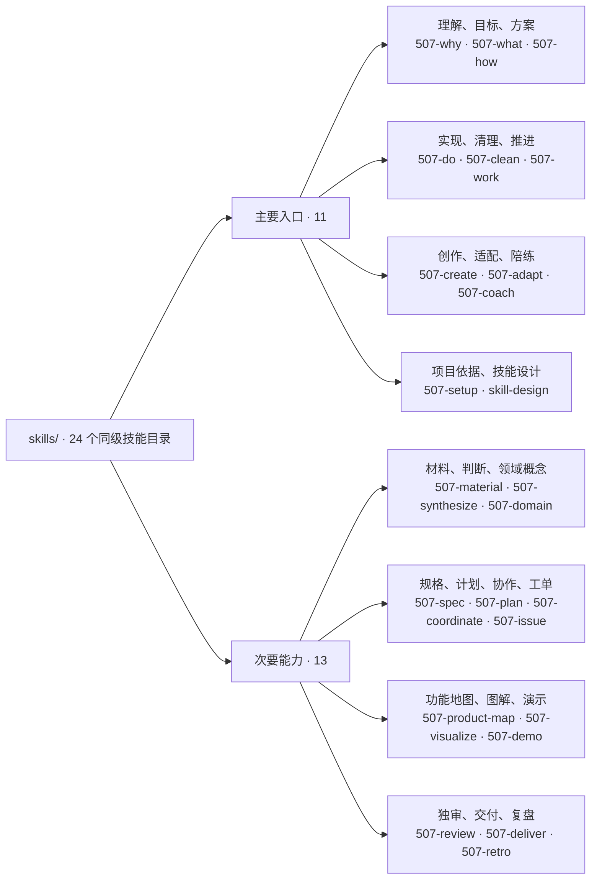

# 当前技能入口

当前清单包含 **24 个入口（11 个主要技能，13 个次要工作能力）**。`skills/` 是唯一现行技能源码目录。当前版本、能力范围、已知限制与待办见[公开进度](../PROGRESS.md)，历史方案与验证见[历史导航](../doc/历史导航.md)。

主要／次要沿[术语表](../GLOSSARY.md#分层与共有资源)定义：用户主要触发主要技能，Agent 按需采用主次技能。清楚任务由 Agent 直接采用所需能力，不固定串行调用；这不表示运行环境权限或宿主已经隐藏次要入口。

## 主要职责



图中按角色和产物归组。每个实际技能目录用 `SKILL.md` 说明采用条件、工作动作和完成标准，用 `RESOURCES.md` 声明依赖，用 `agents/openai.yaml` 提供宿主展示信息。有专用方法的技能将其放在自己的 `references/`。例如 `507-work` 有事项推进和状态视图两份专用说明，`507-plan` 直接在主文说明计划如何完成。

| 实际入口 | 独有责任 |
| --- | --- |
| [skill-design](skill-design/SKILL.md) | 技能设计、编写与指定技能指令审计 |
| [507-what](507-what/SKILL.md) | 目标与关键取舍，主动提出有依据的观点与机会，区分建议和定案 |
| [507-why](507-why/SKILL.md) | 陌生项目初识、理解与证据，核对解释前提和有据替代原因 |
| [507-how](507-how/SKILL.md) | 目标约束下主动构造方案与替代路径，已有成熟方案直接承接 |
| [507-do](507-do/SKILL.md) | 工程实现、修复、局部修改、指定测试及产品界面组件。改动触及关键边界时，识别需要持续成立的条件并在项目中落实可复验的约束 |
| [507-clean](507-clean/SKILL.md) | 指定模块的代码与规则清理；先列清单、核行为规格，超过800行先出拆分方案 |
| [507-create](507-create/SKILL.md) | 创作、完整成文与指定修订 |
| [507-adapt](507-adapt/SKILL.md) | 成熟内容换受众、场景与载体，完成实际制作；持续修订多份关联交付时结合工作记录核对漏件与受众路径 |
| [507-work](507-work/SKILL.md) | 工作事项发现、整理、推进与原记录更新；局部请求直接处理 |
| [507-setup](507-setup/SKILL.md) | 项目工作依据、工作指令审计与导航；局部维护不扩大范围 |
| [507-coach](507-coach/SKILL.md) | 在用户主动要求练习时，用初判、反馈和条件变化的新案例帮助用户练习独立判断 |

## 次要工作能力

| 实际入口 | 独立结果 |
| --- | --- |
| [507-demo](507-demo/SKILL.md) | 产品界面静态图、功能卡片或模拟操作短动画，含可编辑场景、目标实物和检查；不替代业务功能或完整成片 |
| [507-domain](507-domain/SKILL.md) | 构建或校准领域概念、词义、边界与关系，以场景检验并按原授权维护项目文档；结果返回原任务 |
| [507-synthesize](507-synthesize/SKILL.md) | 从访谈、反馈或问题记录中形成有证据的判断，说明分组对优先级、处理方式或待查事项的影响 |
| [507-plan](507-plan/SKILL.md) | 为当前任务的执行者安排交付步骤、依赖、验证与恢复。给读者使用的清单和提纲沿成文任务交付。 |
| [507-visualize](507-visualize/SKILL.md) | 有依据的状态图、时序图、关系图、比较表与配套说明；不代替产品证据地图或业务验证 |
| [507-spec](507-spec/SKILL.md) | PRD、行为与验收规格 |
| [507-product-map](507-product-map/SKILL.md) | 指定功能的交互点及关系，同对象设计／实现／运行证据与可探索地图 |
| [507-review](507-review/SKILL.md) | 独立只读审查，含指定提示与指令审计 |
| [507-issue](507-issue/SKILL.md) | 可独立接手的调查／执行工单；只起草也整理依据、下一动作与推进条件 |
| [507-coordinate](507-coordinate/SKILL.md) | 依赖、并行隔离与集成 |
| [507-deliver](507-deliver/SKILL.md) | PR表达与授权版本交付 |
| [507-retro](507-retro/SKILL.md) | 复盘与工具化建议 |
| [507-material](507-material/SKILL.md) | 整理指定资料的来源、身份、重复与支持范围，或按请求组织已有知识入口 |

明确故障、成熟稿、充分规格和已有任务图可直接进入相应能力；不因技能存在重跑what/why/how/plan或全链。三组分工见[术语表](../GLOSSARY.md#会话分层与验收职责)：技能身份不决定会话角色，B 复用任务能力，C 用 review 独立核验。技能缺失可按同一合同直接工作，独立审查仍须另一执行者。

工单只起草时直接采用507-issue主文的正文组织方法，调查态保留关键未知并给证据动作和推进条件；行为、范围、依赖与验收充分后才作为ready交接。平台参考只在对应动作已获授权时读取，不把正文组织挂在平台许可之后。

## 常见任务的直接入口

| 任务 | 采用方式 |
| --- | --- |
| 实现功能、修 bug、局部修改或只跑测试 | do 沿已有需求和方案直接处理；修复保留复现、根因和原动作复验；复测按有效要求区分缺陷、改进、符合预期与证据不足，完成授权内必要取证；只跑测试不自动改代码 |
| 大扫除、去死代码／重复逻辑或清理旧规则 | clean 限定读取与修改范围，先交清单；重构前沿用或补齐现行行为规格，spec补齐依据后回到原清理项；只读请求不改文件，超过800行先交拆分方案 |
| 了解可定位的陌生项目 | why 自主建立必要全貌并核对代表路径；交互地图只在确有需要时使用 |
| 构建领域模型或解决影响当前任务的语义冲突 | domain 明确概念及适用业务范围，用场景检验关系和约束；what、how、spec、do 按需采用，查词与沿充分定义执行不重开建模 |
| 审计提示、工作指令或技能 | setup承接项目工作指令，skill-design承接技能演进，review承接独立只读审查；按需采用共有方法，核宿主和实际模型，不固定串行 |
| 识别技能提升空间与优化方向 | skill-design按需从速度、高度、深度、广度选择方向，并核方法读取、实际动作与反馈；已有方向和小任务直接继续，不固定走完四维，用相称观察验证改善 |
| 初始化仓库或维护文档导航 | setup 按范围建立或维护项目依据；spec维护现行行为与验收，issue维护软件工单和跟进；局部导航直接处理，不串成固定流程 |
| 整理材料、成文或换载体 | 材料确需独立核身份时用 material。成文、重写论证及局部润色用 create，成熟内容换受众或载体用 adapt。两者按读者用途安排正文与依据，培训保留使用判断，多页作品核主线和跨页呈现，有指定参考时对照实际成品。 |
| 找产品界面组件 | do 按需读取[包内组件方法](507-do/references/component-reuse.md)；只查不改，已知可用直接采用，没有适用组件且有多个确定使用位置才抽取并迁移，单处留在原地 |
| 制作产品界面展示 | demo 承接静态功能卡片或模拟操作短动画；沿已有产品与内容制作并检查，真实功能、操作录制和完整视频沿原任务 |
| 把复杂关系表达清楚 | visualize 按理解动作选择图、表和说明，复用已有材料；简单事实不建图，图解不增加业务操作或资料库写权 |
| 梳理功能与实际操作证据 | product-map 对齐交互点、关系及设计／实现／运行证据；普通实现不强制建图 |
| 推进已有工作或安排协作 | work 持有本次事项与推进结果；需要协作时按需采用 coordinate，工程、创作和研究也可直接采用它 |

create、adapt 和 visualize 新建独立离线阅读页时，按内容和读者要完成的动作组织页面，并打开成品核对。修改已有页面时优先复用项目组件，在原入口验证。见[阅读页方法](../lib/methods/design/reading-page.md)。

资源路径统一按[共有资源合同](../lib/README.md#定位和依赖)从链接所在文档的真实位置解析。共有呈现代码、范例、播放器与检查工具统一在 lib 维护，demo 不保留单独维护源。本地发现入口连接用途、状态、实际接口与预览；demo按结构选范例，外部场景在统一导出前检查类型，不把检查通过称为业务接通。真实产品组件由 do 在目标项目内复用。完整关系见[逐技能资源表](../lib/catalog/skill-resource-map.md)，选用与运行见[共有图解组件](../lib/components/visual/visual-components.md)。旧 `507-component` 的历史身份保持不变。

## 资源维护与构建

[共有资源库](../lib/README.md)分开说明方法、执行代码、运行资源、工具说明、设计参考与名称索引。每技能精确文件和依赖以自己的 `RESOURCES.md` 为准，[packages.json](../packages.json)只保留身份与声明位置及共有文件总清单，[catalog/catalog.json](../lib/catalog/catalog.json)对账共有资源消费者；[逐技能资源表](../lib/catalog/skill-resource-map.md)从这些维护源生成，不另维护调用清单。

共有源修改后直接检查实际消费者，不再生成或同步副本。入口合同或旧名处置改变时，按[名称索引说明](../lib/components/tools/projections/library-view.md)先生成并核对索引，再检查集合。名称查询只返回声明，不执行技能或证明宿主已启用。

每完成一个技能修改，在实际修改的仓库根必须运行独立检查；失败修复后重跑，不能运行则如实报告，未通过不声称完成。该命令检查全部现行技能，不要求每次打包：

```sh
python3 -B scripts/package_skills.py check
```

声明或职责变化后生成关系表并核对；按变化运行相应回归。只有需要分发、归档或验证交付集合时才 build：

```sh
python3 -B scripts/resource_map.py
python3 -B scripts/resource_map.py --check
python3 -B -m unittest discover -s tests -v
python3 -B -m unittest discover -s lib/components/tools/tests -v
```

从仓库根打包前，将 `TASK_DIR` 设为本次任务的库外目录，然后执行 `python3 -B scripts/package_skills.py build --output "${TASK_DIR:?请设置任务目录}/dist"`。

check 直接读取各技能 RESOURCES.md，核身份、文件多缺、技能与共有库显式依赖、引用边界、禁止私有执行资源和共有副本、源文件与索引；build 生成 skills/ 加一份 lib/ 的不可变集合。依赖缺失如实失败，不复制实现兜底。构建工具不安装或自动路由。

build 在写入前执行同一 check，实际共有链接漏登 uses、私有实现或缺失依赖会阻止交付；入口回归同时验证没有新增交付且已有包不变。这里验证结构，不执行 TypeScript 编译或裁决图解语义；上述测试、类型检查与目标文件的独立内容／视觉验收仍按变更范围完成。聊天交付并非由构建器自动门控，须明确报告实际调用的检查入口和未覆盖。

可选的宿主适配见[Codex 维护钩子说明](../scripts/codex-maintenance-hooks.md)：现仅保留结束一致性检查的未启用候选，采用依据尚未确认；副本编辑保护已撤除。仓库只提供未启用的示例，不自动配置宿主、生成索引、同步、构建或安装；未启用时继续使用上述维护流程。

GitHub Actions 配置为在 Python 3.10、3.12 上执行 `check`、`tests` 和 `lib/components/tools/tests` 三项检查，再从固定提交隔离运行[历史专项回归](../doc/历史导航.md#旧版原件与回归)。CI 通过只证明这些检查覆盖的包一致性与脚本行为，不证明宿主发现、自然采用或业务效果。

## 能力与验证边界

入口和资源已实现，不等于每个自然任务都已稳定采用。离线 HTML 与 PNG、PPTX、音频或视频分别核验；源码检查、实际操作、独立审查、安装发现与人的接受保留各自证据。

公开能力范围、已知限制与待办在[PROGRESS](../PROGRESS.md)维护；可公开的历史结论见[历史导航](../doc/历史导航.md)，本机安装、试验过程与临时交接留在库外。历史测试命令和已发布专项能力仍保留在原版本记录中，不作为本清单的默认执行流程。
